# 从选题到 V1.5.0：把大模型嵌进「课程」里，并真正上线跑通（附四套回归数据）

> 本文对应项目 **V1.5.0**，2026-11-06 重新发布并线上复验。项目是 2026 年智能体开发课程作业，答辩时间 2026-11-09。
>
> 在线应用：<https://ai-campus-companion.app.workbuddy.host/?sharecode=CEUN7FBTFJ>（`sharecode` 是访问凭证，转发时请原样保留，去掉会返回 403）
>
> 所有功能、代码、截图与数字都来自实际运行的项目，不是设计稿。`docs/*_results.json` 里存着每个 HTTP 请求的真实响应，文末给出复现命令。
>
> **先把边界说清楚**：本机与线上都没有真实厂商 API Key，默认运行的是「内置演示模式」（规则化应答 + 内置学科知识库）。本文验证的是完整调用链、参数配置与系统行为，**不宣称已实测文心 / Kimi 官方接口**。这一点在答辩和文章里都不含糊。

| 版本 | 关键变化 | 说明 |
|---|---|---|
| V1.1 | 八个模块、课程记忆、AI 错题本、零依赖 `server.py` 补救 | 本文前七节的起点 |
| V1.2 | 学习资源包（五件套）+ 运行时模型接入 | 见第八节 |
| V1.3.0 | **移除 Flask 版，收敛为单一零依赖后端** | 见第三节 |
| V1.4.0 | 安全 Markdown 渲染、按钮忙碌态等 5 项体验优化 | 见第九节 |
| V1.4.1 | 课程资料支持「查看全文 / 下载」 | 见第九节 |
| **V1.5.0** | **三轮自查后的 11 项加固（容错、XSS、数据一致性、上下文预算）** | **当前线上版本** |

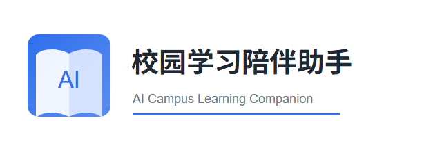

---

## 一、为什么做：五个来自身边的真实痛点

作业要求「选题必须来自真实调研，禁止虚构」。我没有编一份问卷数据，而是从身边同学日常复习的实际过程里梳理出五条高频痛点（也是选题报告里的原文）：

| # | 调研发现的痛点 | 项目里的对应功能 | 实现要点 |
|---|---|---|---|
| 1 | 上课笔记零散、课件看不懂，想快速提炼知识点并生成复习提纲 | 课件总结 | 按句切分提取知识点 + 五段式考点提纲 |
| 2 | 遇到难题缺少引导式讲解，容易直接抄答案或无从下手 | 习题辅导 | 系统提示词强制「先给思路、不甩答案」 |
| 3 | 考前不知道怎么规划复习，难以安排节奏 | 复习计划 | 科目 + 剩余天数 → 按天分阶段排期 |
| 4 | 通用大模型不了解本校课件和授课重点，回答容易跑偏 | **课程记忆智能体** | 按 `course_id` 隔离资料，注入 system 上下文（V1.5.0 起有总量预算） |
| 5 | 复习缺少错题整理与自测的一体化工具，过程没有闭环 | **AI 错题本** | 录题 → 错因诊断 → 定向变式题 → 标记掌握 |

第 4 和第 5 条是关键的差异化判断：**通用聊天框不缺，缺的是「绑定我这门课」的垂直场景**。所以我没有做套壳聊天页，而是让课程成为系统里的一等公民——先建课程、传资料，再问答；错题也挂在课程下，形成闭环。

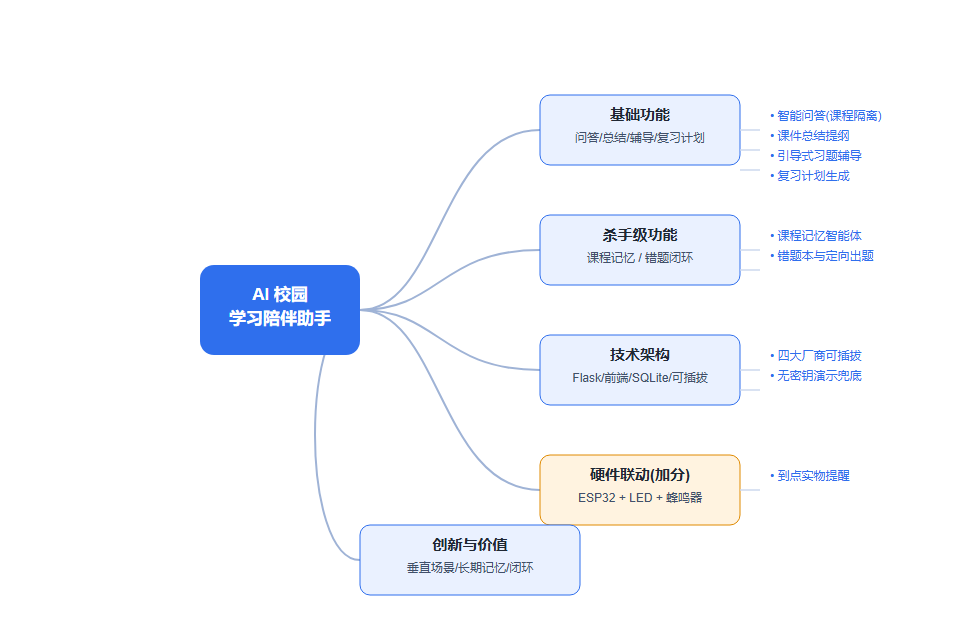

*图 1　功能思维导图：基础功能、杀手级功能、技术架构、硬件联动与创新价值五条主线。*

---

## 二、先看成品：一个浏览器里就能跑的 Web 应用

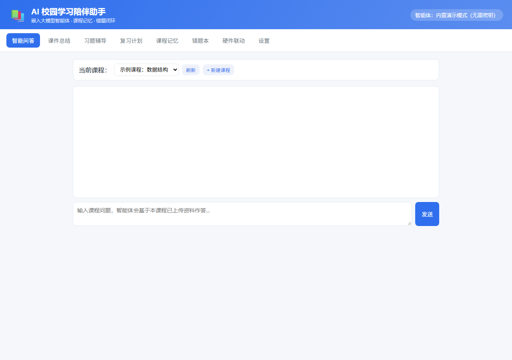

*图 2　应用首页（真实运行截图）。顶部是智能体状态徽标，导航共 10 个模块，课程选择器在所有需要上下文的模块间共享。*

V1.5.0 的十个模块：学习概览（仪表盘 + 番茄钟）、智能问答、学习资源包、课件总结、习题辅导、复习计划、课程记忆、错题本、硬件联动、设置。比 V1.1 多了「学习概览」和「学习资源包」两个标签页。

前端是**原生 HTML/CSS/JS**，没有 Vue/React、没有构建步骤，一个 `static/` 目录就是全部前端资源。选择原生前端不是偷懒：答辩机房、老师临时用手机打开链接、助教在没网环境里本地起服务——零构建意味着零意外。

「课程记忆」里上传的资料现在可以点「查看全文」就地展开（按 Markdown 排版）或「下载 .md」导出，全文会自动拼进该课程的问答上下文。这个入口是 V1.4.1 补上的，背后是一次很典型的「后端没问题、前端没入口」事故，第九节细讲。

---

## 三、系统架构：从「双后端」收敛成单一零依赖后端

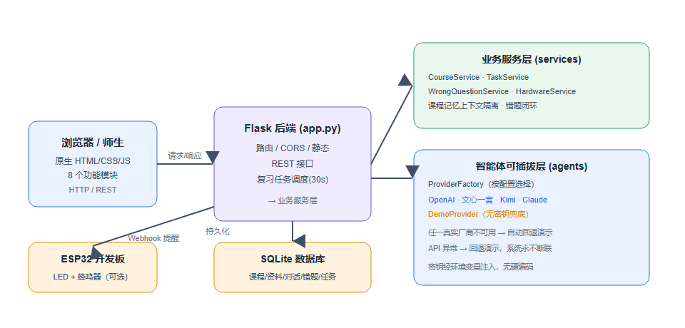

*图 3　需求文档中的系统架构图。图中「Flask 后端 (app.py)」是**设计阶段**方案：V1.1 曾保留 Flask 版与标准库版两套入口，V1.3.0 起已彻底移除 Flask 版，当前只有 `server.py` 一个入口。留着这张图，是为了如实呈现架构演进。*

分层如下：

- **表现层**：`static/index.html` + `style.css` + `app.js`，10 个 tab，通过 `fetch` 调 `/api/*`；V1.4.0 起内置 escape-first 的安全 Markdown 渲染器。
- **服务层**：`server.py`，纯标准库 `ThreadingHTTPServer`，**40 条 REST 路由**，负责静态文件、参数校验、统一 JSON 响应、复习任务调度。
- **业务层** `services/`：8 个业务模块 —— `course`（课程与记忆上下文）、`tasks`（问答/总结/辅导/计划/错因/变式）、`wrong_questions`（错题闭环）、`study`（资源包）、`subject_knowledge`（学科知识库）、`mindmap`、`files`（docx/pdf/txt 解析）、`focus`（番茄钟）。
- **智能体层** `agents/`：`AgentProvider` 抽象 + 5 个真实厂商实现 + `DemoProvider` 兜底 + `factory.py` 工厂 + `credentials.py`（运行时密钥）+ `http_client.py`（标准库 urllib）。
- **数据层**：SQLite，**8 张表** —— `courses`、`course_materials`、`conversations`、`wrong_questions`、`review_tasks`、`settings`、`focus_sessions`、`provider_credentials`。
- **硬件层**（可选）：`hardware/esp32.py` 下发 Webhook，配 `esp32_firmware.ino` 固件点亮 LED + 蜂鸣器。

目录结构（V1.5.0）：

```text
ai-campus-companion/
├─ server.py              # 唯一入口：零依赖 Web 服务器（Python 标准库）
├─ config.py / db.py / version.py
├─ agents/                # 可插拔智能体层
│  ├─ base.py             #   AgentProvider 抽象（complete / _call / probe）
│  ├─ openai_provider.py  #   GPT
│  ├─ qianfan_provider.py #   文心一言（千帆 v2 / 旧版 OAuth 双模式）
│  ├─ moonshot_provider.py#   Kimi
│  ├─ claude_provider.py  #   Claude
│  ├─ custom_provider.py  #   任意 OpenAI 兼容端点
│  ├─ demo_provider.py / demo_knowledge.py
│  ├─ credentials.py / http_client.py / factory.py
├─ services/              # 9 个业务服务模块
├─ hardware/              # ESP32 接口 + Arduino 固件
├─ static/                # 原生前端
├─ docs/                  # 需求文档、PPT、验收脚本、博客与配图
└─ render.yaml            # Render Blueprint
```

技术选型最终收敛为 **Python 标准库 HTTP 服务 + 原生前端 + SQLite**。理由很直接：作业要交付的是**能跑起来、能被检查**的系统，不是技术栈展示；两套后端意味着两套路由要同步维护，任何一次漏改都会造成「页面是新的、接口是旧的」。删掉 Flask 版后，`python server.py` 即可启动——不需要 pip、不需要密钥、不需要联网，答辩现场和机房都能直接跑。

---

## 四、核心设计一：可插拔的智能体接口

作业明确要求「智能体必须嵌入自研系统」，而不是给一个官方聊天页链接。我的做法是先定义一个极小的抽象，让业务层**只认识接口，不认识厂商**：

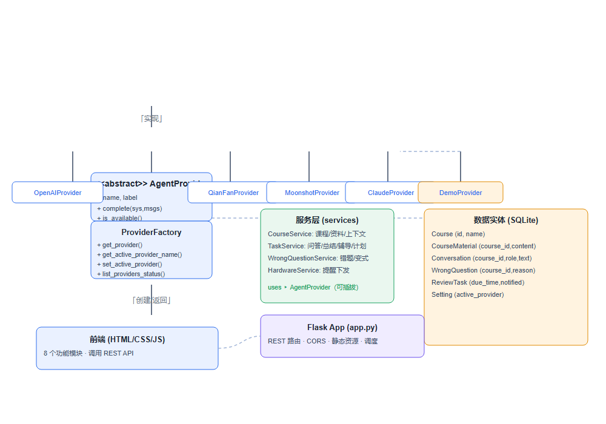

*图 4　类图：Provider 抽象、厂商实现、演示实现、工厂，以及服务层与数据实体（设计阶段绘制，后续新增了 `custom` 实现）。*

```python
# agents/base.py（V1.5.0 节选）
class AgentProvider:
    name = "base"
    label = "基础提供商"

    def is_available(self) -> bool:
        """该提供商当前是否可用（密钥是否配置齐全）。"""
        return True

    def complete(self, system_prompt: str, messages: list) -> str:
        """业务层唯一入口：任何异常都降级为提示文案，不让 Web 应用因模型故障而不可用。"""
        if not self.is_available():
            return f"（{self.label} 未配置密钥，已回退演示模式）"
        sp = _MODE_RE.sub("", system_prompt or "")
        try:
            return self._call(sp, messages)
        except Exception as e:
            return f"（{self.label} 接口调用失败，已回退演示模式：{e}）"

    def _call(self, system_prompt: str, messages: list) -> str:
        """厂商实现：成功返回文本，失败抛异常（由 complete 统一兜底）。"""
        raise NotImplementedError

    def probe(self) -> dict:
        """连通性自检，供设置页与自动化验收脚本使用。"""
        ...
```

所有业务函数都只写 `provider.complete(system, messages)`。厂商差异被关在各自的实现里：

| 厂商 | 接口地址 | 认证方式 | 消息格式差异 |
|---|---|---|---|
| OpenAI GPT | `api.openai.com/v1/chat/completions` | `Authorization: Bearer` | `system` 作为 messages 首条 |
| Kimi (Moonshot) | `api.moonshot.cn/v1/chat/completions` | `Authorization: Bearer` | OpenAI 兼容格式 |
| Anthropic Claude | `api.anthropic.com/v1/messages` | `x-api-key` + `anthropic-version` | **`system` 是顶层字段**，messages 只放 user/assistant |
| 百度文心一言 | 千帆 v2 / 旧版 WenxinWorkshop | v2 用 Bearer；旧版先用 AK/SK 换 `access_token`（内存缓存）再附在 URL | 双模式适配 |
| 自定义 | 任意 OpenAI 兼容端点 | 自填 Key | 自建网关 / Ollama / 其他国产模型 |
| 演示模式 | 无网络调用 | 无 | 规则化应答 + 内置学科知识库 |

工厂按激活项装配，不可用就自动回退，这是「师生不申请密钥也能验收」的关键：

```python
# agents/factory.py（V1.5.0 节选）
_PROVIDERS = {
    "openai": OpenAIProvider,
    "moonshot": MoonshotProvider,
    "claude": ClaudeProvider,
    "qianfan": QianFanProvider,
    "custom": CustomProvider,
    "demo": DemoProvider,
}

def get_provider(name: str = None) -> AgentProvider:
    """返回指定（或当前激活）的提供商实例；未配置密钥时回退演示模式。"""
    if name is None:
        name = get_active_provider_name()      # settings 表 + 运行时配置
    provider_cls = _PROVIDERS.get(name, DemoProvider)
    provider = provider_cls()
    if provider.is_available():
        return provider
    return DemoProvider()
```

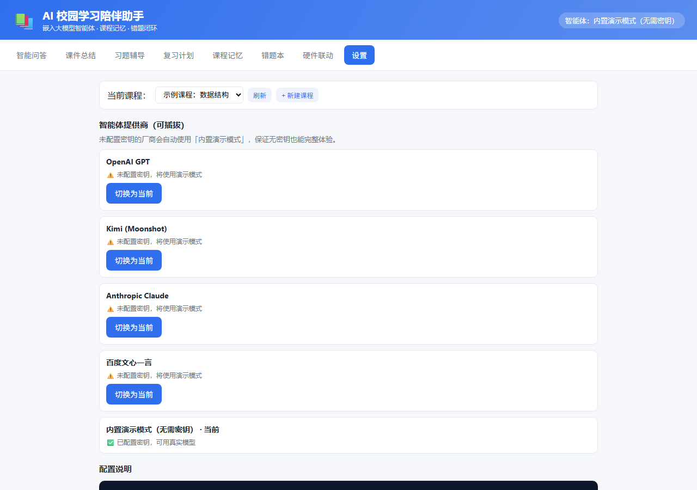

*图 5　设置页真实截图（V1.1 时期为 5 个可选项，V1.5.0 已增至 6 个，新增「自定义 OpenAI 兼容接口」）。未配置密钥的会明确标注将使用演示模式。*

关于密钥，有一处需要更正早期表述：**V1.2 之后不再只有 `.env` 一种来源**。现在支持运行时通过 `POST /api/agent/credentials` 写入密钥，保存在 SQLite 的 `provider_credentials` 表并覆盖环境变量配置，`activate:true` 立即切换、无需重启；`GET /api/agent/providers` 只返回**掩码**，不回传明文。仓库里仍只有占位符模板 `.env.example`，真实 Key 从不写进代码或文档。

线上 `/api/status` 的真实响应（2026-11-06，V1.5.0）：

```json
{
  "app": "AI校园学习陪伴助手",
  "version": "1.5.0",
  "active_provider": "demo",
  "providers": [
    {"name": "openai",   "label": "OpenAI GPT",            "available": false, "active": false, "configured": false, "source": "env"},
    {"name": "moonshot", "label": "Kimi (Moonshot)",       "available": false, "active": false, "configured": false, "source": "env"},
    {"name": "claude",   "label": "Anthropic Claude",      "available": false, "active": false, "configured": false, "source": "env"},
    {"name": "qianfan",  "label": "百度文心一言",            "available": false, "active": false, "configured": false, "source": "env"},
    {"name": "custom",   "label": "自定义 OpenAI 兼容接口",  "available": false, "active": false, "configured": false, "source": "env"},
    {"name": "demo",     "label": "内置演示模式（无需密钥）", "available": true,  "active": true,  "configured": true,  "source": "builtin"}
  ]
}
```

这里必须坦白：**「演示模式」是规则化模板应答，不是大模型推理**。它的价值是让系统在没有任何密钥、没有外网、没有 pip 包的环境里仍能把全部业务流程走通——建课程、传资料、问答、总结、错题闭环一个不少。V1.2 起它还接了内置学科知识库，数学题带标准答案与分步解析，不是占位符。填入任意一家密钥后，同一个 `complete()` 调用就会换成真实模型输出。

---

## 五、核心设计二：课程记忆 = 按课程隔离的上下文注入

这是我认为最值得写的设计。所谓「长期记忆」没有用向量数据库，而是**把课程资料拼进 system prompt**，用结构化标记划清边界。

有两个细节是**跑起来之后才补上的**：

1. `【课程记忆】课程：{cname}` 这个结构化标记不能省。最初只有自然语言描述，演示模式解析不出课程名，界面上的回复一直显示「当前课程」这种含糊字样。
2. **任务指令必须放进 system，user 消息只放原始内容**。我一开始把「请总结以下课件：」拼在用户文本前面，演示模式把这句指令本身也当成知识点提取了，总结结果第一行赫然是「请总结以下课件」。现在每个任务用 `【MODE:xxx】` 在 system 里标明类型。

V1.5.0 又补了第三个，也是代价最大的一个：**总上下文预算**。原实现只对单份资料截断 4000 字，没有总量控制。我用临时库造了 20 份资料做压力测试，拼出来的 system prompt 长达 **80351 字**——真实模型会直接超限，或者产生完全不必要的 token 开销。修复后的实现：

```python
# services/course.py（V1.5.0 节选）
def build_course_context(course_id: int) -> str:
    """单份资料最多 4000 字，整体另有 12000 字总预算；
    超预算时按上传顺序保留并明确提示。"""
    ...
    budget = MAX_CONTEXT_CHARS          # 12000
    included = 0
    for i, m in enumerate(mats, 1):
        t = f"（资料{i}：{m['title']}）\n"
        content = m["content"][:4000]
        room = budget - len(t)
        if room <= 0:
            break
        take = min(len(content), room)
        parts.append(t + content[:take])
        budget -= len(t) + take
        included += 1
    if included < len(mats):
        parts.append(f"（课程记忆共 {len(mats)} 份资料，已按上下文预算展示前 {included} 份；"
                     "其余资料可在「课程记忆」中打开全文查看。）")
    return "\n".join(parts)
```

同一组压力数据复测：**12160 字**，并附带明确的截断提示。20 份资料从「撑爆上下文」变成「有预算、可解释」。

线上真实问答（V1.5.0，课程 1「示例课程：数据结构」）：

```text
POST /api/chat {"course_id": 1, "message": "完全二叉树有什么特点？"}

（演示模式 · 已绑定「示例课程：数据结构」）

「二叉树（Binary Tree）」是每个节点**最多有两个子节点**（左、右子树）的树形结构。
• 四种遍历：前序（根-左-右）、中序（左-根-右）、后序（左-右-根）、层序（逐层，用队列实现 BFS）。
• 二叉搜索树 BST：左子树 < 根 < 右子树，中序遍历得到有序序列……
```

注意回复里的 `**` 和 `•`：这是模型/演示模式返回的 **Markdown**。V1.4.0 之前前端用 `textContent` 原样显示，用户看到的就是一堆星号和圆点——这也是第九节第一轮自查修掉的问题。

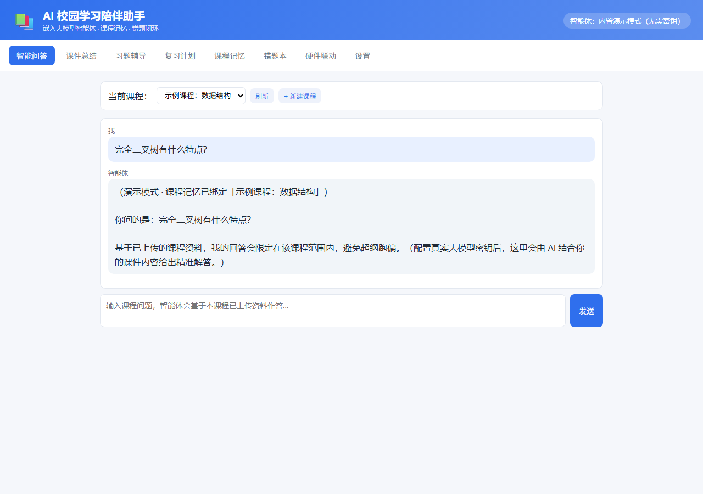

*图 6　真实交互截图：在「示例课程：数据结构」下提问，回复首行明确显示课程记忆已绑定。右上角徽标为「内置演示模式（无需密钥）」。*

验收脚本专门构造 A、B 两门课程验证隔离：两次 `/api/chat` 分别绑定各自的 `course_id`，回复首行显示各自课程名，互不串味——隔离断言通过。

---

## 六、核心设计三：AI 错题本不是「存个题」，是一个闭环

很多同类项目做到「录入错题 + 列表展示」就停了。我把学习闭环补齐成四步：

```text
录入题目 / 我的答案 / 正确答案
        ↓
POST /api/wrong-questions/{id}/analyze
        ↓  【MODE:error_analysis】独立诊断，定位薄弱知识点
        ↓  【MODE:variant】按原题生成同类变式题
        ↓
定向重做 → POST /api/wrong-questions/{id}/master 标记掌握
        ↓
GET /api/wrong-questions?unmastered=1 只剩还没吃透的题
```

`analyze_and_variant()` 会先检查该题是否已有错因，没有才调用智能体推断，并把结果**落库**避免重复请求。这里也踩过一个坑：最初错因分析复用了普通 `chat()`，因为它带的是 `【MODE:chat】`，返回一段通用课程问答，**根本不是错因诊断**；后来拆出独立的 `analyze_error()` 与 `【MODE:error_analysis】` 才修正。

一道真实错题的诊断结果（摘自 `demo_results.json`）：

```text
题目：求斐波那契数列第 n 项，n=40
我的答案：直接递归 f(n)=f(n-1)+f(n-2)
正确答案：使用记忆化或递推，时间复杂度 O(n)

🔍 可能的错因归类：
  1. 方法选择：直接套用了最直观的解法，未评估其在本题输入规模下的代价。
  2. 概念边界：对该知识点适用条件与前提的理解不够完整。
  3. 复杂度 / 边界意识：未检查解法在规模增大或边界输入下是否仍成立。

📌 薄弱知识点定位：建议回到该知识点的基础定义、复杂度分析与典型例题重新过一遍。
✅ 改进建议：先列出候选解法并比较代价 → 用小样本手算验证 → 再做同类题巩固。
```

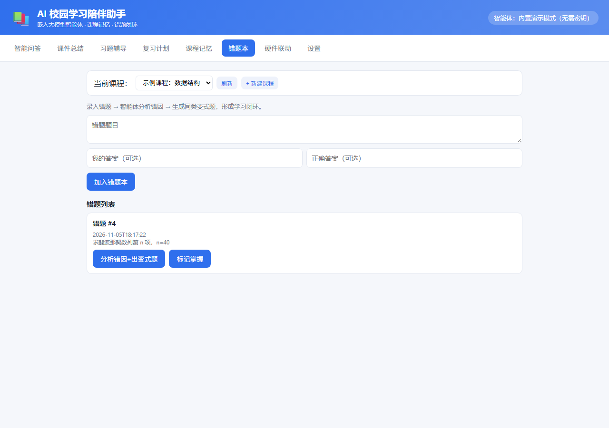

*图 7　错题本模块界面：录题、按课程归档、错因分析、变式题与「标记已掌握」都挂在同一个页面。（V1.5.0 已修掉列表的 innerHTML 注入风险，见第九节）*

---

## 七、一次真实翻车：为什么又多写了一个 `server.py`

这一节我想如实写，因为它比功能清单更有价值。

项目第一版是 Flask 后端。开发机上 `pip install -r requirements.txt` 被网络代理拦截（502），装不上 Flask。当时我做了「全量 `py_compile` + 直接调用业务函数」的验证，六个功能都返回了非空结果，于是我认为系统没问题，交付了。

**但这个 Web 服务其实一次都没有真正启动过。** 我只测了 Python 函数，没测 HTTP 层：路由、静态文件、JSON 解析、状态码、Cookie、并发，全都没验证过。老师一句「我要检查的是 Web 应用」就把它戳穿了。

补救分两步：

**第一步，补一个零依赖运行层。** `server.py` 用标准库 `ThreadingHTTPServer` 实现，与 Flask 版共用 `db / agents / services / hardware`，暴露同一套 API 和页面，尊重 `PORT` 环境变量、绑定 `0.0.0.0`：

```python
# server.py（V1.5.0 节选）
def _dispatch(self, method):
    parsed = urlparse(self.path)
    path, query = parsed.path, parse_qs(parsed.query)
    if method == "GET" and not path.startswith("/api/"):
        self._serve_static(path)
        return
    for verb, pattern, handler in ROUTES:
        if verb != method:
            continue
        m = re.match(pattern, path)
        if not m:
            continue
        if method == "POST":
            ctype = self.headers.get("Content-Type", "")
            body = (self._read_multipart() if ctype.startswith("multipart/form-data")
                    else self._read_body())
        else:
            body = {}
        result = handler(m, body, query)
        if isinstance(result, Download):
            self._send_download(result)
        elif isinstance(result, Raw):
            self._send_raw(result)
        else:
            self._send_json(200, result)
        return
    self._send_json(404, {"error": "接口不存在", "path": path})
```

**第二步，真正发 HTTP 请求。** 服务一起来，三个 bug 立刻暴露：

| # | 现象 | 根因 | 修复 |
|---|---|---|---|
| 1 | 课程记忆回复只显示「当前课程」 | 上下文缺可解析的结构化标记 | `build_course_context()` 增加 `【课程记忆】课程：{cname}` |
| 2 | 课件总结把「请总结以下课件：」当成知识点 | 任务指令拼进了 user 文本 | 指令统一移入 system，用 `【MODE:xxx】` 区分 |
| 3 | 错因分析返回一段通用闲聊 | 复用了 `chat()` 的 MODE | 新增 `analyze_error()` 与 `【MODE:error_analysis】` |

这三个问题，只测函数永远发现不了——因为函数都「正常返回了字符串」。**结论：可运行 ≠ 跑过 HTTP；验收要打真实请求。**

后续 V1.3.0 干脆把 Flask 版删掉了：两只后端一起维护，迟早会不同步。现在仓库里只有 `server.py` 一个入口，`requirements.txt` 里只有说明注释、没有任何 pip 依赖，部署的 Build 阶段什么都不用装。

---

## 八、让它自己长出复习资料：学习资源包与运行时模型接入

### 8.1 为什么加一层学科知识库

原来的「课件总结」是**先有课件才有输出**。但复习场景经常是：我只有一门课的名字，想先要一套自测题和知识框架。如果没配 API Key，纯规则化的演示模式只能回模板话术，这在答辩里站不住。

V1.2 加了 `services/subject_knowledge.py`：把同济《高等数学》上册的 7 章整理成结构化数据，每章包含知识点、公式/定理、高频易错点、带**标准答案 + 分步解析 + 考点**的题，以及对应的教材/公开课/工具资料。比如第一章第一题：

> 求极限 `lim(x→0) sin(3x) / tan(2x)`，答案 `3/2`，解析：sin(3x) ~ 3x、tan(2x) ~ 2x。

配上真实模型后，这层知识库不会丢，而是作为「接地上下文」送进模型，让 Kimi / 文心在指定章节范围内原创变式题，结果用 `origin` 字段标记来源。模型超时、鉴权失败、返回非预期 JSON 时静默回退知识库——**接口永远有可用输出**，这条比「接了大模型」更重要。

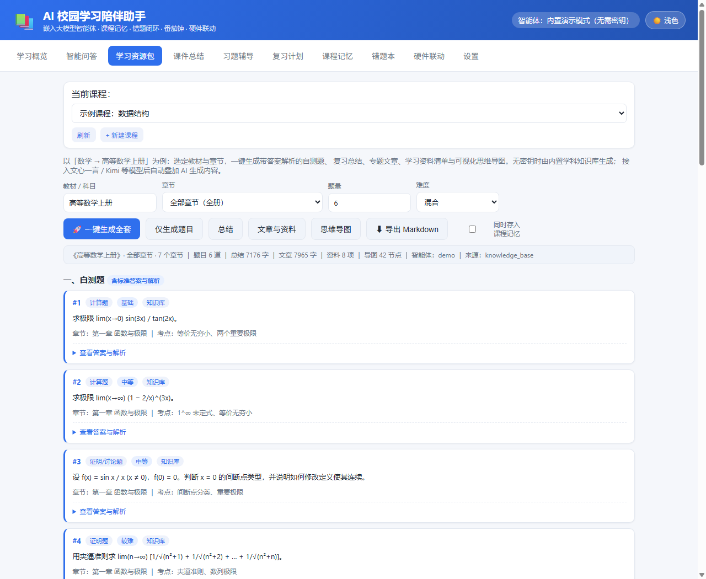

*图 8　学习资源包：题目 / 总结 / 文章 / 资料 / 思维导图。*

### 8.2 一次请求生成五件套

`POST /api/study/pack` 一次返回：自测题、复习总结、专题文章、资料清单、思维导图（树 JSON + SVG + Markdown 大纲 + Mermaid 源码）。实测：全册总结 7176 字、专题文章 7965 字 / 7 节、资料 8 项、导图 42 节点。题目可折叠查看答案，导图 SVG 用 CSS 变量跟随深浅色与主题色；另有 Markdown 全套导出与 SVG 下载。答辩现场直接打开 `/?autopack=1#study`，页面加载完就自动生成好全套。

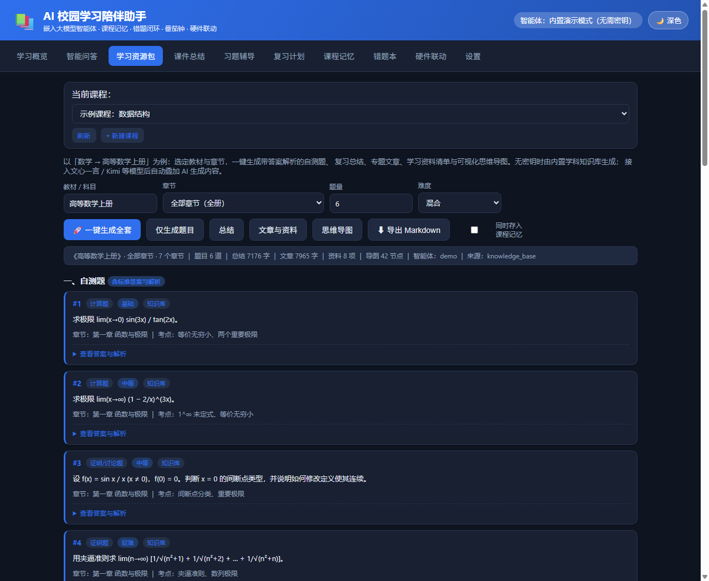

*图 9　深色模式下的学习资源包。*

### 8.3 模型接入：不重启、不改代码

之前四家厂商虽然都实现了，但密钥只能写在 `.env` 里，改一次要重启。答辩前一刻想换成文心一言，很尴尬。V1.2 把这件事做成了**运行时接口**：

- `POST /api/agent/credentials` —— 填 Key / 模型名 / 接口地址，`activate:true` 立即切换；
- `POST /api/agent/credentials/clear` —— 清除并回退演示模式；
- `POST /api/agent/test` —— `validate` 只校验配置，`probe` 真实调用一次模型；
- `POST /api/agent/complete` —— 通用透传，自建系统直接调用当前或指定模型；
- `GET /api/agent/providers` —— 状态列表，**密钥只返回掩码**。

文心一言做了双模式适配：千帆 v2 只需 API Key（Bearer），旧版 WenxinWorkshop 用 AK/SK 换 `access_token`（内存缓存）。`custom` 提供商支持任何 OpenAI 兼容端点。所有厂商调用改成标准库 `urllib`，本机和云端都不依赖 `requests`。

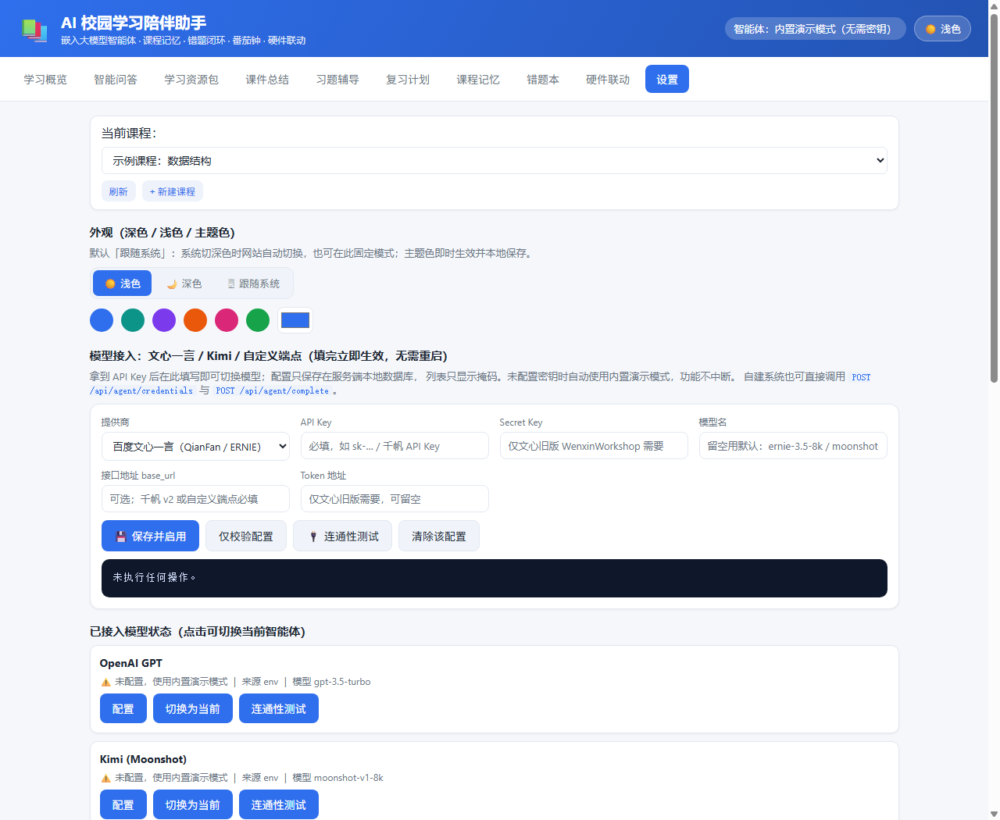

*图 10　模型接入表单与已接入状态。*

### 8.4 没有真实 Key，怎么证明链路是通的

`docs/study_check.py` 会在本机临时起一个模拟服务，同时扮演「OpenAI 兼容端点」和「文心 OAuth + 聊天端点」，然后通过上述接口写密钥、发探测、调透传、让模型出题、再清除配置。36 项断言覆盖鉴权头、token 换取、请求体、响应解析、模型原创题并入结果、失败降级、掩码不泄漏。把模拟地址换成官方地址、假 Key 换成真 Key，就是真实调用。

**这一点在答辩里要如实说**：验证的是完整调用链与参数配置，不是「已经实测官方接口」。线上环境无法回调本机模拟端点，因此这 11 项探针在线上自动跳过，`study_check.py` 线上口径为 **25/25**。

---

## 九、三轮自我检查：比加功能更值得写的部分

功能做完不等于能用。V1.4 之后我又做了三轮自查，每轮都坚持「**先真实复现、再动手**」，复现不了的一律不改。这比功能清单更能说明工程成熟度。

### 9.1 第一轮（V1.4.0）：看得见的体验缺陷

| 问题 | 真实证据 | 修复 |
|---|---|---|
| 问答/总结/辅导/计划/资源包返回 Markdown，却被 `textContent` 原样显示 | 页面满屏 `**`、`•`、未渲染表格 | 新增 escape-first 安全 Markdown 渲染器（先转义再渲染），支持标题/列表/表格/代码块/引用 |
| 按钮无请求中状态，可重复点击 | 连续点两次发起两个请求 | 统一忙碌态：禁用 + `finally` 恢复 |
| 概览「错题掌握率」无误题时显示 `0.0%` | 新用户第一眼就是 0 分 | 优雅显示「暂无」 |
| 未内置科目生成内容无提示 | 「数据结构」返回通用模板，用户不知情 | 接口返回 `discipline`，前端对「自定义科目」追加说明 |
| 概览「待复习任务」卡片误跳硬件页 | 点击后离开首页 | 留在首页并聚焦输入框 |
| **隐藏损坏**：`app.js` 里混入 4 个空字节（0x00），会使整页 JS 失效 | `grep` 判定为二进制；占位符空格被替换 | 精确还原为空格，`node --check` 通过 |

### 9.2 第二轮（V1.4.1）：「资料打不开」

用户反馈「上传了资料但无法打开」。排查结论很典型：**后端数据完全正常**（`list_materials` 返回全文），问题在前端——列表只渲染「标题 + 时间 + 前 120 字预览」，**根本没有打开入口**。修复是给每条资料加「查看全文 / 收起」与「下载 .md」，复用安全 Markdown 渲染器，顺带修掉列表的 `innerHTML` 注入隐患。

还有一处部署侧的坑：本地自测用的资料存在 `data/companion.db` 里，部署是整目录上传，测试数据会跟着上线。我备份数据库后精确删除那一条并重新发布，线上 17 条用户资料一条没动。**这条经验值得记：发布工具会覆盖线上数据，发布前必须确认数据目录内容。**

### 9.3 第三轮（V1.5.0）：换角度查异常路径、脏数据、并发与状态一致性

这一轮不再看「界面好不好看」，专查系统在**不顺利的时候**会怎样。最严重的两个发现：

**① 任何一个接口报错，整页会「变砖」。** `init()` 把 `bindEvents()` 排在一长串串行 `await` 之后，前面任何一步抛错（例如 `loadStatus` 里的 `s.providers.find()`），后面所有标签、按钮、上传、番茄钟、语音都不再绑定——页面看起来加载完了，却完全点不动。

为了坐实归因，我做了一组 **A/B 浏览器对照**：用同一个注入探针，唯一变量是后端 API 是否报错。

| 场景 | 修复前：点击「课程记忆」后 | 修复后 |
|---|---|---|
| 故障后端（所有 API 返回 error） | 仍停在 `panel-dashboard`，徽标卡在「加载中…」，整页无交互 | 正常切到 `panel-memory`，徽标降级为「智能体：状态不可用」 |
| 对照后端（API 正常） | 正常切到 `panel-memory` | 正常切到 `panel-memory` |

修复方式是把初始化拆成「每一步独立兜底 + 事件绑定前置」，接口挂了只影响对应区块的数据，不影响全局交互。

**② 存储型 XSS 真的执行了。** 向错题本录入 ``，再用无头 Chrome 打开首页，DOM 里出现 `<body data-xss3="FIRED">`——不是理论风险，是载荷真的跑了。同源问题还在概览专注记录、上传预览里。三处全部改为 `esc()` 转义，修复后重跑：注入串以 `&lt;img...&gt;` 存在，不再执行。

其余确认并修复的问题（共 11 项）：

| 类别 | 问题 | 修复 |
|---|---|---|
| 数据一致性 | 给不存在的课程写资料返回 200，留下孤儿记录；空任务名静默入库 | 校验课程存在（400）、空名回落默认值 |
| 成本 / 稳定 | 课程记忆无总量预算，20 份资料拼出 80351 字 | 12000 字总预算，复测 12160 字并带截断提示 |
| 状态一致性 | 切课程后 A 课程对话留在 B 页面；慢响应覆盖新列表 | 清空聊天 + 请求序号丢弃过期响应 |
| 异常路径 | 「文章与资料」第二个请求失败时状态永久卡在「正在生成」 | 双请求独立判断 + 明确失败文案 + 按钮恢复 |
| 其他 | 统计卡片/上传区键盘不可达、导出失败替换整个应用页、后端 400 前端「点了没反应」、docx 只还原 3 种 XML 实体、SQLite 并发无等待窗口 | `tabindex`/`role`/Enter-Space、blob 下载、统一错误提示、`html.unescape`、`busy_timeout` |

**也如实剔除 5 类误报**：思维导图 SVG 后端已转义、quiz 的 `count` 后端已钳制到 30、空资料/空错题/空课程名已有 400 校验、页面无 `<form>` 故按钮 `type` 不成问题、未发现定时器泄漏或重复绑定。这些**一行代码都没改**——为了「修」而改，反而会引入回归。

### 9.4 测试手段本身也在升级

V1.1 只有「打真实 HTTP 请求」，V1.5.0 已经有了：Node 渲染器单测（含 XSS 注入串）、无头 Chrome DOM dump（验证按钮/标签真实渲染）、故障注入后端（模拟接口全挂）、A/B 对照实验、四套自动化回归、以及发布后的线上复验。第三轮的测试污染也做了收尾：先备份数据库 → 注入数据验证 → 停服还原 → 重启干净实例，实测 0 条测试残留。

---

## 十、验收：四套回归，本地与线上各跑一遍

四套脚本都只用标准库 `urllib`，不依赖 pytest 或任何第三方包：

| 脚本 | 覆盖 | 本地 V1.5.0 | 线上 V1.5.0 |
|---|---|---|---|
| `startup_check.py` | 启动自检、静态资源、版本指纹、路由可达 | **26 / 26** | **26 / 26** |
| `demo_check.py` | 26 个真实 HTTP 请求 + 30 项业务断言 | **26 / 26 请求，30 / 30 断言** | **26 / 26 请求，30 / 30 断言** |
| `feature_check.py` | V1.1 新增功能（上传资料入记忆等） | **19 / 19** | **19 / 19** |
| `study_check.py` | 高数资源包 + 模型接入链路 | **36 / 36** | **25 / 25**（11 项本机模拟端点探针线上跳过） |

线上实况确认（2026-11-06）：`/api/status` 返回 `version: 1.5.0`；静态 `app.js` 与本地**字节级一致**（47665 字节）；无头浏览器打开线上页面，10 个导航标签、资料「查看全文 / 下载」按钮、智能体徽标全部真实渲染，无 XSS 残留。

`demo_check.py` 的 26 个请求覆盖完整链路（含异常分支）：

| 分组 | 请求 | 验证点 |
|---|---|---|
| 静态与状态 | `GET /`、`/static/css/*`、`/static/js/*`、`/api/status`、`/api/providers` | 页面/资源可访问，返回提供商列表 |
| 配置 | `POST /api/settings/provider` | 切换即时生效 |
| 课程记忆 | 新建课程 A/B、上传资料、读取资料、两门课各问答一次 | 上下文绑定正确、A/B 隔离成功 |
| 四大任务 | `/api/summarize`、`/api/tutor`、`/api/review-plan` | 知识点与提纲、引导式不甩答案、逐日排期 |
| 错题闭环 | 录题 → 按课程查询 → 错因+变式 → 标记掌握 → 筛选未掌握 | 五步全部通过 |
| 硬件与调度 | `/api/review-tasks`、`/api/hardware/test` | 到点下发接口正常 |
| 异常分支 | 缺参数 400、重名 400、未知接口 404 | 参数校验与错误处理 |

几个真实响应摘录：

**课件总结**（`POST /api/summarize`）—— 提取 6 条知识点并给出五段式提纲：

```text
📌 提取的关键知识点：
  1. 栈是一种后进先出的线性结构     2. 队列是先进先出的线性结构
  3. 树是非线性层次结构             4. 图由顶点和边组成
  5. 哈希表支持平均O(1)查找         6. 二叉搜索树中序遍历有序
📝 建议的复习考点提纲：
  一、核心概念梳理  二、重点公式/定理  三、易混淆点对比
  四、典型例题思路  五、考前速记清单
```

**引导式习题辅导**（`POST /api/tutor`）—— 明确不给最终答案：

```text
我先不直接给答案，按「引导式讲解」帮你理清思路：
1. 题意复述… 2. 破题思路… 3. 第一步… 4. 第二步… 5. 自检…
👉 你先按这个步骤试一下，卡在哪一步告诉我，我再针对性提示。
```

**10 天复习计划**（`POST /api/review-plan`）：

```text
第 1~2 天：基础回顾  第 3~4 天：重点突破  第 5~6 天：真题/例题演练
第 7~8 天：查漏补缺  第 9~10 天：冲刺复盘（每日 2~3 小时，配合错题本）
```

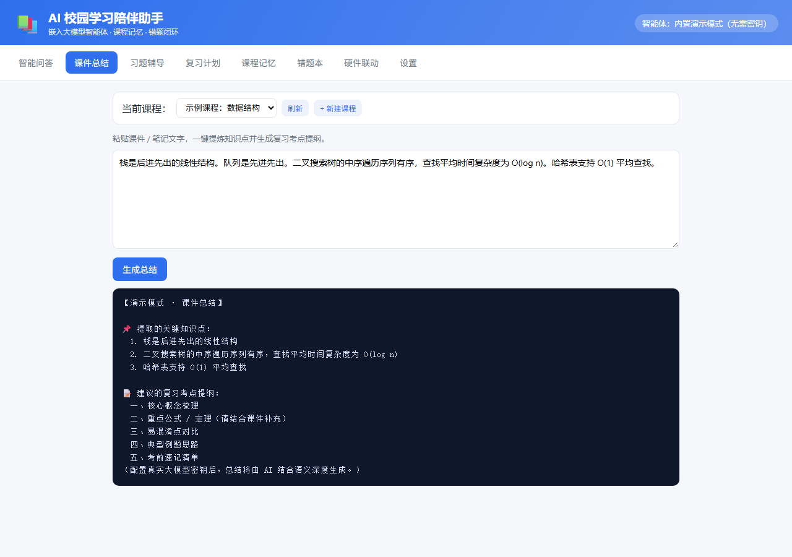

*图 11　课件总结：左侧粘贴课件文字，下方显示知识点与考点提纲（真实演示模式输出）。*

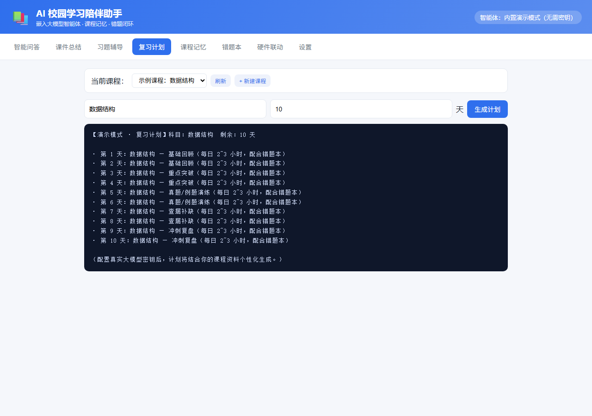

*图 12　按科目与天数生成逐日复习计划。*

复现命令（无需任何第三方库）：

```bash
# 本地
python server.py                       # 默认 5000 端口，尊重 PORT 环境变量
python docs/startup_check.py
python docs/demo_check.py
python docs/feature_check.py
python docs/study_check.py

# 线上（BASE_URL / SHARECODE 由脚本读取）
BASE_URL=https://ai-campus-companion.app.workbuddy.host \
SHARECODE=CEUN7FBTFJ python docs/demo_check.py
```

> 本地若设置了 `HTTP_PROXY` / `HTTPS_PROXY`，记得先 `export NO_PROXY=127.0.0.1,localhost`，否则 `urllib` 会把 localhost 请求转给代理，得到莫名其妙的 502。这个坑我踩过。
>
> 线上链接带分享鉴权：`demo_check.py` 会先用 `sharecode` 打开首页建立会话 Cookie，再带着 Cookie 调 API，和浏览器行为一致。

---

## 十一、上线、开源与「逐步提交」

- **在线应用**：上面的公网链接，用 `python server.py` 启动，Build 阶段零依赖。发布平台会整目录上传，因此 `data/` 里的数据会一起覆盖线上——发布前务必确认数据目录内容。
- **代码仓库**：<https://github.com/kecit33/ai-agent-study>（Public，`main` 分支）。本地按模块拆成 **60 余个独立 commit、90 余个受版本控制的文件**；远端同步并非每次本地提交都立即执行，仓库内容以 GitHub 页面为准，本文描述的是本地 + 线上实况。
- **部署配置**：根目录 `render.yaml` 是 Render Blueprint，声明服务类型、`python server.py`、健康检查 `/api/status` 与 `ACTIVE_PROVIDER=demo`。
- **需求与答辩材料**：`docs/软件需求规格说明书.docx`（含迭代记录表、项目标志、思维导图、类图、验收标准）、`docs/AI校园学习陪伴助手_答辩.pptx`。
- **自查与验收记录**：`docs/自我检查报告.md`（十节，含三轮自查的复现证据）、`docs/*_results.json` 与 `*_线上.json` 双份结果。

提交历史按模块拆分，不是一次性打包：`骨架 → 数据层 → 智能体抽象/厂商/工厂 → 业务服务 → 硬件 → Flask API → 零依赖 server → 前端 → 验收脚本 → 文档 → 部署配置 → 迭代记录 → 三轮自查修复 → 线上复验证据`。`git log --oneline` 能完整看到演进过程。

推送到 GitHub 时也遇到一串真实环境问题：连接器用的 GitHub App 凭据是**只读**的（写仓库返回 `403 Resource not accessible by integration`），沙箱代理又只放行 `api.github.com` 而拦截 `github.com:443`，常规 `git push` 走不通。最后用本机已登录的 GitHub CLI 取 PAT，经 Git Data API 逐 commit 重建历史；空仓库下该 API 返回 `409 Git Repository is empty`，需要先用 Contents API 建引导提交，再把 `main` 指向重建出的链尾。工具留在 `docs/push_to_github.py`。

---

## 十二、诚实复盘：这个项目还差什么

写技术博客只写好话，价值就折半了。V1.5.0 当前的局限：

1. **演示模式是规则化应答，不是真推理**。它保证流程可验，但内容质量不代表大模型能力；填密钥后才是真实模型输出。本机和线上都没有真实厂商 Key，官方接口未实测。
2. **课程记忆仍是「拼接 + 预算截断」**，没有分块、向量检索或 RAG。资料一多仍会丢信息，长课件场景需要换成检索式上下文。
3. **SQLite 单文件、单实例**，没有用户体系、没有权限隔离、没有并发压测。已加 `busy_timeout` 缓解写竞争，但仍是课程作业规模的原型，不是多租户 SaaS。
4. **ESP32 联动只做到接口 + 固件 + Webhook 下发测试**，没有实机联调，属于可选加分项。
5. **测试是端到端黑盒为主**：四套回归 + Node 渲染器单测 + 无头浏览器 + 故障注入 A/B 对照，但没有 pytest 风格的单元测试、没有 CI 流水线，前端交互也没有覆盖到每一个分支。
6. **课程资料只能「查看全文 / 下载」，没有删除入口**（后端也无 DELETE 路由）；前后端没有鉴权与速率限制，公网链接依赖平台侧分享码保护，不能直接当生产系统用。
7. **发布会覆盖线上数据**：整目录部署会带上传本地 SQLite，线上新增内容在下一次发布后可能丢失，目前靠发布前人工核对与数据库备份兜底。

如果继续做，优先级是：接一家真实密钥跑通完整链路并录屏 → 用检索替换全文拼接 → 把数据目录纳入部署排除 / 做双向同步 → 补登录与多用户隔离 → 把四套回归接进 CI。

---

## 十三、一键复现

```bash
git clone https://github.com/kecit33/ai-agent-study.git
cd ai-agent-study
python server.py                 # 零依赖，访问 http://localhost:5000
python docs/startup_check.py     # 26/26
python docs/demo_check.py        # 26 请求 / 30 断言
python docs/feature_check.py     # 19/19
python docs/study_check.py       # 36/36（本机模拟模型端点）
```

想接真实模型（也可在「设置 → 模型接入」页面直接填，无需重启）：

```bash
cp .env.example .env             # 填入任一厂商密钥
# ACTIVE_PROVIDER=openai / qianfan / moonshot / claude / custom
python server.py
```

主要 API 一览（完整 40 条见 `server.py` 的 `ROUTES`）：

| 方法 | 路径 | 说明 |
|---|---|---|
| GET | `/api/status` `/api/providers` | 版本、当前智能体与厂商可用性 |
| POST | `/api/settings/provider` | 切换智能体 |
| GET/POST | `/api/courses` | 课程列表 / 新建课程 |
| GET/POST | `/api/courses/{id}/materials` | 读取 / 新增课程资料 |
| POST | `/api/courses/{id}/materials/upload` | 上传 docx/pdf/txt/md 并提取文本 |
| POST | `/api/chat` | 带课程记忆的问答 |
| POST | `/api/summarize` `/api/tutor` `/api/review-plan` | 总结 / 引导辅导 / 复习计划 |
| GET/POST | `/api/wrong-questions` | 错题列表 / 录题 |
| POST | `/api/wrong-questions/{id}/analyze` `/master` | 错因诊断 + 变式题 / 标记掌握 |
| GET | `/api/wrong-questions/export` | 错题本导出 |
| GET | `/api/overview` | 学习概览仪表盘数据 |
| GET/POST | `/api/focus/sessions` | 番茄钟专注记录 |
| GET/POST | `/api/review-tasks` | 复习任务与到点提醒 |
| POST | `/api/hardware/test` | ESP32 下发测试 |
| GET/POST | `/api/study/*` | 资源包：目录 / 题目 / 总结 / 文章 / 资料 / 导图 / 导出 |
| GET/POST | `/api/agent/*` | 模型接入：状态 / 密钥 / 连通性 / 通用透传 |

---

## 附：配图清单与博客园发布说明

本文共 **13 张图**（含文首 logo + 图 1~12），全部是项目实拍或项目内矢量图导出，源文件在仓库 `docs/blog/assets/`：

| 文件 | 用途 |
|---|---|
| `logo.png` | 项目标志 |
| `mindmap.png` | 功能思维导图（图 1） |
| `ui-home.png` | 应用首页（图 2） |
| `architecture.png` | 系统架构图·设计阶段（图 3） |
| `classdiagram.png` | 类图（图 4） |
| `ui-settings.png` | 智能体提供商设置（图 5） |
| `ui-chat-reply.png` | 课程记忆问答真实交互（图 6） |
| `ui-wrong.png` | 错题本界面（图 7） |
| `ui-study-pack.png` | 学习资源包五件套（图 8） |
| `ui-study-dark.png` | 深色模式下的学习资源包（图 9） |
| `ui-model-settings.png` | 模型接入表单（图 10） |
| `ui-summarize.png` | 课件总结输出（图 11） |
| `ui-plan.png` | 复习计划输出（图 12） |

文章用的是 GitHub 仓库外链，**实测在部分网络环境下加载不稳定**（同一批链接有的 200、有的直接连不上）。发到博客园前建议把 `docs/blog/assets/` 下这 13 张 PNG 一次性上传到博客园图床，再把文中的链接前缀

```text
https://raw.githubusercontent.com/kecit33/ai-agent-study/main/docs/blog/assets/
```

批量替换成博客园返回的地址，文件名保持不变。配图由 `docs/blog/build_images.py` 用无头浏览器自动生成（4 张 SVG 栅格化 + 6 张真实界面截图），V1.2 新增的 3 张来自 `docs/ui_shots.py` 的深浅色截图。

如果要把 V1.4.1 / V1.5.0 也配上图，建议补拍两张：① 课程资料点开「查看全文」后的 Markdown 排版；② 设置页 6 个提供商的状态列表。这两处是迭代后变化最直观的界面。

---

*本文数据来自 `docs/startup_results.json`、`docs/demo_results.json`、`docs/feature_results.json`、`docs/study_results.json` 及对应的 `*_线上.json`（2026-11-06 实测），对应线上 V1.5.0。欢迎在评论区指出问题。*
