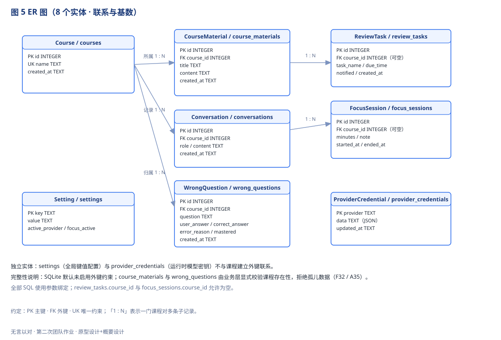

# 无言以对_数据库设计说明书

<div align="center">

**AI 校园学习陪伴助手（ACC）**

文档类别：数据库设计说明书（DBDS）　　版本：V1.0（对应产品 V1.5.0 验收基线）

编制单位：无言以对队　　编制日期：2026-11-09　　复核定稿：2026-11-21

编写依据：GB/T 8567-2006《计算机软件文档编制规范》、GB/T 9385-2008《计算机软件需求说明编制指南》

</div>

---

## 文档控制信息

| 项 | 内容 |
|---|---|
| 文档名称 | 无言以对_数据库设计说明书 |
| 产品标识 | AI 校园学习陪伴助手 / AI Campus Learning Companion / 缩写 ACC |
| 对应产品版本 | `version.py` 中 `APP_VERSION = "1.5.0"` |
| 数据库 | SQLite，文件 `data/companion.db`，共 8 张表 |
| 权威模式定义 | `db.py` 的 `SCHEMA` 常量，由 `init_db()` 执行 |
| 文档状态 | 第二次团队作业交付稿 |
| 编制 / 审核 | 无言以对队：陈明凯（3124004503，后端与质量保障）、邓文炜（3124004505，前端与交互体验） |
| 上游文档 | `docs/软件需求规格说明书.md`（SRS V1.5.0）第 5 章 |
| 配套文档 | 《无言以对_系统设计说明书》 |
| 同源维护 | 本 Markdown 为正文单一源，`docs/第二次团队作业/build_docs.py` 生成同名 PDF |

> 本文的字段、类型、约束与 SQL 语句均取自 `db.py`、`services/*.py`、`agents/*.py`、`hardware/esp32.py` 与 `server.py` 的实际代码；附录 B 为 `db.py` 中 `SCHEMA` 的逐字副本。未实机验证或明确排除的内容写入第 11 章，不作设计承诺。

---

## 1 引言

### 1.1 编写目的

给出 ACC 数据库从概念结构、逻辑结构到物理结构的完整设计，说明 8 张表的实体含义、字段、约束、联系、实体类与库表的映射关系、典型数据操作与完整性保障，使验收者可以按本文逐项核对数据库实现，使后续维护者可以按本文扩展数据模型而不破坏课程记忆隔离这一核心设计。

### 1.2 范围

覆盖 `data/companion.db` 中 8 张表、它们的联系与约束、初始化与预置数据、连接与并发策略、参数化数据操作、数据规模与性能边界。不覆盖数据库迁移框架、备份恢复策略、多租户分库与主从复制（见第 11 章）。

### 1.3 术语、定义与缩略语

本文及配套文档中出现的缩写，均以下表为准；正文首次出现时不再另行解释。

| 缩写 / 术语 | 定义 |
|---|---|
| ACC | AI Campus Learning Companion，本项目「AI 校园学习陪伴助手」的产品缩写 |
| SRS / SDD / DBDS | 软件需求规格说明书 / 系统设计说明书 / 数据库设计说明书 |
| Fxx / NFR-xx / Axx | 功能需求 / 非功能需求 / 自动化验收标准编号，取自 SRS 第 4、7、10 章 |
| 课程记忆 | 按 `course_id` 隔离、由该课程已上传资料拼接而成的智能体 system prompt 上下文，非向量检索 |
| 上下文预算 | 单份资料 4000 字、总量 12000 字的上限，由 `MAX_CONTEXT_CHARS` 控制 |
| 孤儿数据 | 外键未启用时写入的、指向不存在课程 ID 的资料或错题 |
| 错题闭环 | 录入错题 → 错因分析 → 定向变式题 → 标记掌握 → 导出 |
| 演示模式 | `DemoProvider`，无密钥或调用异常时的规则化应答与内置知识库作答，不是真实大模型推理 |
| ER | 实体—联系（Entity-Relationship），概念结构设计方法 |
| PK / FK / UK | 主键（Primary Key）/ 外键（Foreign Key）/ 唯一约束（Unique Key） |
| DDL / DML | 数据定义语言 / 数据操作语言 |
| SQL / SQLite | 结构化查询语言 / 本系统使用的嵌入式关系数据库 |
| CRUD | 创建、读取、更新、删除 |
| 1NF / 2NF / 3NF | 第一 / 第二 / 第三范式 |
| JSON / BLOB | JavaScript 对象表示法 / 二进制大对象（本系统**未**使用 BLOB 存储附件） |
| ACID | 原子性、一致性、隔离性、持久性 |
| `busy_timeout` | SQLite 在遇到数据库锁时的等待参数，本系统设为 5000 毫秒 |
| `sqlite3.Row` | 本系统使用的行工厂，使查询结果可按列名访问 |
| `get_conn()` | `db.py` 中统一的数据库连接获取函数 |
| `init_db()` | `db.py` 中首次启动时执行建表与预置数据的函数 |
| `course_id` | 课程主键，本系统的核心隔离维度 |

### 1.4 参考资料

1. GB/T 8567-2006《计算机软件文档编制规范》
2. GB/T 9385-2008《计算机软件需求说明编制指南》
3. `docs/软件需求规格说明书.md`（V1.5.0）第 5 章「数据需求」与 10.5「实测结果」
4. `db.py`（`SCHEMA`、`get_conn()`、`init_db()`）
5. `services/course.py`、`tasks.py`、`wrong_questions.py`、`focus.py`、`subject_knowledge.py`
6. `agents/credentials.py`、`agents/factory.py`、`hardware/esp32.py`、`server.py`
7. 《无言以对_系统设计说明书》第 5 章

### 1.5 文档约定

- 图的序号为团队第二次作业交付物的**全局统一编号**，与团队博客随笔、SDD 一致；本文只引用相关图，故序号不连续。表按章内顺序编号。
- 字段名、表名、模块名与代码逐字一致；SQL 示例为源码中的实际语句，参数以 `?` 占位。
- 「已实现」指有对应代码与自动化验证；「不予承诺」指明确排除在验收之外。
- ER 图中 PK 为主键、FK 为外键、UK 为唯一约束，`1 : N` 表示一对多联系。

---

## 2 数据库总体设计

### 2.1 设计目标与约束

| 项 | 内容 |
|---|---|
| 设计目标 | 以 `course_id` 为核心隔离维度，让课程、资料、对话、错题、任务、专注记录围绕同一门课组织，支撑课程记忆绑定与隔离（F06 / F33）这一杀手级功能 |
| 形态约束 | 单机单库、单文件、零安装；不使用独立数据库服务，不引入 ORM 与迁移框架 |
| 依赖约束 | 仅 Python 标准库 `sqlite3`（约束 C02 零第三方依赖） |
| 安全约束 | 全部 SQL 参数绑定；用户输入先转义再展示；密钥只存运行时配置的 JSON 字段且状态接口只回掩码（C04、C07） |
| 并发约束 | `ThreadingHTTPServer` 多线程处理请求，连接需设置等待窗口以避免偶发 `database is locked` |
| 规模约束 | 课程级资料、对话、错题量在千级以内；不承诺海量数据性能 |

### 2.2 运行环境

| 项 | 取值 |
|---|---|
| 数据库管理系统 | SQLite（Python 3.8+ 标准库 `sqlite3`） |
| 数据库文件 | `data/companion.db`，路径由 `config.py` 的 `DB_PATH` 指定 |
| 目录创建 | `db.py` 导入时 `os.makedirs(os.path.dirname(DB_PATH), exist_ok=True)` |
| 建表时机 | 首次启动由 `init_db()` 执行 `conn.executescript(SCHEMA)` |
| 连接参数 | `sqlite3.connect(DB_PATH, timeout=10)`，`row_factory = sqlite3.Row`，`PRAGMA busy_timeout=5000` |
| 外键开关 | SQLite 默认未启用 `PRAGMA foreign_keys=ON`，外键为声明性约束，实际完整性由业务层保证 |

### 2.3 命名规范

| 对象 | 规范 | 示例 |
|---|---|---|
| 表名 | 小写复数或语义化复数，下划线分词 | `courses`、`course_materials`、`wrong_questions` |
| 实体类名 | 大驼峰单数 | `Course`、`CourseMaterial`、`WrongQuestion` |
| 主键 | 统一 `id INTEGER PRIMARY KEY AUTOINCREMENT`；键值型实体用业务主键 | `settings.key`、`provider_credentials.provider` |
| 外键字段 | `<被引用实体单数>_id` | `course_id` |
| 时间字段 | `created_at` / `updated_at` / `started_at` / `ended_at` / `due_time`，均为 ISO 8601 `TEXT` | `2026-11-06T10:00:00` |
| 布尔字段 | `INTEGER` 0 / 1，带 `DEFAULT 0` | `mastered`、`notified` |
| 服务模块 | 与实体所属业务域同名或近名 | `services/course.py` ↔ `courses` / `course_materials` |

---

## 3 概念结构设计

### 3.1 ER 图



图 5　ER 图（8 个实体 · 联系与基数）。

图中符号约定：矩形为实体，框内首行为实体类 / 表名，其下为属性清单；PK 标注主键、FK 标注外键、UK 标注唯一约束；连线上的 `1 : N` 表示一门课程对多条子记录。

### 3.2 实体定义

| 实体类 | 表名 | 含义 | 关键属性 |
|---|---|---|---|
| `Course` | `courses` | 课程，课程记忆的隔离单元 | `id`、`name`（唯一且非空）、`created_at` |
| `CourseMaterial` | `course_materials` | 课程资料全文 | `id`、`course_id`、`title`、`content`、`created_at` |
| `Conversation` | `conversations` | 课程内对话历史 | `id`、`course_id`、`role`、`content`、`created_at` |
| `WrongQuestion` | `wrong_questions` | 错题、错因与掌握状态 | `id`、`course_id`、`question`、`user_answer`、`correct_answer`、`error_reason`、`mastered`、`created_at` |
| `ReviewTask` | `review_tasks` | 复习任务与提醒状态 | `id`、`course_id`（可空）、`task_name`、`due_time`、`notified`、`created_at` |
| `Setting` | `settings` | 全局键值配置 | `key`、`value` |
| `FocusSession` | `focus_sessions` | 一次专注记录 | `id`、`course_id`（可空）、`minutes`、`note`、`started_at`、`ended_at`、`created_at` |
| `ProviderCredential` | `provider_credentials` | 运行时模型密钥与地址 | `provider`、`data`（JSON）、`updated_at` |

### 3.3 联系与基数

| 联系 | 参与实体 | 基数 | 可选性 | 说明 |
|---|---|---|---|---|
| 所属 | `Course` ↔ `CourseMaterial` | 1 : N | 资料端强制 | 一门课程可有多份资料；写入前显式校验课程存在 |
| 记录 | `Course` ↔ `Conversation` | 1 : N | 对话端强制 | 课程内问答历史按 `course_id` 隔离 |
| 归属 | `Course` ↔ `WrongQuestion` | 1 : N | 错题端强制 | 错题必须属于存在的课程 |
| 关联 | `Course` ↔ `ReviewTask` | 1 : N | 两端可空 | `review_tasks.course_id` 允许为空（通用任务） |
| 关联 | `Course` ↔ `FocusSession` | 1 : N | 两端可空 | `focus_sessions.course_id` 允许为空 |
| 独立 | `Setting` | — | — | 全局键值，不与课程建立联系 |
| 独立 | `ProviderCredential` | — | — | 运行时模型配置，不与课程建立联系 |

`CourseMaterial` 与 `Conversation` 之间无直接联系，二者通过 `course_id` 在业务层 `build_course_context()` 中汇合，构成课程记忆上下文。

### 3.4 与杀手级功能的关系

课程记忆绑定与隔离（F06 / F33）在数据层的落点是：`course_materials` 以 `course_id` 为过滤条件按 `id` 升序读取，拼接后作为该课程的 system prompt；`conversations` 同样以 `course_id` 过滤，保证切课程后对话不串。因此 `course_id` 不是普通外键，而是全系统的隔离主键维度。验收 A05（绑定）、A06（隔离）、A36（上下文预算）均建立在这一结构之上。

---

## 4 逻辑结构设计

### 4.1 关系数据模型

以下 8 个关系模式与 `db.py` 的 `SCHEMA` 逐字对应。

**R1 `courses`**

| 字段 | 类型 | 可空 | 键 / 默认 | 说明 |
|---|---|---|---|---|
| `id` | INTEGER | 否 | PK, AUTOINCREMENT | 课程主键 |
| `name` | TEXT | 否 | UK | 课程名，唯一且非空 |
| `created_at` | TEXT | 否 | — | ISO 8601 创建时间 |

**R2 `course_materials`**

| 字段 | 类型 | 可空 | 键 / 默认 | 说明 |
|---|---|---|---|---|
| `id` | INTEGER | 否 | PK, AUTOINCREMENT | 资料主键 |
| `course_id` | INTEGER | 否 | FK → `courses.id` | 所属课程 |
| `title` | TEXT | 是 | — | 资料标题 |
| `content` | TEXT | 否 | — | 资料全文，单份入库上限 20000 字 |
| `created_at` | TEXT | 否 | — | 创建时间 |

**R3 `conversations`**

| 字段 | 类型 | 可空 | 键 / 默认 | 说明 |
|---|---|---|---|---|
| `id` | INTEGER | 否 | PK, AUTOINCREMENT | 对话主键 |
| `course_id` | INTEGER | 否 | FK → `courses.id` | 所属课程 |
| `role` | TEXT | 否 | — | 角色（user / assistant） |
| `content` | TEXT | 否 | — | 消息正文 |
| `created_at` | TEXT | 否 | — | 创建时间 |

**R4 `wrong_questions`**

| 字段 | 类型 | 可空 | 键 / 默认 | 说明 |
|---|---|---|---|---|
| `id` | INTEGER | 否 | PK, AUTOINCREMENT | 错题主键 |
| `course_id` | INTEGER | 否 | FK → `courses.id` | 所属课程 |
| `question` | TEXT | 否 | — | 题干 |
| `user_answer` | TEXT | 是 | — | 我的答案 |
| `correct_answer` | TEXT | 是 | — | 正确答案 |
| `error_reason` | TEXT | 是 | — | 错因分析（由 `analyze` 写回） |
| `mastered` | INTEGER | 否 | DEFAULT 0 | 是否掌握，0 / 1 |
| `created_at` | TEXT | 否 | — | 创建时间 |

**R5 `review_tasks`**

| 字段 | 类型 | 可空 | 键 / 默认 | 说明 |
|---|---|---|---|---|
| `id` | INTEGER | 否 | PK, AUTOINCREMENT | 任务主键 |
| `course_id` | INTEGER | 是 | FK → `courses.id`（可空） | 关联课程，可空 |
| `task_name` | TEXT | 否 | — | 任务名，空值回落「复习任务」 |
| `due_time` | TEXT | 否 | — | 到期时间 |
| `notified` | INTEGER | 否 | DEFAULT 0 | 是否已提醒，0 / 1 |
| `created_at` | TEXT | 否 | — | 创建时间 |

**R6 `settings`**

| 字段 | 类型 | 可空 | 键 / 默认 | 说明 |
|---|---|---|---|---|
| `key` | TEXT | 否 | PK | 配置键，如 `active_provider`、`focus_active`、`focus_since` |
| `value` | TEXT | 是 | — | 配置值 |

**R7 `focus_sessions`**

| 字段 | 类型 | 可空 | 键 / 默认 | 说明 |
|---|---|---|---|---|
| `id` | INTEGER | 否 | PK, AUTOINCREMENT | 记录主键 |
| `course_id` | INTEGER | 是 | FK → `courses.id`（可空） | 关联课程，可空 |
| `minutes` | INTEGER | 否 | — | 专注分钟数 |
| `note` | TEXT | 是 | — | 备注 |
| `started_at` | TEXT | 是 | — | 开始时间 |
| `ended_at` | TEXT | 是 | — | 结束时间 |
| `created_at` | TEXT | 否 | — | 创建时间 |

**R8 `provider_credentials`**

| 字段 | 类型 | 可空 | 键 / 默认 | 说明 |
|---|---|---|---|---|
| `provider` | TEXT | 否 | PK | Provider 标识，如 `openai`、`qianfan` |
| `data` | TEXT | 否 | — | JSON 序列化的配置（`api_key`、`secret_key`、`model`、`base_url`、`token_url`） |
| `updated_at` | TEXT | 否 | — | 更新时间 |

> 兼容性说明：`db.py` 的 `SCHEMA` 是权威定义；`agents/credentials.py` 的 `ensure_table()` 中另有一条 `CREATE TABLE IF NOT EXISTS provider_credentials (provider TEXT PRIMARY KEY, data TEXT NOT NULL, updated_at TEXT NOT NULL)`，字段与 R8 完全一致，用于兼容早期未建该表的数据库文件。

### 4.2 范式分析

- R1 – R5、R7 中非主属性均完全依赖于主键、且不传递依赖于其他非主属性，满足 3NF；所有属性为原子值，满足 1NF；无部分依赖，满足 2NF。
- R6 `settings` 为键值表，R8 的 `data` 为 JSON 文本：二者是有意的配置存储设计，不做进一步拆分，原因是配置项集合随 Provider 类型变化且只做整体读写，拆分不会带来查询收益。
- 未做反范式冗余：`course_name` 等字段在查询时由 `LEFT JOIN courses c` 实时取得（如 `review_tasks` 与 `focus_sessions` 的列表查询），避免更新异常。

### 4.3 完整性约束

| 类型 | 约束 | 保障方式 |
|---|---|---|
| 实体完整性 | 每张表的主键非空且唯一；`courses.name` 唯一 | `PRIMARY KEY` / `UNIQUE`，SQLite 自动建索引 |
| 参照完整性 | 资料、对话、错题必须指向存在的课程 | **业务层显式校验**：`SELECT 1 FROM courses WHERE id=?`，不存在返回 400（F32 / A35）；因 SQLite 默认未启用外键，数据库本身不强制 |
| 域完整性 | `NOT NULL` 字段、`mastered` / `notified` 为 0 / 1、`content` 非空 | DDL `NOT NULL` + 服务层校验 |
| 用户定义完整性 | 单份资料入库 ≤ 20000 字、进入上下文 ≤ 4000 字、上下文总量 ≤ 12000 字；课程名非空；任务名非空 | `services/files.py`、`services/course.py` 的 `MAX_TEXT_CHARS` 与 `MAX_CONTEXT_CHARS`，`server.py` 的空值回落 |
| 并发完整性 | 连接等待，避免锁冲突直接变成 5xx | `timeout=10` + `PRAGMA busy_timeout=5000` |

---

## 5 物理结构设计

### 5.1 存储与文件

数据库为单文件 `data/companion.db`，首次启动自动创建目录与库文件；无独立数据库进程、无网络端口、无额外配置文件。所有表使用 SQLite 默认页大小与默认 `WAL` 之外的回滚日志模式（**未显式设置 journal_mode**）。

### 5.2 索引

| 索引 | 来源 | 说明 |
|---|---|---|
| 各表 `id` 主键索引 | `INTEGER PRIMARY KEY` | SQLite 隐式 rowid，唯一且有序 |
| `courses.name` 唯一索引 | `UNIQUE` 约束 | 防止同名课程，支撑课程去重 |
| `settings.key` / `provider_credentials.provider` 主键索引 | `TEXT PRIMARY KEY` | 支撑按键 / 按 Provider 的配置读写 |

当前 `SCHEMA` **未显式创建额外二级索引**。依据是课程级数据量在千级以内，且 `course_id` 过滤在单表内代价很低（见第 9 章）。后续若数据量增长，可按需为 `course_materials(course_id)`、`conversations(course_id)`、`wrong_questions(course_id, mastered)` 增加索引；这属于后续优化，不在 V1.5.0 已实现范围内。

### 5.3 连接与并发

```python
def get_conn():
    conn = sqlite3.connect(DB_PATH, timeout=10)
    conn.row_factory = sqlite3.Row
    conn.execute("PRAGMA busy_timeout=5000")
    return conn
```

`ThreadingHTTPServer` 为每个请求分配线程，服务层「取连接 → 执行 → `commit()` → `close()`」短连接；`timeout=10` 与 `busy_timeout=5000` 给并发写留出等待窗口（F36 / A39）。`sqlite3.Row` 使结果可按列名访问，便于直接序列化为 JSON。

### 5.4 初始化与预置数据

`init_db()` 执行 `executescript(SCHEMA)` 后写入两条预置数据：

```sql
INSERT OR IGNORE INTO settings(key, value) VALUES('active_provider', ?)   -- 取自 ACTIVE_PROVIDER 环境变量，默认 demo
INSERT OR IGNORE INTO courses(name, created_at) VALUES('示例课程：数据结构', ?)
```

`INSERT OR IGNORE` 保证重复启动不产生重复配置与重复示例课程。验收数据由脚本动态创建课程，**不依赖固定 ID**。

### 5.5 模式变更策略

当前无迁移框架。新增表或字段时需同步修改 `db.py` 的 `SCHEMA`（`CREATE TABLE IF NOT EXISTS` 不会为已存在的表补列），并由维护者手动执行 `ALTER TABLE`；该限制已记入第 11 章，不作为已实现能力。

---

## 6 实体类与库表映射

本系统不使用 ORM，映射为「实体类（概念） ↔ 库表（物理） ↔ 服务模块（操作）」的约定式对应关系。

| 实体类 | 库表 | 主要服务模块 | 主键 | 外键 | 主要 CRUD 操作 |
|---|---|---|---|---|---|
| `Course` | `courses` | `services/course.py` | `id` | — | 列表、新建；无删除接口 |
| `CourseMaterial` | `course_materials` | `services/course.py`、`services/files.py` | `id` | `course_id` | 按课程列出、新增、上传解析、全文查看；无删除接口 |
| `Conversation` | `conversations` | `services/tasks.py` | `id` | `course_id` | 按课程倒序取历史、写入问答；无删除接口 |
| `WrongQuestion` | `wrong_questions` | `services/wrong_questions.py` | `id` | `course_id` | 按课程 / 掌握状态筛选、新增、更新错因、更新掌握、导出 |
| `ReviewTask` | `review_tasks` | `server.py`、`services/focus.py`、`hardware/esp32.py` | `id` | `course_id`（可空） | 新增、列表（JOIN 课程名）、标记完成、扫描到期并更新 `notified` |
| `Setting` | `settings` | `agents/factory.py`、`hardware/esp32.py` | `key` | — | 读取 / 切换 `active_provider`、读写专注状态 |
| `FocusSession` | `focus_sessions` | `services/focus.py` | `id` | `course_id`（可空） | 新增、列表（JOIN 课程名）、概览聚合 |
| `ProviderCredential` | `provider_credentials` | `agents/credentials.py` | `provider` | — | 读取、写入（`INSERT ... ON CONFLICT` 形式）、清除 |

映射一致性说明：`course_materials` 与 `wrong_questions` 的写入路径都先执行 `SELECT 1 FROM courses WHERE id=?`；`review_tasks` 与 `focus_sessions` 的列表查询都通过 `LEFT JOIN courses c` 取 `course_name`；`settings` 与 `provider_credentials` 都以业务键为主键且只做整体读写。上述规则在第 7、8 章给出对应 SQL。

---

## 7 数据完整性与安全设计

### 7.1 SQL 注入防护

全部 SQL 使用 `?` 参数绑定，无字符串拼接查询（约束 C07）。`wrong_questions.py` 中动态拼接的只有 `WHERE` 条件片段，条件值仍走参数元组 `args`：

```python
sql = "SELECT * FROM wrong_questions"
# 依据筛选条件追加 WHERE / AND 片段，值与 sql 分离传入 args
rows = conn.execute(sql, args).fetchall()
```

### 7.2 孤儿数据拦截

```python
if not conn.execute("SELECT 1 FROM courses WHERE id=?", (course_id,)).fetchone():
    raise ValueError("课程不存在，请先选择或新建课程")
```

`services/course.py` 的 `add_material()` 与 `services/wrong_questions.py` 的 `add_wrong_question()` 均包含该校验；V1.5.0 已用 `course_id=999999` 复现并修复为返回 400（F32 / A35）。

### 7.3 展示层转义

数据库取出的题干、资料标题、专注备注、Provider 名称等全部经 `esc()` / `mdEscape()` 后才进入 `innerHTML`；SQL 结果本身不直接拼进 HTML（F31 / A34）。

### 7.4 密钥存储

模型密钥只存于 `provider_credentials.data`（JSON 文本）或环境变量；`agents/credentials.py` 的 `status()` 只返回掩码，`save()` 之后前端不持久化明文（C04）。`/api/agent/*` 公网未加鉴权，属校内演示边界（见第 11 章）。

### 7.5 备份与恢复边界

当前无自动备份、无恢复脚本；部署工具整目录上传会覆盖线上 `data/companion.db`。发布前需同步线上数据，或把数据目录纳入部署排除。该项属于已识别的待办，不承诺已实现。

---

## 8 数据操作设计

以下 SQL 逐字取自项目源码，均为参数化形式。

### 8.1 课程与课程记忆（`services/course.py`）

```sql
SELECT id, name, created_at FROM courses ORDER BY id
INSERT INTO courses(name, created_at) VALUES(?, ?)
SELECT 1 FROM courses WHERE id=?
INSERT INTO course_materials(course_id, title, content, created_at) VALUES(?, ?, ?, ?)
SELECT id, course_id, title, content, created_at FROM course_materials WHERE course_id=? ORDER BY id
SELECT name FROM courses WHERE id=?
SELECT title, content FROM course_materials WHERE course_id=? ORDER BY id
```

最后两条是 `build_course_context(course_id)` 的数据来源：按 `id` 升序拼出资料全文，再施加单份 4000 字与总量 12000 字预算（F33 / A36）。

### 8.2 对话历史（`services/tasks.py`）

```sql
SELECT role, content FROM conversations WHERE course_id=? ORDER BY id DESC LIMIT ?
INSERT INTO conversations(course_id, role, content, created_at) VALUES(?, ?, ?, ?)
```

### 8.3 错题闭环（`services/wrong_questions.py`）

```sql
SELECT 1 FROM courses WHERE id=?
INSERT INTO wrong_questions(course_id, question, user_answer, correct_answer, error_reason, mastered, created_at) VALUES(?, ?, ?, ?, ?, ?, ?)
SELECT * FROM wrong_questions WHERE id=?
UPDATE wrong_questions SET error_reason=? WHERE id=?
UPDATE wrong_questions SET mastered=? WHERE id=?
```

### 8.4 复习任务与硬件调度（`server.py`、`hardware/esp32.py`）

```sql
INSERT INTO review_tasks(course_id, task_name, due_time, notified, created_at) VALUES(?, ?, ?, ?, ?)
SELECT ... c.name AS course_name FROM review_tasks r ...
UPDATE review_tasks SET notified = 1 WHERE id = ?
SELECT * FROM review_tasks WHERE notified=0 AND due_time<=?
UPDATE review_tasks SET notified=1 WHERE id=?
SELECT COUNT(*) FROM review_tasks WHERE notified=0
```

后台线程每 30 秒执行 `check_due_tasks()`，取出到期未提醒任务、下发 Webhook 后置 `notified=1`。

### 8.5 学习概览与专注（`services/focus.py`）

```sql
INSERT INTO focus_sessions(course_id, minutes, note, started_at, ended_at, created_at) VALUES(?, ?, ?, ?, ?, ?)
SELECT f.*, c.name AS course_name FROM focus_sessions f ...
SELECT COUNT(*) FROM courses
SELECT COUNT(*) FROM course_materials
SELECT COUNT(*) FROM wrong_questions
SELECT COUNT(*) FROM wrong_questions WHERE mastered=1
SELECT COALESCE(SUM(minutes),0) FROM focus_sessions WHERE created_at LIKE ?
SELECT COALESCE(SUM(minutes),0) FROM focus_sessions
SELECT COUNT(*) FROM focus_sessions
```

概览六项统计由上述聚合查询得到；无误题时前端显示「暂无」而非 `0.0%`（F26 / A29）。

### 8.6 配置与凭据（`agents/factory.py`、`agents/credentials.py`、`hardware/esp32.py`）

```sql
SELECT value FROM settings WHERE key='active_provider'
INSERT INTO settings(key, value) VALUES('active_provider', ?) ...
INSERT OR REPLACE INTO settings(key, value) VALUES('focus_active', ?)
INSERT OR REPLACE INTO settings(key, value) VALUES('focus_since', ?)
SELECT data, updated_at FROM provider_credentials WHERE provider=?
INSERT INTO provider_credentials(provider, data, updated_at) VALUES(?, ?, ?) ...
DELETE FROM provider_credentials WHERE provider=?
```

配置优先级：运行时 `provider_credentials` > `.env` 环境变量 > 内置演示模式；清除配置后若当前激活的是该 Provider，自动切回 `demo`（F21 / F23 / A24、A26）。

### 8.7 学科知识库读取（`services/subject_knowledge.py`）

```sql
SELECT title FROM course_materials WHERE course_id IN (SELECT id FROM courses WHERE name=?) ORDER BY id
```

资源包在生成时读取该课程已有资料标题作为接地上下文，可把生成结果回写课程记忆（F18 / A21）。

### 8.8 事务边界

各服务函数在自己的连接内完成「一条或一组写操作 + `commit()` + `close()`」；不存在跨请求的长事务。`init_db()` 使用 `executescript()` 一次性建表后统一 `commit()`。

---

## 9 数据规模与性能

| 项 | 实况 / 设计值 | 依据 |
|---|---|---|
| 数据库形态 | 单机单文件，单机单库原型 | `db.py` |
| 线上复验实况 | 24 个课程；课程 1 有 17 条用户资料 | SRS 5.4、10.5 |
| 课程级数据量 | 资料、对话、错题量在千级以内 | SRS 5.4 |
| 上下文压测 | 20 份 × 1 万字场景，由 80351 字收敛到 12160 字并带预算提示 | SRS 4.3.1、A36 |
| 连接等待 | `timeout=10` + `busy_timeout=5000` | `db.py` |
| 索引策略 | 仅主键 / 唯一约束隐式索引，无显式二级索引 | `SCHEMA` |

在上述规模下 SQLite 即可满足；**不承诺多用户、分库分表、海量数据性能或性能 SLA**。

---

## 10 数据库初始化与验收

### 10.1 初始化

```bash
cd ai-campus-companion
python -c "import db; db.init_db()"    # 或由 server.py 启动时调用
```

也可直接运行 `python db.py`，输出「数据库初始化完成：<DB_PATH>」。

### 10.2 可判定验收项

| 验收项 | 判定条件 |
|---|---|
| A02 零依赖启动 | 不执行 `pip install`，`python server.py` 可启动并自动建表 |
| A04 课程管理 | 新建课程返回 `id`；列表包含该课程；空课程名返回 400 |
| A05 / A06 课程记忆绑定与隔离 | 为课程 A 上传资料后 `/api/chat` 引用该资料；A / B 分别提问绑定课程名不同且上下文不串 |
| A10 – A12 资料 | 保存后 `GET /api/courses/{id}/materials` 可取回全文；上传类型与大小白名单生效 |
| A13 / A14 错题 | 录入 → 分析 → 掌握 → 筛选全链路可用；导出返回带 attachment 的 Markdown |
| A15 复习任务 | 创建 / 列出 / 完成可用；空任务名回落「复习任务」 |
| A23 – A26 模型配置 | 6 个 Provider 状态可见；写入后只显示掩码；清除后自动回退 `demo` |
| A35 孤儿数据 | 向不存在课程写资料 / 错题返回 400 |
| A36 上下文预算 | 超预算时收敛到约 1.2 万字并带提示 |
| A39 并发与导出 | SQLite 并发写无锁异常；导出失败不替换页面 |

V1.5.0 实测：`startup_check.py` 26/26、`demo_check.py` 26/26 请求 + 30/30 断言、`feature_check.py` 19/19、`study_check.py` 本地 36/36；线上前三项同，线上 `study` 25/25（跳过 11 项需本机模拟厂商端点的探针，已在本地完整验证）。证据为 `docs/*_results.json` 及 `_线上` 副本。

---

## 11 范围边界与不予承诺

| 项 | 现状 | 影响 |
|---|---|---|
| 数据库迁移框架 | 无；`CREATE TABLE IF NOT EXISTS` 不会为已存在的表补列 | 加字段需手工 `ALTER TABLE` |
| 外键强制 | SQLite 默认未启用 `PRAGMA foreign_keys=ON` | 参照完整性由业务层显式校验保证 |
| 显式二级索引 | 无 | 千级数据量下可接受，规模增长后需补充 |
| 备份与恢复 | 无自动备份与恢复脚本 | 不承诺数据备份与恢复策略 |
| 部署数据覆盖 | 部署工具整目录上传会覆盖线上 `data/companion.db` | 发布前需同步线上数据 |
| 课程资料删除 | 无 DELETE 路由 | 无法在线删除资料 |
| 多用户与权限 | 无登录、无权限、单机单库，所有访问者共享同一份数据 | 按单用户原型说明 |
| 生产级能力 | 不承诺高可用、性能 SLA、多租户隔离、主从复制 | — |

---

## 附录 A　图清单与符号约定

| 图号 | 图名 | 文件 | 本文引用 |
|---|---|---|---|
| 图 5 | ER 图（8 个实体 · 联系与基数） | `assets/ER图.svg` | 3.1、3.4、第 4 章 |
| 图 6 | 后端分层与请求分发设计图（数据层位置） | `assets/后端分层图.svg` | 2.2、5.3 |
| 图 8 | 系统架构图（SQLite 在整体结构中的位置） | `assets/系统架构图.png` | 2.2 |
| 图 10 | 类图（8 个数据实体与模块关系） | `assets/类图.png` | 第 6 章 |

符号约定：ER 图矩形为实体、连线为联系；PK 主键、FK 外键、UK 唯一约束；`1 : N` 一对多；虚线文本为补充说明。全文表名、字段名与图内标注逐字一致。团队交付物的完整图清单见《无言以对_系统设计说明书》附录 A。

---

## 附录 B　`db.py` 中 `SCHEMA` 的逐字副本

```sql
CREATE TABLE IF NOT EXISTS courses (
    id INTEGER PRIMARY KEY AUTOINCREMENT,
    name TEXT NOT NULL UNIQUE,
    created_at TEXT NOT NULL
);

CREATE TABLE IF NOT EXISTS course_materials (
    id INTEGER PRIMARY KEY AUTOINCREMENT,
    course_id INTEGER NOT NULL,
    title TEXT,
    content TEXT NOT NULL,
    created_at TEXT NOT NULL,
    FOREIGN KEY (course_id) REFERENCES courses(id)
);

CREATE TABLE IF NOT EXISTS conversations (
    id INTEGER PRIMARY KEY AUTOINCREMENT,
    course_id INTEGER NOT NULL,
    role TEXT NOT NULL,
    content TEXT NOT NULL,
    created_at TEXT NOT NULL,
    FOREIGN KEY (course_id) REFERENCES courses(id)
);

CREATE TABLE IF NOT EXISTS wrong_questions (
    id INTEGER PRIMARY KEY AUTOINCREMENT,
    course_id INTEGER NOT NULL,
    question TEXT NOT NULL,
    user_answer TEXT,
    correct_answer TEXT,
    error_reason TEXT,
    mastered INTEGER NOT NULL DEFAULT 0,
    created_at TEXT NOT NULL,
    FOREIGN KEY (course_id) REFERENCES courses(id)
);

CREATE TABLE IF NOT EXISTS review_tasks (
    id INTEGER PRIMARY KEY AUTOINCREMENT,
    course_id INTEGER,
    task_name TEXT NOT NULL,
    due_time TEXT NOT NULL,
    notified INTEGER NOT NULL DEFAULT 0,
    created_at TEXT NOT NULL
);

CREATE TABLE IF NOT EXISTS settings (
    key TEXT PRIMARY KEY,
    value TEXT
);

CREATE TABLE IF NOT EXISTS focus_sessions (
    id INTEGER PRIMARY KEY AUTOINCREMENT,
    course_id INTEGER,
    minutes INTEGER NOT NULL,
    note TEXT,
    started_at TEXT,
    ended_at TEXT,
    created_at TEXT NOT NULL
);

-- 运行时模型接入凭据（Web 设置页 / REST 接口写入，优先于环境变量）
CREATE TABLE IF NOT EXISTS provider_credentials (
    provider TEXT PRIMARY KEY,
    data TEXT NOT NULL,
    updated_at TEXT NOT NULL
);
```

> 说明：`review_tasks` 与 `focus_sessions` 在 DDL 中未声明 `FOREIGN KEY`，但 `course_id` 语义上仍引用 `courses.id`；ER 图按语义联系绘制并标注「可空」。此差异如实保留，未在文档中掩饰。

---

## 附录 C　待补事项清单

| 项 | 状态 |
|---|---|
| 墨刀原型工程与在线预览地址 | ✅ 已按 V1.5.0 建立墨刀在线工程（16 页交互版，2026-11-21 21:18 写入并复核；已补 16 个页面画布与 100 个原生跳页热区（分享链接同该地址））：`https://modao.cc/proto/design/pb2mcpVbc0AcCTz0QuMv`；本地单一源与逐页核对表见博客 1.1、1.2.2。R01 已完成；【重点 · R02】访问密码未提供 |
| 硬件原型照片或连接图 | ✅ 图 7 连接图已满足作业原文择一措辞；实物照片为可选增强，不代填 |
| 团队分工记录（书面说明） | ✅ 见博客 3.2 / 3.3，无缺口 |
| 逐人 GitHub 贡献记录 | 【重点 · R10】仓库级实测已核验（本地 85 / 远端 49 / PR 0 / Issue 0；两段历史无共同祖先，2026-11-21 复核快照）；两名队员账号名已由本人提供并核验（kecit33 / Dengwenwei0821）；【待填写：本人绑定邮箱、账号归属确认与逐人统计】 |
| 作业课程、班级与作业要求链接 | 【重点 · R11】【待填写：课程名称、班级链接、作业要求链接】 |
| 两份 PDF 的云盘下载地址 | 【重点 · R03】【待填写：蓝奏云 / 百度网盘 / 微云 链接与提取码】 |

> 本附录各项的**缺口、原因与需补充内容**逐项列于同目录《交付合规检查表与缺口清单》第 2 节（编号 R01 – R08、R10 – R12，R09 已删除）。本文不填写任何推测的链接、密码、提取码、日期、账号或统计数字。
