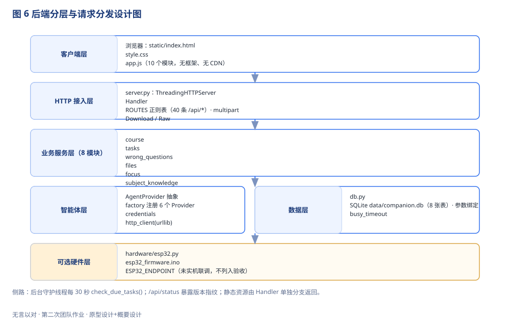
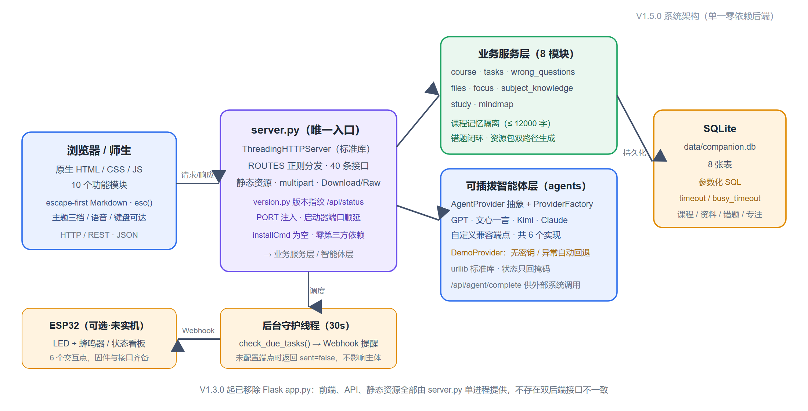
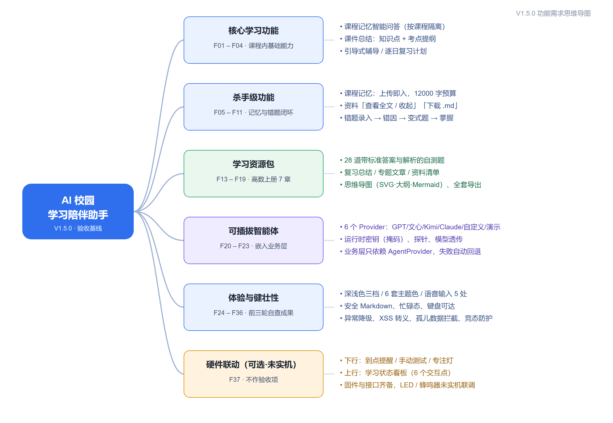
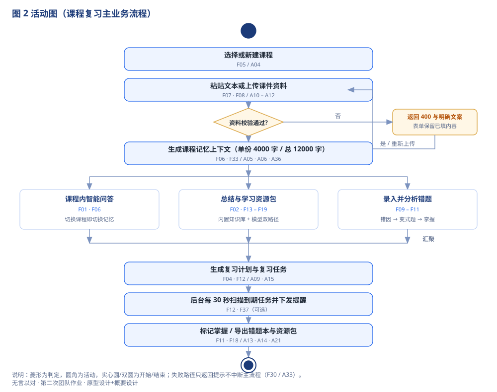
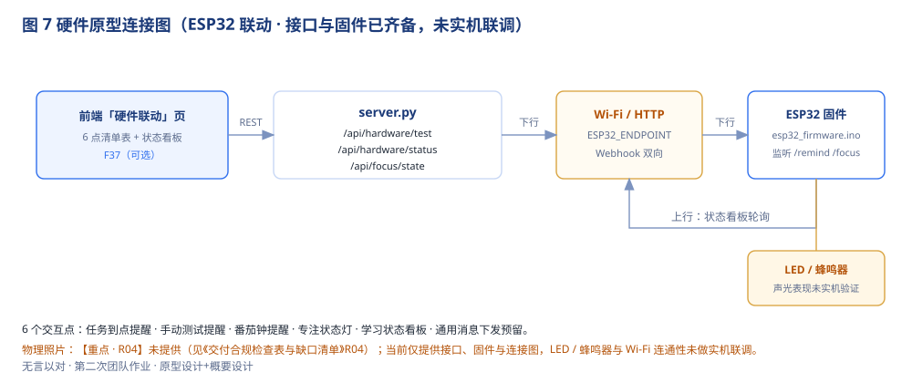
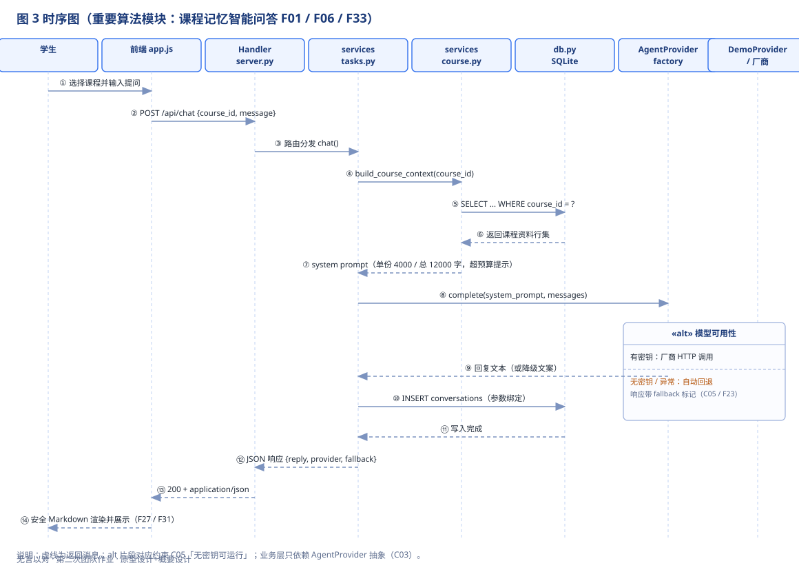
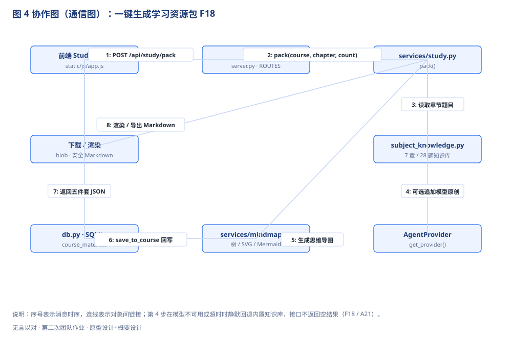
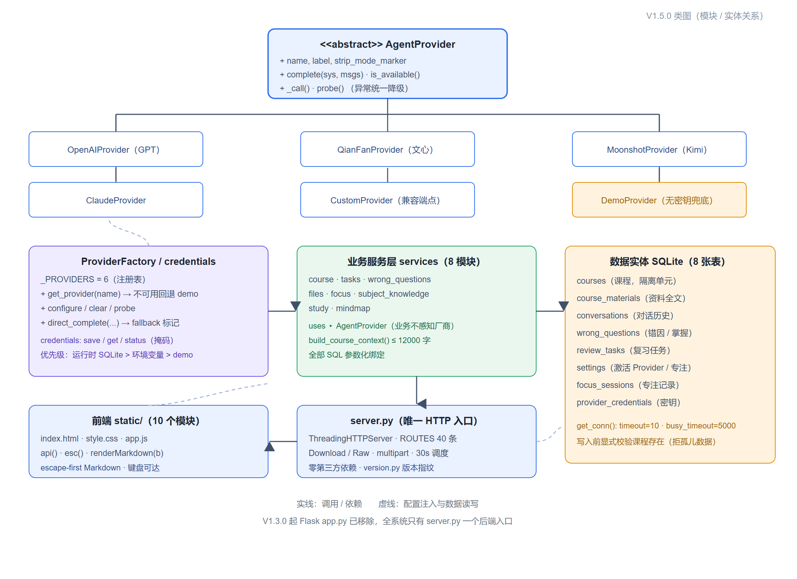
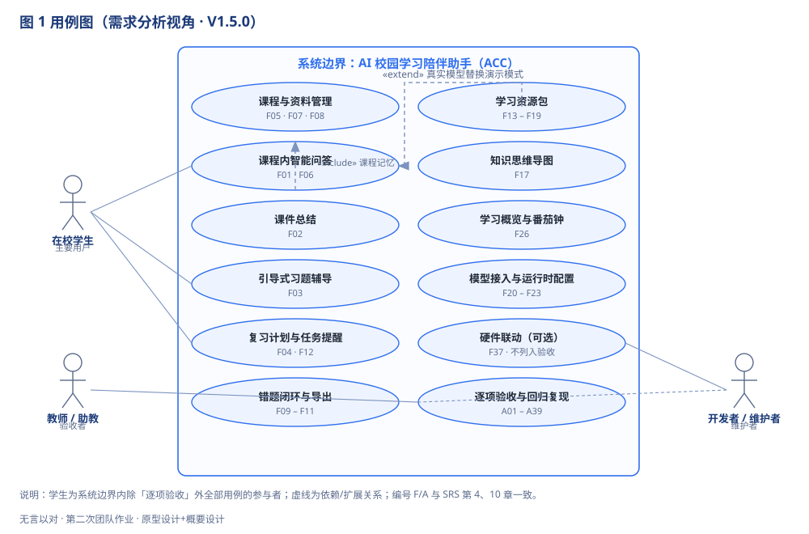
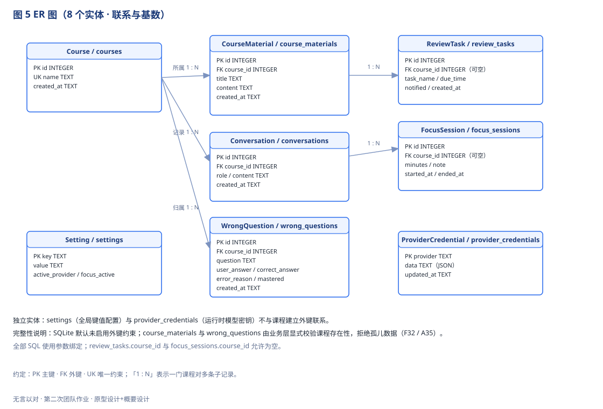

# 无言以对_系统设计说明书

**AI 校园学习陪伴助手（ACC）**

文档类别：系统设计说明书（SDD）　　版本：V1.0（对应产品 V1.5.0 验收基线）

编制单位：无言以对队　　编制日期：2026-11-09　　复核定稿：2026-11-21

编写依据：GB/T 8567-2006《计算机软件文档编制规范》、GB/T 9385-2008《计算机软件需求说明编制指南》

---

## 文档控制信息

| 项 | 内容 |
|---|---|
| 文档名称 | 无言以对_系统设计说明书 |
| 产品标识 | AI 校园学习陪伴助手 / AI Campus Learning Companion / 缩写 ACC |
| 对应产品版本 | `version.py` 中 `APP_VERSION = "1.5.0"`，即《软件需求规格说明书》V1.5.0 验收基线 |
| 文档状态 | 第二次团队作业交付稿（概要设计层，含关键模块详细设计） |
| 编制 / 审核 | 无言以对队：陈明凯（3124004503，后端与质量保障）、邓文炜（3124004505，前端与交互体验） |
| 上游文档 | `docs/软件需求规格说明书.md`（V1.5.0，下称 SRS） |
| 配套文档 | 《无言以对_数据库设计说明书》 |
| 同源维护 | 本 Markdown 为正文单一源，`docs/第二次团队作业/build_docs.py` 生成同名 PDF；图源在 `docs/第二次团队作业/assets/` |

> 本文只描述 V1.5.0 中已在代码或测试结果中可核验的结构与行为。凡未实机验证、依赖外部条件或明确排除的内容，一律写入第 10 章，不作设计承诺。文中 F / NFR / A 编号、模块名、表名与 SRS 逐字一致。

---

图 11　项目标志：以展开的书页与「AI」字样组合，体现「学习陪伴 + 智能体」的产品定位；配色为产品主色 `#2F6FED`，与前端 CSS 变量 `--primary` 及本文全部图表保持一致。

## 1 引言

### 1.1 编写目的

把第一次团队作业已确定的选题、需求分析与系统规划，转化为可指导实现与可对照验收的设计说明：自顶向下给出系统的层次划分、功能模块、运行逻辑、接口、关键算法与数据落地方式，并用统一的 UML 图与文字说明把「需求 → 设计 → 实现 → 验收」串成可追溯的链。本文读者为课程验收教师、助教及后续维护者。

本次作业不安排现场答辩，交付重心为设计文档。由于第一次作业阶段已交付可运行系统与核心功能流程，本文是在既有实现上做的规范化设计沉淀，**不引入新的功能需求、不改变架构选型**。

### 1.2 范围

覆盖 ACC 的接入层、业务服务层、智能体层、数据层、前端交互层与可选硬件层，以及 40 条 REST 接口、37 项功能需求（F01 – F37）与 39 项自动化验收标准（A01 – A39）的设计归属。数据库的字段级设计见《无言以对_数据库设计说明书》。不覆盖生产级高可用、多租户、权限体系与性能 SLA（见第 10 章）。

### 1.3 术语、定义与缩略语

本文及配套文档中出现的缩写，均以下表为准；正文首次出现时不再另行解释。

| 缩写 / 术语 | 定义 |
|---|---|
| ACC | AI Campus Learning Companion，本项目「AI 校园学习陪伴助手」的产品缩写 |
| SRS | 软件需求规格说明书（Software Requirements Specification），本文上游文档 |
| SDD | 系统设计说明书（Software Design Document），本文 |
| DBDS | 数据库设计说明书，本文配套文档 |
| Fxx / NFR-xx / Axx | 功能需求 / 非功能需求 / 自动化验收标准编号，取自 SRS 第 4、7、10 章 |
| C01 – C07 | 设计与实现约束编号，取自 SRS 3.4 |
| Provider | 通过 HTTP 接口接入的大模型能力，统一抽象为 `AgentProvider`；本系统含 6 个实现 |
| 演示模式 | `DemoProvider`，无密钥或调用异常时的规则化应答与内置知识库作答，**不是真实大模型推理** |
| 课程记忆 | 按 `course_id` 隔离、由该课程已上传资料拼接而成的智能体 system prompt 上下文，非向量检索 |
| 上下文预算 | 单份资料 4000 字、总量 12000 字的上限，由 `MAX_CONTEXT_CHARS` 控制 |
| 错题闭环 | 录入错题 → 错因分析 → 定向变式题 → 标记掌握 → 导出 |
| 学习资源包 | 针对某一教材 / 章节生成的题目、总结、专题文章、资料清单与思维导图五件套 |
| 安全 Markdown | escape-first 渲染策略：先转义 HTML 元字符，再做 Markdown 标记替换，杜绝 XSS |
| 孤儿数据 | 外键未启用时写入的、指向不存在课程 ID 的资料或错题 |
| B/S | 浏览器 / 服务器（Browser / Server）架构 |
| API / REST | 应用程序编程接口 / 表述性状态转移风格的 HTTP 接口 |
| HTTP / HTTPS / JSON | 超文本传输协议 / 其安全版本 / JavaScript 对象表示法（数据交换格式） |
| CRUD | 创建、读取、更新、删除（Create / Read / Update / Delete） |
| SQL / DDL / DML | 结构化查询语言 / 数据定义语言 / 数据操作语言 |
| PK / FK / UK | 主键 / 外键 / 唯一约束 |
| ER / UML | 实体—联系图 / 统一建模语言 |
| SVG / PNG / CSS / HTML / JS | 可缩放矢量图形 / 便携式网络图形 / 层叠样式表 / 超文本标记语言 / JavaScript |
| UI / IDE | 用户界面 / 集成开发环境 |
| XSS / RAG | 跨站脚本攻击 / 检索增强生成（本系统**未**采用） |
| SQLite | 本系统使用的嵌入式关系数据库，文件 `data/companion.db` |
| `ROUTES` | `server.py` 中「HTTP 方法 / 正则路径 / 处理函数」三元组构成的路由表 |
| `Download` / `Raw` | `Handler` 支持的两种非 JSON 返回值：附件下载 / 原样字节输出 |
| Webhook / ESP32 | 基于 HTTP 回调的联动方式 / 本项目可选硬件开发板 |
| NFR | 非功能需求（Non-Functional Requirement） |

### 1.4 参考资料

1. GB/T 8567-2006《计算机软件文档编制规范》
2. GB/T 9385-2008《计算机软件需求说明编制指南》
3. `docs/软件需求规格说明书.md`（V1.5.0 验收基线）
4. 项目源码：`server.py`、`db.py`、`config.py`、`version.py`、`launch.py`、`agents/`、`services/`、`hardware/`、`static/`
5. 验证脚本与结构化结果：`docs/startup_check.py`、`demo_check.py`、`feature_check.py`、`study_check.py` 及对应 `*_results.json`
6. 过程报告：`docs/自我检查报告.md`、`docs/演示验收报告.md`、`docs/模型接入接口说明.md`、`docs/硬件交互说明.md`
7. `README.md`（运行、部署、接口速览）

### 1.5 文档约定

- 图的序号为团队第二次作业交付物的**全局统一编号**，与团队博客随笔、DBDS 一致；本文只引用相关图，故序号不连续。表按章内顺序编号。
- 「已实现」指有对应代码与自动化验证；「可选（未实机）」指接口与固件齐备但未做物理联调；「不予承诺」指明确排除在验收之外。
- 接口路径中的 `{id}` 表示整数主键，实际路由以正则 `\d+` 匹配。
- 图内 F / A 编号、模块名与表名均与正文表格逐字一致；图中虚线表示依赖、扩展或返回消息，实线箭头表示调用或控制流。

---

## 2 总体设计

### 2.1 系统目标与设计原则

ACC 是面向大学生课程复习场景的轻量级 B/S 学习助手。目标不是「再做一个聊天页」，而是把大模型能力嵌入自研业务流程：按课程隔离的记忆上下文、围绕错题的闭环、按教材章节组织的学习资源包。系统按单机单用户课程作业原型定位。

| 约束 | 内容 | 在设计中的落点 |
|---|---|---|
| C01 单一后端 | V1.3.0 起移除 Flask `app.py`，只有 `server.py` 一个 HTTP 入口 | 2.3 接入层唯一；3.1 接口全表由一张 `ROUTES` 表分发 |
| C02 零第三方依赖 | 仅 Python 标准库；厂商调用用 `urllib`，multipart 手写，docx 用 `zipfile` + XML | 2.3 智能体层、4.2 文件服务 |
| C03 智能体嵌入自研系统 | 业务层只依赖 `AgentProvider` 抽象；课程记忆由服务层拼入 system prompt | 4.3、图 3 时序图 |
| C04 密钥不硬编码 | 环境变量或运行时 SQLite 配置；状态接口只返回掩码 | 4.3、6.1 |
| C05 无密钥可运行 | 任一 Provider 未配置或调用失败自动回退 `DemoProvider` | 图 3 `«alt»` 片段、7.2 |
| C06 前后端版本一致 | `version.py` 由 `/api/status` 暴露，`launch.py` 启动前探测 | 4.1、8.1 |
| C07 用户输入必须转义 | 进入 `innerHTML` 的动态内容先转义；SQL 全部参数化 | 4.5、6.1 |

### 2.2 运行环境

| 层次 | 环境 |
|---|---|
| 客户端 | 现代浏览器（Chrome / Edge 最佳）；语音输入依赖 Web Speech API |
| 后端 | Python 3.8+，仅标准库，无 `pip install` 步骤；`http.server.ThreadingHTTPServer` |
| 数据存储 | SQLite，文件 `data/companion.db`，首次启动由 `db.init_db()` 自动建表 |
| 本地启动 | `start.bat` → `launch.py` → `python server.py`；默认端口 5000，占用自动顺延；支持 `PORT` 环境变量 |
| 云端部署 | 平台注入 `PORT`；`startCmd: "python server.py"`，`installCmd: ""`；健康检查 `/api/status` |
| 可选硬件 | ESP32 + LED + 蜂鸣器，通过 `ESP32_ENDPOINT` 配置 |

### 2.3 总体结构（L0 → L1）

图 6　后端分层与请求分发设计图（L1 层次视图）。

图 8　系统架构（V1.5.0）：浏览器经 REST 访问单一入口 `server.py`；`Handler` 按 `ROUTES` 正则表分发到业务服务层；服务层按需调用可插拔智能体层；所有业务数据落到 SQLite（8 张表）；后台守护线程每 30 秒扫描到期复习任务并可向 ESP32 下发 Webhook。

系统自上而下分为六层，L0 为系统整体，L1 为下列层次，L2 为各层内的模块（见 2.4），L3 为关键模块的处理逻辑（见第 4 章与图 3 时序图）：

| 层 | 组成 | 职责 | 对外可见物 |
|---|---|---|---|
| 客户端层 | `static/index.html`、`style.css`、`app.js` | 10 个页面模块、主题、渲染与交互 | 浏览器 UI、URL hash |
| HTTP 接入层 | `server.py` 的 `Handler` 与 `ROUTES` | 请求分发、静态资源、multipart、下载与原始响应 | 40 条 REST 接口、`GET /`、`/static/*` |
| 业务服务层 | 8 个 `services/*.py` | 课程、问答、错题、文件、专注、学科知识、资源包、思维导图 | 服务函数 |
| 智能体层 | `agents/base.py`、`factory.py`、6 个 Provider、`credentials.py`、`http_client.py` | 模型能力抽象、装配、配置与降级 | `complete()`、`probe()` |
| 数据层 | `db.py` + SQLite 8 张表 | 持久化、连接管理、并发等待 | `data/companion.db` |
| 可选硬件层 | `hardware/esp32.py`、`esp32_firmware.ino` | 下行 Webhook 与上行状态看板 | `/api/hardware/*`、`/api/focus/state` |

侧路：后台守护线程 `threading.Thread(target=_scheduler, daemon=True)`，每 30 秒执行 `check_due_tasks()`；`srv.daemon_threads = True`。

### 2.4 功能模块划分（L1 → L2，自顶向下逐步细化）

图 9　功能思维导图（V1.5.0）：顶层「课程复习闭环」下分四条主线，共 37 项功能需求。

| L1 主线 | L2 模块 | 功能编号 | 主要接口 |
|---|---|---|---|
| 课程与资料 | 课程与资料管理、课程记忆绑定与隔离、上传解析、全文查看与下载 | F05 – F08、F33 | `/api/courses*`、`POST /api/chat` |
| 理解与练习 | 智能问答、课件总结、引导式辅导、课件文件上传 | F01 – F03、F08 | `/api/chat`、`/api/summarize`、`/api/tutor` |
| 计划与执行 | 复习计划、复习任务与到点提醒、番茄钟、学习概览 | F04、F12、F26 | `/api/review-plan`、`/api/review-tasks*`、`/api/overview` |
| 复盘与产出 | 错题闭环、学科目录、自测题、总结、文章与资料、思维导图、一键全套与导出 | F09 – F11、F13 – F19 | `/api/wrong-questions*`、`/api/study/*` |
| 运行支撑 | 六类可插拔智能体、运行时配置、连通性自检、自动回退、主题、语音、安全 Markdown、忙碌态、键盘可达 | F20 – F25、F27 – F29 | `/api/agent/*`、`/api/providers` |
| 健壮性 | 接口异常降级、XSS 防护、孤儿数据拦截、切课竞态、异常路径兜底、导出解析健壮 | F30 – F36 | 全接口 |
| 可选硬件 | ESP32 双向联动 6 个交互点 | F37 | `/api/hardware/*`、`/api/focus/state` |

前端 10 个模块与后端 8 个服务模块的逐项分解分别见 4.5 与 4.2；40 条接口与模块的归属见 3.1。

### 2.5 运行逻辑与处理流程

图 2　活动图（业务流程）：选择 / 新建课程 → 上传或粘贴课件资料 → 资料校验判定 → 生成课程记忆上下文 → 三条并行活动 → 汇聚生成复习计划与任务 → 30 秒定时扫描提醒 → 标记掌握与导出 → 结束。校验不通过只返回提示并允许重新上传，不中断主流程。

四条主要数据流（SRS 3.7）：

1. **问答流**：选择课程 → `build_course_context(course_id)` 拼出带预算的课程记忆 → 作为 system prompt 交给 `get_provider(...).complete(...)` → 回复经安全 Markdown 渲染 → 对话写入 `conversations`。
2. **资料流**：粘贴或上传 → 后端校验课程存在、类型白名单、2 MB 与 2 万字限制 → 解析文本写入 `course_materials` → 后续问答自动引用；前端可展开全文或下载 `.md`。
3. **错题流**：录入 → `analyze` 生成错因与变式题 → 标记 `mastered` → 概览掌握率聚合 → 导出 Markdown。
4. **资源包流**：教材 / 章节 / 题量 → 内置结构化知识库（或叠加模型原创内容）→ 五件套 → 前端渲染 / 导出 / 可选回写课程记忆。

### 2.6 需求向设计的分配

| 需求组 | 承载层 | 设计章节 |
|---|---|---|
| F01 – F08、F33 | 业务服务层 `course.py` / `tasks.py` / `files.py` + 智能体层 + 数据层 | 4.2、4.3、图 3 |
| F09 – F12 | `wrong_questions.py`、`focus.py`、后台调度 | 4.2、4.6 |
| F13 – F19 | `study.py`、`subject_knowledge.py`、`mindmap.py` | 4.2、图 4 |
| F20 – F23 | `agents/` 全部模块 | 4.3 |
| F24 – F29 | 前端交互层 | 4.5 |
| F30 – F36 | 跨层：前端降级、服务层校验、数据层并发 | 第 6、7 章 |
| F37 | 可选硬件层 | 3.4、图 7 |

---

## 3 接口设计

### 3.1 外部接口：REST 全表（40 条）

以下 40 条路由全部由 `server.py` 的 `ROUTES` 正则表定义并分发，是本系统唯一的对外 HTTP 接口集合（另有 `GET /` 与 `/static/*` 静态资源）。

| # | 方法 | 路径 | 说明 | 归属模块 |
|---|---|---|---|---|
| 1 | GET | `/api/status` | 版本指纹、激活 Provider、Provider 列表 | 接入层 / `agents` |
| 2 | GET | `/api/providers` | 厂商状态列表 | `agents/factory.py` |
| 3 | POST | `/api/settings/provider` | 切换当前 Provider | `agents/factory.py` |
| 4 | GET | `/api/courses` | 课程列表 | `services/course.py` |
| 5 | POST | `/api/courses` | 新建课程 | `services/course.py` |
| 6 | GET | `/api/courses/{id}/materials` | 课程资料列表（含全文） | `services/course.py` |
| 7 | POST | `/api/courses/{id}/materials` | 新增资料 | `services/course.py` |
| 8 | POST | `/api/chat` | 课程记忆问答 | `services/tasks.py` |
| 9 | POST | `/api/summarize` | 课件总结 | `services/tasks.py` |
| 10 | POST | `/api/tutor` | 引导式辅导 | `services/tasks.py` |
| 11 | POST | `/api/review-plan` | 复习计划 | `services/tasks.py` |
| 12 | GET | `/api/wrong-questions` | 错题列表（课程与掌握状态过滤） | `services/wrong_questions.py` |
| 13 | POST | `/api/wrong-questions` | 新增错题 | `services/wrong_questions.py` |
| 14 | POST | `/api/wrong-questions/{id}/analyze` | 错因分析 + 变式题 | `services/tasks.py` |
| 15 | POST | `/api/wrong-questions/{id}/master` | 标记掌握 | `services/wrong_questions.py` |
| 16 | POST | `/api/review-tasks` | 创建复习任务 | `services/focus.py` |
| 17 | GET | `/api/review-tasks` | 待复习任务列表（含课程名） | `services/focus.py` |
| 18 | POST | `/api/review-tasks/{id}/done` | 标记任务完成 | `services/focus.py` |
| 19 | POST | `/api/hardware/test` | 下发 ESP32 测试提醒 | `hardware/esp32.py` |
| 20 | POST | `/api/courses/{id}/materials/upload` | multipart 课件上传 | `services/files.py` |
| 21 | GET | `/api/wrong-questions/export` | 导出错题本 Markdown | `services/wrong_questions.py` |
| 22 | GET | `/api/overview` | 学习概览统计 | `services/focus.py` |
| 23 | GET | `/api/focus/sessions` | 专注记录列表 | `services/focus.py` |
| 24 | POST | `/api/focus/sessions` | 新增专注记录 | `services/focus.py` |
| 25 | POST | `/api/focus/state` | 设置专注状态并推送硬件 | `hardware/esp32.py` |
| 26 | GET | `/api/hardware/status` | 学习状态看板（供 ESP32 轮询） | `hardware/esp32.py` |
| 27 | GET | `/api/study/catalog` | 学科目录 | `services/subject_knowledge.py` |
| 28 | POST | `/api/study/quiz` | 生成自测题 | `services/study.py` |
| 29 | POST | `/api/study/summary` | 生成复习总结 | `services/study.py` |
| 30 | POST | `/api/study/article` | 生成专题文章 | `services/study.py` |
| 31 | POST | `/api/study/resources` | 生成资料清单 | `services/study.py` |
| 32 | POST | `/api/study/mindmap` | 生成思维导图（JSON / SVG / 大纲 / Mermaid） | `services/mindmap.py` |
| 33 | POST | `/api/study/pack` | 一键生成全套，可回写课程记忆 | `services/study.py` |
| 34 | GET | `/api/study/mindmap.svg` | 直接返回 SVG 图片 | `services/mindmap.py` |
| 35 | GET | `/api/study/pack/export` | 导出全套 Markdown | `services/study.py` |
| 36 | GET | `/api/agent/providers` | 模型列表、配置状态与掩码 | `agents/credentials.py` |
| 37 | POST | `/api/agent/credentials` | 运行时写入密钥并可即时切换 | `agents/credentials.py` |
| 38 | POST | `/api/agent/credentials/clear` | 清除配置并回退演示模式 | `agents/credentials.py` |
| 39 | POST | `/api/agent/test` | `validate` 校验 / `probe` 真实探针 | `agents/factory.py` |
| 40 | POST | `/api/agent/complete` | 通用模型透传，供自建系统调用 | `agents/factory.py` |

通信约定：

| 项 | 约定 |
|---|---|
| 请求 / 响应 | JSON，`Content-Type: application/json; charset=utf-8`；上传 `multipart/form-data`；下载 `Content-Disposition: attachment` |
| 缓存 | 动态接口 `Cache-Control: no-store` |
| 跨域 | `Access-Control-Allow-Origin: *`，允许 `GET, POST, OPTIONS`，允许头 `Content-Type` |
| 200 | 成功，返回业务对象 |
| 400 | 参数校验失败（空课程名、空资料、课程不存在、非法文件类型、超大小限制、未知 Provider 等） |
| 404 | 未知路径 |
| 异常 | `complete()` 捕获厂商异常并返回降级文案，不向上抛 5xx；前端 `api()` 归一化 `res.ok`、`null` 与非 JSON 响应 |
| 文件下载 | 错题本、资源包、思维导图 SVG 走 `Download` / `Raw` 响应分支 |

### 3.2 内部接口

| 接口 | 调用方 → 被调方 | 契约 |
|---|---|---|
| `get_provider(name)` | `services/tasks.py` → `agents/factory.py` | 返回 `AgentProvider` 实例；未知名称或不可用时回退 `demo` |
| `AgentProvider.complete(system_prompt, messages)` | 业务层 → 智能体层 | 返回回复文本；内部捕获全部异常并降级 |
| `build_course_context(course_id)` | `services/tasks.py` → `services/course.py` | 返回带预算裁剪的 system prompt 文本 |
| `get_conn()` | 全部服务模块 → `db.py` | 返回 `sqlite3.Row` 连接，`timeout=10`、`PRAGMA busy_timeout=5000` |
| `check_due_tasks()` | 后台线程 → `services/focus.py`、`hardware/esp32.py` | 每 30 秒扫描 `review_tasks` 并按需下发 |
| `downloadFromUrl()` | 前端 → `GET /api/*/export` | `fetch` + blob + `URL.createObjectURL`，失败不替换页面 |

### 3.3 用户界面接口

单页应用：顶栏（品牌、当前智能体徽标、主题切换）、10 个导航按钮、10 个 `section.panel`、全局课程选择条。URL hash 直达（如 `/#study`）；`/?autopack=1#study` 打开即自动生成全套资源。10 个模块的页面元素与交互规则见团队博客随笔 1.2 与 1.4，本文不重复展开。

### 3.4 硬件接口（可选）

图 7　硬件原型连接图：前端「硬件联动」页 ↔ `server.py` 的 `/api/hardware/*` 与 `/api/focus/state` ↔ Wi-Fi / HTTP Webhook ↔ ESP32 固件 ↔ LED / 蜂鸣器；6 个交互点为任务到点提醒、手动测试提醒、番茄钟提醒、专注状态灯、学习状态看板、通用消息下发预留。未配置 `ESP32_ENDPOINT` 时接口返回 `{sent: false, reason: ...}`，不抛异常、不影响主体功能。

**判定（按作业原文措辞）**：作业要求为「硬件原型照片**或连接图**」，二者择一即可；本节图 7 为自绘连接图，已满足该项。**边界**：图 7 只表达接口与连接设计，`hardware/esp32.py` 与 `esp32_firmware.ino` 齐备，但 ESP32 未实机联调，物理声光效果未验证（F37 为可选项、不列入验收）；连接图不得冒充实物照片，拍摄日期不得臆造。实物 / 接线照片属可选增强，不代填。详见《交付合规检查表与缺口清单》R04。

---

## 4 详细设计（L2 → L3）

### 4.1 接入层

`server.py` 是唯一 HTTP 入口。`ROUTES` 为「HTTP 方法 / 正则路径 / 处理函数」三元组列表；`Handler` 依次匹配，命中后把解析后的 JSON body、query 与正则捕获组交给处理函数。返回值支持普通 dict（序列化为 JSON）、`Download`（带附件）、`Raw`（SVG 原样输出）三种。静态资源与首页由单独分支处理。

本地启动链路：`start.bat` → `launch.py`（读取 `version.py` 版本，探测端口是否已有同版本服务；占用则顺延 5001、5002…）→ `python server.py` → 自动打开浏览器。云端由平台注入 `PORT` 并绑定 `0.0.0.0`。`/api/status` 返回 `version`，启动器据此避免「页面新、接口旧」（C06）。

### 4.2 业务服务层（8 个模块）

| 模块 | 输入 | 处理 | 输出 | 异常与边界 |
|---|---|---|---|---|
| `course.py` | 课程名；资料标题与正文；`course_id` | 课程 CRUD、资料 CRUD、`build_course_context()` 按上传顺序拼接，单份截取前 4000 字，总量受 `MAX_CONTEXT_CHARS = 12000` 约束；无资料写「暂无资料」引导语 | 课程 / 资料列表、system prompt 文本 | 课程不存在返回 400「课程不存在，请先选择或新建课程」；空资料返回 400；超预算追加「共 N 份，已展示前 M 份」 |
| `tasks.py` | `system_prompt`、`message` / `messages` | 问答、总结、辅导、计划、错因、变式题；把课程记忆拼入 system prompt 后调用 `get_provider(...).complete(...)` | 结构化文本（按安全 Markdown 排版） | 只依赖 `AgentProvider` 抽象；厂商异常由 `complete()` 内部降级 |
| `wrong_questions.py` | 题干、我的答案、正确答案、`course_id`、筛选条件 | 列表 / 新增 / 分析 / 掌握 / 导出；概览按状态聚合掌握率 | 错题列表、错因与变式题、Markdown 附件 | 写入前显式校验课程存在；无错题时概览显示「暂无」而非 `0.0%`；列表字段全部转义 |
| `files.py` | multipart 文件 | 类型白名单 `.txt/.md/.markdown/.docx`、2 MB、2 万字；编码依次尝试 utf-8 / utf-8-sig / gb18030；docx 用 `zipfile` 读 `document.xml` 并 `html.unescape` 还原全部实体 | 纯文本正文 | 非法类型 / 超限返回 400 或截断；不做字符串拼接查询 |
| `focus.py` | 任务名、到期时间、专注分钟、课程 ID | 复习任务 CRUD、专注记录、学习概览六项统计聚合 | 任务列表、专注记录、概览 JSON | 参数化 SQL；空任务名回落「复习任务」并回传；`course_id` 可空 |
| `subject_knowledge.py` | 科目 / 章节 / 难度 / 题量 | 高等数学上册 7 章 × 4 题 = 28 道带标准答案与分步解析的题目；别名解析（「高数」） | 结构化知识库条目 | 未内置学科返回 `discipline=自定义科目` 并给来源提示 |
| `study.py` | 教材 / 章节 / 题量 / 难度 / `save_to_course` | 双路径：内置知识库始终可用；配置真实模型后以知识库为接地上下文追加原创内容并标记 `origin=llm` / `source=hybrid` | 题目、总结、文章、资料、思维导图五件套 | 模型未配置、超时、鉴权失败或返回非预期 JSON 时静默回退知识库，接口不返回空结果；`count` 后端钳制 |
| `mindmap.py` | 科目 / 章节 | 生成树 JSON、SVG、Markdown 大纲与 Mermaid 文本 | 四种表示 | 科目名转义；SVG 跟随主题变量 |

### 4.3 智能体层与关键算法模块

`AgentProvider`（`agents/base.py`）定义 `name` / `label` / `strip_mode_marker` 与 `is_available()`、`complete(system_prompt, messages)`、`_call()`、`probe()`；`complete()` 内建 `try/except`，任何厂商异常转成「已回退演示模式」文案。`factory._PROVIDERS` 注册 6 项：`openai`、`moonshot`、`claude`、`qianfan`、`custom`、`demo`。文心一言支持千帆 v2（Bearer）与旧版 WenxinWorkshop（OAuth 换 token）双模式；所有 HTTP 走标准库 `urllib`。

配置优先级：运行时 SQLite `provider_credentials` > `.env` 环境变量 > 内置演示模式。清除配置后若当前激活的是该 Provider，自动切回 `demo`。`status()` 输出掩码；`validate()` 检查必填项；`save()` 写 `provider_credentials`。`/api/agent/complete` 允许外部系统复用同一模型实例，`direct_complete()` 返回 `provider`、`requested_provider`、`model`、`fallback`、`latency_ms`。

图 3　时序图（重要算法模块：课程记忆智能问答 F01 / F06 / F33），14 条消息覆盖「选择课程 → 拼上下文 → 模型调用 → 落库 → 安全渲染」，`«alt»` 片段对应 C05 与 F23。业务层只依赖 `AgentProvider` 抽象，是 C03「智能体嵌入自研系统」的直接证据。

图 4　协作图（通信图）：一键生成学习资源包（F18）时 8 个对象之间的链接与 8 条编号消息，说明对象协作、消息传递与交互顺序；第 4 步静默回退内置知识库。

图 10　类图（V1.5.0）：`AgentProvider` 抽象与 6 个实现、`ProviderFactory` 与运行时配置中心、8 个业务服务模块、单一 HTTP 入口 `server.py`、8 张 SQLite 数据实体，以及前端 10 个模块之间的依赖与调用关系。

图 1　用例图（需求分析）：三类参与者与系统边界内 12 个用例；「课程内智能问答」`«include»`「课程与资料管理」，「模型接入与运行时配置」`«extend»`「课程内智能问答」。用例与 F / A 编号的对应关系见 2.6 与第 9 章。

### 4.4 数据层

`db.py` 的 `SCHEMA` 定义 8 张表；`get_conn()` 返回 `sqlite3.Row` 连接并设 `timeout=10`、`PRAGMA busy_timeout=5000`，应对 `ThreadingHTTPServer` 并发写；数据库文件 `data/companion.db`。字段级定义、ER 图、关系模式与实体类映射见《无言以对_数据库设计说明书》。

### 4.5 前端交互层

| 文件 | 职责 |
|---|---|
| `static/index.html` | 单页结构：顶栏、10 个导航按钮、10 个 `section.panel`、课程选择条；首屏内联防闪烁主题脚本 |
| `static/css/style.css` | CSS 变量主题系统、深浅色令牌、6 套主题色、`.md` 富文本排版、资料展开区、硬件清单表、`:focus-visible` 焦点样式 |
| `static/js/app.js` | API 封装、状态加载、事件绑定、渲染器、上传下载、主题、语音、番茄钟、思维导图与导出 |

关键机制：`api()` 统一检查 `res.ok` 并把 JSON `null` / 非 JSON / 空响应归一化为 `{error}`；`init()` **先 `bindEvents()` 再逐模块 `safe()` 加载**；`showApiError()` 统一失败提示并保留已填内容；`studyBusy(on, msg)` 统一忙碌态；`courseLoadSeq` 丢弃过期异步响应；`downloadFromUrl()` 用 blob 下载；`esc()` 转义 HTML 元字符；`mdEscape` → `mdInline` → `renderMarkdown` 实现 escape-first 安全 Markdown；`subjectHintText(r)` 依据 `discipline` 追加来源提示；`loadOverview` 处理空态语义。

无构建步骤、无框架、无 CDN 依赖；页面由 `server.py` 直接提供静态文件。

### 4.6 后台调度与硬件层

`threading.Thread(target=_scheduler, daemon=True)` 每 30 秒执行 `check_due_tasks()`，`srv.daemon_threads = True`。`esp32.py` 提供 `notify_esp32()`、`set_focus_state()`、`hardware_status()`、`check_due_tasks()`；固件监听 `/remind` 与 `/focus`。未配置 `ESP32_ENDPOINT` 时返回 `sent: false` 与原因，不抛异常。

---

## 5 数据结构与数据库设计（概要）

图 5　ER 图（8 个实体、联系与基数）。`Course` 与 `CourseMaterial`、`Conversation`、`WrongQuestion`、`ReviewTask`、`FocusSession` 均为 1 : N 联系；`Setting` 与 `ProviderCredential` 为独立全局实体。SQLite 默认未启用外键约束，资料与错题由业务层显式校验课程存在性，拒绝孤儿数据（F32 / A35）。

8 张表：`courses`、`course_materials`、`conversations`、`wrong_questions`、`review_tasks`、`settings`、`focus_sessions`、`provider_credentials`。关系模式、字段类型、约束、实体类与库表映射、DDL 全文、索引与并发设计见《无言以对_数据库设计说明书》。

---

## 6 非功能设计

### 6.1 安全性

- **输入转义**：所有进入 `innerHTML` 的动态内容先经 `esc()` / `mdEscape()`；注入串输出为转义文本而非活动标签（F31 / A34）。
- **SQL 注入防护**：全部 SQL 使用参数绑定，无字符串拼接查询（C07）。
- **密钥保护**：环境变量或运行时 SQLite 配置，状态接口只返回掩码；密钥不写日志、不落前端持久化（C04）。
- **上传白名单**：4 类扩展名、2 MB、2 万字；资料链接做协议白名单，拒绝 `javascript:` 等非白名单链接（F35）。
- **诚实边界**：`/api/agent/*` 公网未加鉴权，面向校内演示；生产化前需加登录 / Token（见第 10 章）。

### 6.2 可靠性与降级

`complete()` 捕获厂商异常并返回降级文案，不向上抛 5xx；前端 `init()` 逐模块 `safe()` 降级，故障后端下仍可切换标签、按钮可点击、徽标显示「智能体：状态不可用」（F30 / A33）。资源包双请求独立判错，任一失败给出明确文案且按钮恢复（F35 / A38）。

### 6.3 可用性与无障碍

深浅色三档与 6 套主题色；语音输入覆盖 5 处文本框，不支持时给降级提示；统计卡片与上传区补 `tabindex="0"`、`role="button"`、`aria-label`、Enter / Space 激活与 `:focus-visible` 样式（F24、F25、F29 / A27、A28、A32）。

### 6.4 可维护性

`version.py` 单一版本指纹；SRS 为需求单一源、本文为设计单一源、DBDS 为数据单一源，均由 Markdown 生成 PDF；接口、需求、验收通过第 9 章矩阵建立追溯；四套回归脚本与 JSON 结果随仓库留存。

---

## 7 出错处理与降级设计

| 故障点 | 系统行为 | 判定 |
|---|---|---|
| 任一 `/api/*` 返回错误 | 事件绑定已提前完成，逐模块提示，页面不整页变砖 | F30 / A33 |
| 课程不存在时写资料 / 错题 | 返回 400「课程不存在，请先选择或新建课程」 | F32 / A35 |
| 空课程名 / 空资料 / 空任务名 | 前两者返回 400；空任务名回落「复习任务」并回传 | A04、A15 |
| 非法文件类型 / 超 2 MB / 超 2 万字 | 拒绝或截断并给出明确文案 | A12 |
| 厂商未配置、超时、鉴权失败、非预期 JSON | 自动回退 `DemoProvider` 或内置知识库，响应带 `fallback` / `origin` 标记 | C05、F23、F18 |
| 上下文超预算 | 收敛到约 1.2 万字并追加「共 N 份，已展示前 M 份」提示 | F33 / A36 |
| 切课程时的慢响应 | `courseLoadSeq` 丢弃过期响应；切换时清空 `chatBox` | F34 / A37 |
| 导出失败 | blob 下载，只提示、不替换当前页面 | F36 / A39 |
| SQLite 并发写 | `timeout=10` + `PRAGMA busy_timeout=5000` | F36 |
| 未配置 `ESP32_ENDPOINT` | 返回 `{sent: false, reason: ...}`，不影响主体 | F37 |

---

## 8 系统配置、部署与运行

- 本地：`start.bat` → `launch.py` → `python server.py`；默认端口 5000，显式设置 `PORT` 时严格绑定，本地占用自动顺延。
- 云端：`Procfile` 声明 `web: python server.py`；`render.yaml` 为 Blueprint；实际部署参数 `startCmd: "python server.py"`、`installCmd: ""`。
- 健康检查：`GET /api/status` 返回 `version = 1.5.0`、`active_provider = demo`、`providers` 长度 6。
- 零依赖是可验收事实：`requirements.txt` 仅含说明性注释，无 pip 安装项。
- 复现命令与线上 `BASE_URL` / `SHARECODE` 见 SRS 10.6。

---

## 9 需求—设计—验收追溯矩阵

| 需求 | 设计落点 | 接口 | 验收 | 证据 |
|---|---|---|---|---|
| F01、F06、F33 课程记忆问答 | 4.2 `course.py` / `tasks.py`、4.3 智能体层、图 3 | `POST /api/chat` | A05、A06、A36 | `demo_results.json`、`study_results.json` |
| F05、F07、F08 资料管理 | 4.2 `course.py` / `files.py`、4.5 前端 | `/api/courses/*/materials*` | A10 – A12 | `feature_results.json`、线上 DOM 复验 |
| F02、F03、F04 总结 / 辅导 / 计划 | 4.2 `tasks.py` | `/api/summarize`、`/api/tutor`、`/api/review-plan` | A07 – A09 | `demo_results.json` |
| F09 – F12 错题与任务 | 4.2 `wrong_questions.py` / `focus.py`、4.6 调度 | `/api/wrong-questions*`、`/api/review-tasks*` | A13 – A15 | `demo_results.json` |
| F13 – F19 学习资源包 | 4.2 `study.py` / `subject_knowledge.py` / `mindmap.py`、图 4 | `/api/study/*` | A16 – A22 | `study_results.json` |
| F20 – F23 智能体接入 | 4.3 智能体层、图 10 | `/api/agent/*`、`/api/providers` | A23 – A26 | `study_results.json`、`模型接入接口说明.md` |
| F24 – F29 体验与无障碍 | 4.5 前端交互层 | 前端 | A27 – A32 | `feature_results.json`、`docs/ui/*.png` |
| F30 – F36 健壮性 | 第 6、7 章 | 全接口 | A33 – A39 | `自我检查报告.md` 第十节 |
| F37 硬件联动 | 3.4、4.6、图 7 | `/api/hardware/*`、`/api/focus/*` | 不列入验收 | `硬件交互说明.md` |

V1.5.0 实测：`startup_check.py` 26/26、`demo_check.py` 26/26 请求 + 30/30 断言、`feature_check.py` 19/19、`study_check.py` 本地 36/36；线上前三项同，线上 `study` 25/25（跳过 11 项需本机模拟厂商端点的探针，这 11 项已在本地完整验证）。证据文件为 `docs/*_results.json` 及 `_线上` 副本。

---

## 10 范围边界与不予承诺

| 项 | 现状 | 影响 |
|---|---|---|
| 真实厂商模型调用 | 6 个 Provider 的鉴权、请求体、响应解析、失败降级链路均以本机临时模拟端点验证；本机与线上均无真实 API Key | 不得声称「已实测官方接口」 |
| 演示模式 | 规则化应答 + 内置知识库，不是大模型推理 | 问答深度有限，但流程完整可验收 |
| 课程记忆 | 全文拼接，非 RAG / 向量检索 | 长课件受 12000 字总预算约束 |
| 学科知识库 | 仅「高等数学上册」为完整 7 章结构化数据 | 不承诺全学科覆盖 |
| ESP32 联动 | 6 个交互点、固件与服务端接口齐备，未实机联调 | 不承诺物理声光效果 |
| 课程资料删除 | 后端无 DELETE 路由 | 无法在线删除资料 |
| 公网配置接口 | `/api/agent/*` 未加鉴权，面向校内演示 | 生产化前需加登录 / Token |
| 多用户 | 无登录、无权限、单机单库 | 按单用户原型说明 |
| 部署数据覆盖 | 部署工具整目录上传，`data/companion.db` 会覆盖线上数据 | 发布前需同步线上数据 |
| GitHub 远端 | 2026-11-21 复核：本地 85 次提交（`git rev-list --count HEAD`），`git shortlog -sne HEAD` 仅 `kecit33` 一个账号；`gh api` 实测远端 `main` HEAD `3006b32dd`（2026-11-05）、远端贡献者仅 `kecit33`（49 次）、PR 0、Issue 0；`git merge-base HEAD origin/main` 为空 | 【重点 · R10】远端落后且两段历史无共同祖先，普通 `git push` 会被拒绝；须先合并历史或重建远端，并补齐两名队员账号 |

明确不予承诺：生产级高可用、性能 SLA、多租户隔离、数据备份与恢复策略、移动原生客户端、第三方平台账号代操作、模型输出内容的绝对正确性。

---

## 附录 A　图清单与符号约定

| 图号 | 图名 | 文件 | 本文引用 |
|---|---|---|---|
| 图 1 | 用例图（需求分析） | `assets/用例图.svg` | 4.3 |
| 图 2 | 活动图（业务流程） | `assets/活动图.svg` | 2.5 |
| 图 3 | 时序图（课程记忆问答） | `assets/时序图.svg` | 2.1、4.3 |
| 图 4 | 协作图（资源包生成） | `assets/协作图.svg` | 2.4、4.3、第 9 章 |
| 图 5 | ER 图 | `assets/ER图.svg` | 第 5 章 |
| 图 6 | 后端分层与请求分发设计图 | `assets/后端分层图.svg` | 2.3 |
| 图 7 | 硬件原型连接图 | `assets/硬件连接图.svg` | 3.4、4.6 |
| 图 8 | 系统架构图 | `assets/系统架构图.png` | 2.3 |
| 图 9 | 功能思维导图 | `assets/思维导图.png` | 2.4 |
| 图 10 | 类图 | `assets/类图.png` | 4.3 |
| 图 11 | 项目标志 | `assets/项目标志.png` | 文档控制信息（产品标识） |

符号约定：UML 图中实线箭头为调用 / 控制流，虚线箭头为依赖、扩展或返回消息；`«include»` / `«extend»` / `«alt»` 为 UML 标准构造型；活动图圆角矩形为活动、菱形为判定、实心圆与双圆为开始与结束；ER 图中 PK 为主键、FK 为外键、UK 为唯一约束，`1 : N` 表示一对多联系。

---

## 附录 B　待补事项清单

| 项 | 状态 |
|---|---|
| 墨刀原型工程与在线预览地址 | ✅ 已按 V1.5.0 建立墨刀在线工程（16 页交互版，2026-11-21 21:18 写入并复核（分享链接同该地址））：`https://modao.cc/proto/design/pb2mcpVbc0AcCTz0QuMv`；本地单一源 `gen_modao_v150.py` / `modao_v150/html_list.json` / `原型需求核对表.md`（见博客 1.1、1.2.2）。R01 已完成；【重点 · R02】访问密码未提供 |
| 硬件原型照片或连接图 | ✅ 图 7 连接图已满足作业原文择一措辞；实物照片为可选增强，不代填 |
| 团队分工记录（书面说明） | ✅ 见博客 3.2 / 3.3，无缺口 |
| 逐人 GitHub 贡献记录 | 【重点 · R10】仓库级实测已核验（本地 85 / 远端 49 / PR 0 / Issue 0；两段历史无共同祖先，2026-11-21 复核快照）；【待填写：两名队员账号与逐人统计】 |
| 作业课程、班级与作业要求链接 | 【重点 · R11】【待填写：课程名称、班级链接、作业要求链接】 |
| 两份 PDF 的云盘下载地址 | 【重点 · R03】【待填写：蓝奏云 / 百度网盘 / 微云 链接与提取码】 |
| 3 张原型页截图与后台管理原型 | ✅ 3 张真实界面截图 + 6 张同源原型页图（含 2 张后台管理页）已补入博客 1.2.1 / 1.2.2 / 1.3；M01 – M05 共 5 页后台管理原型已补齐（作业未要求「独立后台站点」）；16 页交互版（含 M01 – M05）已写入墨刀并复核，另有 `modao_v150/交互走查版.html` 提供浏览器本地可交互走查 |

> 本附录各项的**缺口、原因与需补充内容**逐项列于同目录《交付合规检查表与缺口清单》第 2 节（编号 R01 – R08、R10 – R12，R09 已删除）。本文不填写任何推测的链接、密码、提取码、日期、账号或统计数字。
