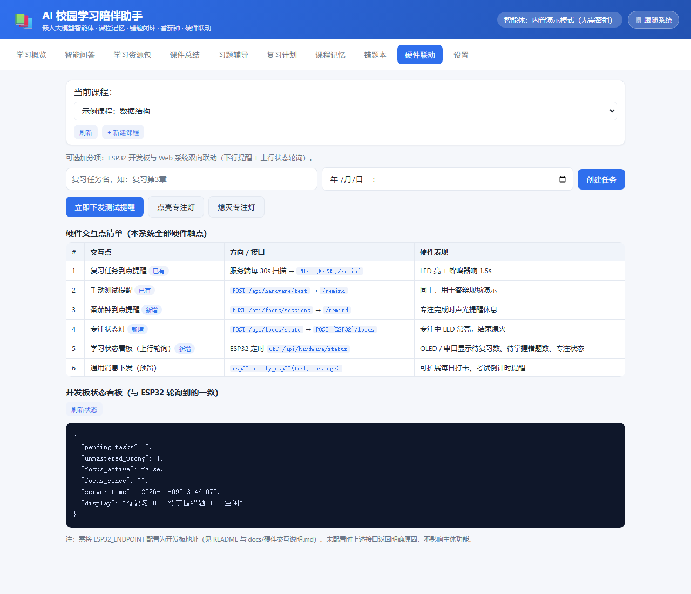
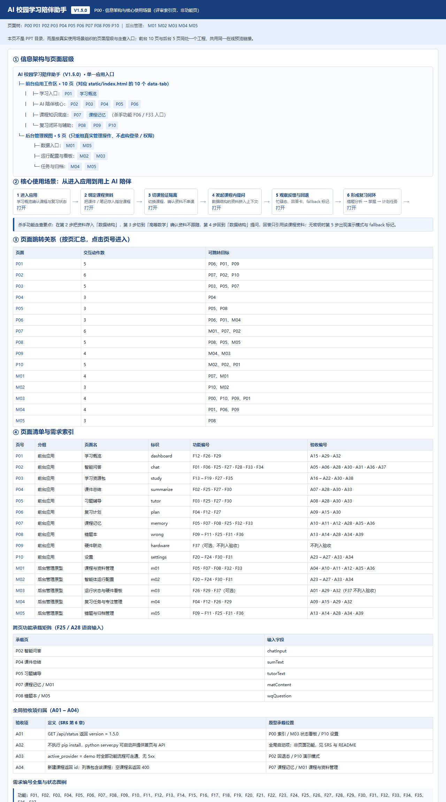
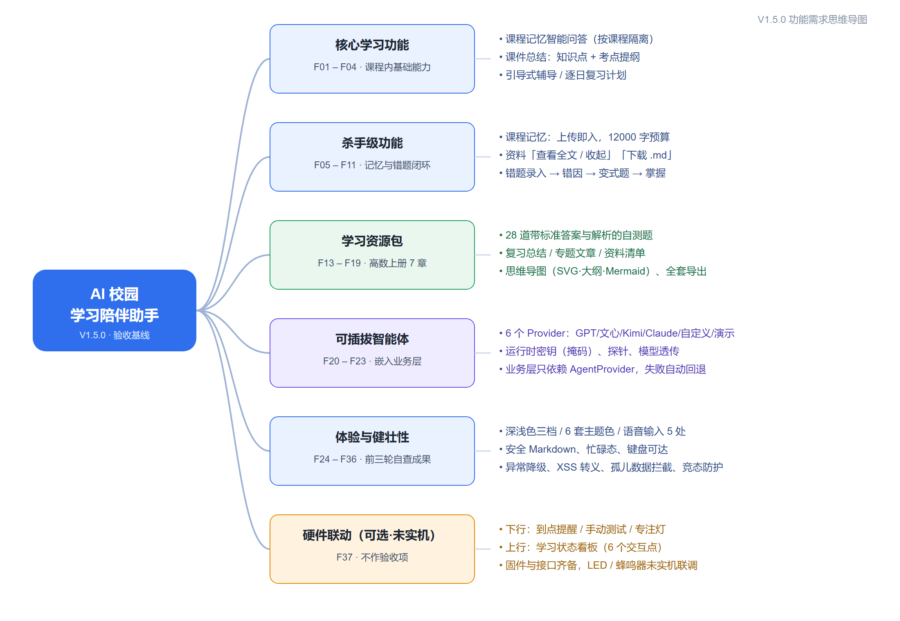
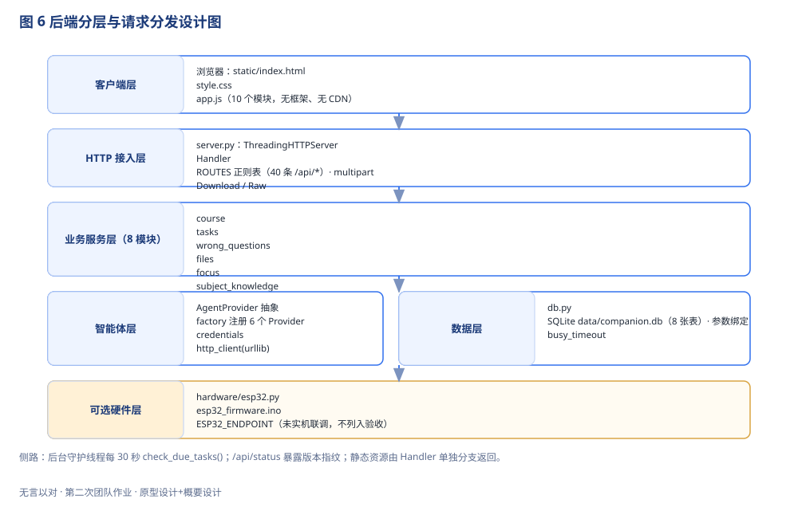
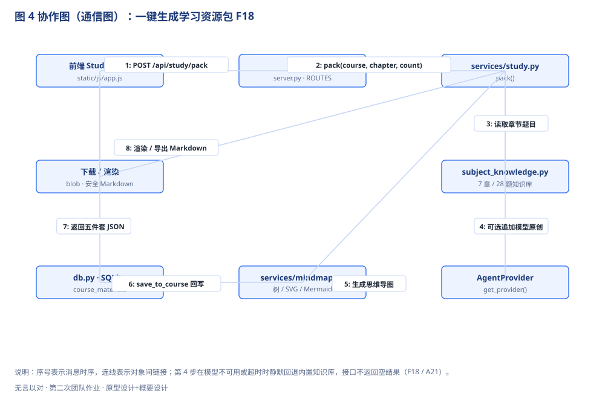

# 无言以对第二次团队作业——原型设计+概要设计

> 队名：无言以对　｜　项目：AI 校园学习陪伴助手（ACC）　｜　版本基线：V1.5.0　｜　编制日期：2026-11-09　｜　复核定稿：2026-11-21
> 本次作业不安排现场答辩，交付重心为设计文档与可核验的原型、概要设计成果。全文按「作业信息表 → 原型设计（40%）→ 概要设计（40%）→ 团队协作记录（20%）→ 交付地址 → 合规速览」组织。
> 核验仅以作业要求明写条目为依据：原文写「照片或连接图」「前台应用与后台管理原型」，故以连接图与同工程后台管理页满足，不额外要求实物照片或独立后台站点。未提供、无法生成或无法核验者统一标【重点】并写明缺口、原因与需补充内容；正文对应位置以【重点 · Rxx】【待填写：…】双标注，编号 R01 – R12 与同目录《交付合规检查表与缺口清单》（简称「合规检查表」）一致。

## 0 作业信息表

| 项 | 内容 |
|---|---|
| 作业所属课程及班级链接 | 【重点 · R11】【待填写：课程名称、班级、班级博客或课程主页链接】 |
| 作业要求链接 | 【重点 · R11】【待填写：第二次团队作业要求博文链接】 |
| 你理解的作业目标具体内容 | 在第一次团队作业已确定的选题、需求分析与系统规划基础上，把「已经跑起来的系统」反向沉淀为规范设计产物：① 用原型固定前台应用与后台管理的界面、交互、文本与业务规则，形成可在线预览、可对照走查的界面基线；② 用概要设计自顶向下说明模块划分与运行逻辑，以用例图、活动图、类图、时序图、协作图、ER 图与后端设计图串起「需求 → 结构 → 数据 → 运行」；③ 用按周计划表、逐人分工表与协作记录说明分工与推进。本次不新增功能，只求设计表达与已实现系统逐字一致、图文编号一致、缩略语与符号事先定义、无推测性承诺。 |
| 团队名称 | 无言以对 |
| 团队成员学号-名字 | 3124004503-陈明凯；3124004505-邓文炜 |
| 队长及发布账号 | 【重点 · R12】【待填写：队长姓名、博客园 / 语雀等发布账号与本文发布链接】 |
| 本次交付形态 | 团队博客随笔 1 篇 + 《无言以对_系统设计说明书.pdf》 + 《无言以对_数据库设计说明书.pdf》 + 原型在线预览 + 仓库提交清单 |

### 0.1 推进策略：原型与核心流程尽早完成，为杀手级功能留出时间

第一次作业期间已于 2026-11-05 完成「选题 → 需求与架构 → 核心流程 → 可运行系统上线」闭环（V0.5 确定功能分解与 SQLite 数据模型，V0.8 打通课程记忆问答、课件总结、习题辅导、复习计划、错题闭环，V1.0 发布公网地址），11-06 收敛为单一零依赖后端并完成三轮自查，11-08 统一答辩材料与文档口径。因此本次开始时，前台 10 个模块、40 条接口、8 张表与四套回归脚本均已可点、可测、可截图，只需规范化为原型说明与概要设计，不存在「文档写了但系统没有」的风险。省下的时间持续投入杀手级功能课程记忆绑定与隔离（F06 / F33）：V1.4.1 补齐资料全文查看与下载并修复列表注入，V1.5.0 加入单份 4000 字、总量 12000 字上下文预算，将 20 份 × 1 万字压力场景从 80351 字收敛到 12160 字。该能力是既有实现，不是本次新画的饼。

### 0.2 缩略语、编号与图清单约定

| 缩写 / 符号 | 含义 |
|---|---|
| ACC / SRS / SDD / DBDS | AI Campus Learning Companion（本项目）/ 软件需求规格说明书 / 系统设计说明书 / 数据库设计说明书 |
| Fxx / Axx / Cxx / Rxx | 功能需求 / 验收项 / 设计与实现约束 / 本次交付缺口编号；Rxx 与合规检查表共用一套编号 |
| REST / API / JSON / SQL | HTTP 表述性状态转移风格接口 / 应用程序编程接口 / 数据交换格式 / 结构化查询语言 |
| ER / UML / UI | 实体—联系图 / 统一建模语言 / 用户界面 |
| XSS / RAG / Webhook | 跨站脚本攻击 / 检索增强生成（本系统未采用）/ 基于 HTTP 回调的联动 |
| ESP32 / Provider / DemoProvider | 可选硬件开发板 / 大模型能力抽象 / 无密钥时的规则化演示实现，不是真实大模型推理 |
| PR / Issue / ISO 周 | 拉取请求 / 议题 / 国际标准化组织公历周编号，不等于课程周次 |

图分三类独立编号：「图 N」为 UML 与系统设计图（图 1 – 图 10）；「截图 N」为 V1.5.0 真实运行界面（截图 1 – 截图 6）；「原型图 N」为墨刀同源原型页渲染图（原型图 1 – 原型图 6）。三套编号不与小节出现顺序绑定，完整图清单见两份说明书附录 A。

---

## 一、原型设计（权重 40%）

### 1.1 原型工具、形态与在线预览

| 项 | 内容 |
|---|---|
| 原型工具 | 墨刀（在线 Web 版，个人空间 / 默认团队）。源文件为 `gen_modao_v150.py` 生成的 **16 页可编辑 HTML**：`modao_v150/*.html` + 导入载荷 `modao_v150/html_list.json`，可完整重建并一键导入 |
| 页面范围 | P00 评审索引 + P01 – P10 前台 10 页 + M01 – M05 后台管理 5 页，共 16 页；前台 10 页与 `static/index.html` 的 `data-tab` 一一对应，后台 5 页只重组 V1.5.0 真实存在的管理操作 |
| 在线预览 | `https://modao.cc/proto/design/pb2mcpVaTJUOuaSf3x1X`（2026-11-09 18:47 导入实测返回，`imported_items` = 16；`get_proto_details` 复核 16 个画布）；16 页已全部上线 |
| 工程信息（实测） | 项目名「未命名原型」（导入时自动命名）；`个人空间` / `默认团队`；`project_cid` = `pb2mcpVaTJUOuaSf3x1X`；`prototype_key` = `pm2mcpVaTJUOusjkmDOH`；更新时间 2026-11-09 18:47 |
| 可运行系统 | `https://ai-campus-companion.app.workbuddy.host/?sharecode=CEUN7FBTFJ`（`sharecode` 为访问凭证，须原样保留）；浏览器直接打开，无需安装、无需 API Key |
| 截图来源 | `assets/界面_*.png` **10 张**（V1.5.0 真实运行界面）+ `assets/原型_*.png` **6 张**（原型页同源渲染，含 2 张后台管理页）；均为真实渲染，非示意图、非 AI 生成图；抓取记录见合规检查表 3.3 / 3.5 / 3.6 |
| 原型形态 | 每页含**界面线框**（按 `static/index.html` 真实结构绘制）、字段 / 组件 / 文案表、交互状态、业务流程、规则与边界、需求核对卡与页面互链（P00 → 逐页 → 下一页），可点击走查；页面名统一 `V1.5.0_页号_页面名(标识)`，组件统一 `v15-` 前缀 |
| 等价物边界 | 可运行系统可代替高保真原型走查，不能代替墨刀工程；`原型_*.png` 由与 `html_list.json` 同源的 HTML 本地渲染，不冒充墨刀客户端「导出图片」产物 |
| 残留缺口 | 【重点 · R02】访问密码未提供，不得臆造，【待填写：队长在墨刀分享面板设置后回填】。R01 已完成：16 页最终版已导入墨刀并复核，工程正式命名属可选优化、作业未要求 |

### 1.2 前台应用原型：10 个页面模块

单页应用 `static/index.html`：顶栏含品牌、当前智能体徽标与主题切换，左侧 10 个导航按钮对应右侧 10 个 `section.panel`；课程选择条全局生效；支持 hash 直达（如 `/#study`），`/?autopack=1#study` 打开即自动生成全套资源。「对应需求」列只列本页主责编号；跨页功能 **F25 / A28（语音输入）承载于 P02 / P04 / P05 / P07 / P08 五处输入框**，逐页标注见 1.2.2 承载矩阵与 `原型需求核对表.md`。

| # | 页面 / `data-tab` | 原型关键元素 | 主要交互 | 对应需求 | 截图 |
|---|---|---|---|---|---|
| 1 | 学习概览 `dashboard` | 6 项统计卡片、待复习任务快捷增删、番茄钟、最近专注记录 | 卡片可 Tab / Enter / Space 激活；无误题显示「暂无」而非 `0.0%` | F12、F26、F29 | `assets/界面_学习概览.png` |
| 2 | 智能问答 `chat` | 演示模式提示条、对话区、输入框与语音按钮 | 选择课程即切换上下文；发送期间按钮禁用；切课程清空对话 | F01、F06、F28、F34 | `assets/界面_智能问答.png` |
| 3 | 学习资源包 `study` | 教材 / 章节 / 题量 / 难度、7 个动作按钮、题目、总结、文章、资料、思维导图 | 5 个生成按钮统一忙碌态；双请求独立判错；一键五件套与导出 | F13 – F19、F35 | `assets/界面_学习资源包.png` |
| 4 | 课件总结 `summarize` | 大文本框 + 语音、生成按钮、富文本结果区 | 输出「关键知识点 / 复习考点提纲」并按安全 Markdown 排版 | F02、F27 | `assets/界面_课件总结.png` |
| 5 | 习题辅导 `tutor` | 大文本框 + 语音、辅导按钮、结果区 | 返回分步思路与提示，不直接给最终答案 | F03、F27 | `assets/界面_习题辅导.png` |
| 6 | 复习计划 `plan` | 科目、天数、生成按钮、结果区 | 生成「第 1 天」至「第 N 天」逐日安排 | F04、F27 | `assets/界面_复习计划.png` |
| 7 | 课程记忆 `memory` | 资料标题 / 正文、文件上传区、资料列表 | 每条资料「查看全文 / 收起」「下载 .md」；上传类型与大小白名单 | F05、F07、F08 | `assets/界面_课程记忆.png` |
| 8 | 错题本 `wrong` | 录入表单、筛选下拉、导出按钮、错题列表 | 录入 → 错因分析 + 变式题 → 标记掌握 → 按状态筛选 → 导出 | F09 – F11、F36 | `assets/界面_错题本.png` |
| 9 | 硬件联动 `hardware` | 任务创建、测试提醒、专注灯、6 点清单表、状态看板 | 未配置 `ESP32_ENDPOINT` 时返回 `sent: false` 与原因，不影响主体 | F37（可选） | `assets/界面_硬件联动.png` |
| 10 | 设置 `settings` | 主题三档与色板、模型接入表单、Provider 状态卡片、参数速查 | 运行时写入密钥即时生效、只回掩码；清除后自动回退 `demo` | F20 – F24 | `assets/界面_模型接入设置.png` |

#### 1.2.1 典型页面原型截图（V1.5.0 真实运行界面）

图注分三类：「截图 N」为真实运行界面，「原型图 N」为原型页同源渲染图，「图 N」为 UML 与系统设计图，三者编号各自独立。


截图 1　学习概览页：6 项统计卡片、待复习任务快捷区与番茄钟；统计卡片支持 Tab / Enter / Space 激活，无误题时显示「暂无」。


截图 2　课程内智能问答页：顶部课程选择条切换即切换课程记忆，回答按安全 Markdown 排版；请求期间按钮禁用并显示状态。


截图 3　学习资源包页：教材 / 章节 / 题量 / 难度参数区与 7 个生成动作，结果分题目、总结、专题文章、资料清单、思维导图五区展示，支持一键生成与导出。


截图 4　习题辅导页：大文本框 + 语音输入、「辅导一下」按钮与结果区；返回分步思路与提示，不直接给最终答案。截图为本地 V1.5.0 服务 `PORT=8765` 于 2026-11-09 13:46 经 `/#tutor` 抓取的真实运行界面。


截图 5　课程记忆页：资料标题 / 正文、文件上传区与已上传资料列表；可见真实资料「第 3 章 树与二叉树」及「查看全文 / 下载 .md」操作，即 F05 / F07 / F08 与杀手级功能 F06 / F33 的界面证据。抓取方式同截图 4，路径 `/#memory`。



截图 6　硬件联动页：任务创建、测试提醒、专注灯、6 点硬件交互清单表与状态看板 JSON。抓取方式同截图 4，路径 `/#hardware`。**边界**：该页展示配置、接口清单与状态看板态，ESP32 未实机联调，不代表物理声光效果已验证。

其余 4 张（课件总结、复习计划、错题本、模型接入设置）见 1.2 表「截图」列。10 张界面截图与 6 张原型页图均取自 V1.5.0 真实渲染；其中习题辅导、课程记忆、硬件联动 3 张对应补充要求点名的三页，已满足 R05（墨刀客户端「导出图片」非作业明写载体，不列为缺口）。见合规检查表 R05。

#### 1.2.2 V1.5.0 墨刀原型：页面范围、流程、状态、文案与组件

按 `lv1.5.0`（`version.py` = `1.5.0`）建立原型，共 **16 页**。前台 10 页与 `data-tab` 一一对应；后台 5 页只重组 V1.5.0 真实管理操作与 `server.py` 真实路由，不虚构登录、权限、用户管理或多租户。作业原文要求「前台应用与后台管理原型」，未要求「独立后台站点」，故两部分同处一套原型、共用同一预览链接。逐页核对见 `原型需求核对表.md`，页面与导入载荷见 `modao_v150/`。



原型图 1　P00 原型总览与需求索引：页面树与 F01 – F37 / A01 – A39 编号对照、交互状态图例、版本边界与排除的旧版口径。

| 页号 | 分组 | 页面名（标识） | 功能编号 | 验收编号 | 关键交互状态 |
|---|---|---|---|---|---|
| P00 | 索引 | 原型总览与需求索引 | F01 – F37 / A01 – A39（全集） | — | 评审索引，非功能页 |
| P01 | 前台 | 学习概览 `dashboard` | F12 · F26 · F29 | A15 · A29 · A32 | 默认 / 空 / 键盘焦点 / 异常降级 |
| P02 | 前台 | 智能问答 `chat` | F01 · F06 · F25 · F27 · F28 · F33 · F34 | A05 · A06 · A28 · A30 · A31 · A36 · A37 | 默认 / 忙碌 / 回退 / 切课程 |
| P03 | 前台 | 学习资源包 `study` | F13 – F19 · F27 · F35 | A16 – A22 · A30 · A38 | 默认 / 忙碌 / 部分失败 / 直达 |
| P04 | 前台 | 课件总结 `summarize` | F02 · F25 · F27 · F30 | A07 · A28 · A30 · A33 | 默认 / 忙碌 / 空值拦截 / 异常降级 |
| P05 | 前台 | 习题辅导 `tutor` | F03 · F25 · F27 · F30 | A08 · A28 · A30 · A33 | 默认 / 忙碌 / 结果 / 异常降级 |
| P06 | 前台 | 复习计划 `plan` | F04 · F12 · F27 | A09 · A15 · A30 | 默认 / 忙碌 / 结果 / 异常降级 |
| P07 | 前台 | 课程记忆 `memory` | F05 · F07 · F08 · F25 · F32 · F33 | A10 · A11 · A12 · A28 · A35 · A36 | 默认 / 空 / 上传中 / 展开 / 校验失败 |
| P08 | 前台 | 错题本 `wrong` | F09 – F11 · F25 · F31 · F36 | A13 · A14 · A28 · A34 · A39 | 默认 / 空 / 忙碌 / 校验失败 |
| P09 | 前台 | 硬件联动 `hardware` | F37（可选，不列入验收） | 不列入验收 | 默认 / 未配置 / 边界声明 |
| P10 | 前台 | 设置 `settings` | F20 – F24 · F30 · F31 | A23 – A27 · A33 · A34 | 默认 / 配置生效 / 自检 / 回退 / 掩码 |
| M01 | 后台管理 | 课程与资料管理 `m01` | F05 · F07 · F08 · F32 · F33 | A04 · A10 · A11 · A12 · A35 · A36 | 默认 / 空 / 校验失败 / 上传中 |
| M02 | 后台管理 | 智能体运行配置 `m02` | F20 – F24 · F30 · F31 | A23 – A27 · A33 · A34 | 默认 / 配置生效 / 自检 / 回退 / 掩码 |
| M03 | 后台管理 | 运行状态与硬件看板 `m03` | F26 · F29 · F37（可选） | A01 · A29 · A32 | 默认 / 未配置 / 边界声明 |
| M04 | 后台管理 | 复习任务与专注管理 `m04` | F04 · F12 · F26 · F29 | A09 · A15 · A29 · A32 | 默认 / 空 / 忙碌 / 异常降级 |
| M05 | 后台管理 | 错题与归档管理 `m05` | F09 – F11 · F25 · F31 · F36 | A13 · A14 · A28 · A34 · A39 | 默认 / 空 / 忙碌 / 校验失败 |

**跨页功能承载（F25 / A28 语音输入）**：5 处真实输入框 `chatInput`（P02）、`sumText`（P04）、`tutorText`（P05）、`matContent`（P07 / M01）、`wqQuestion`（P08 / M05），对应 `static/index.html` 的 `data-mic-target`，逐页标注无漏项。

**全局验收归属（A01 – A04）**：A01 版本指纹 → P00 / M03 看板 / P10；A02 零依赖启动 → 全局启动项（SRS、README，非页面功能）；A03 无密钥可运行 → P02 回退态 / P10；A04 课程管理 → P07 / M01。四项不落在单一功能页，按可核对页面分别归属。

**界面线框与页面互链**：16 页均含按 `static/index.html` 绘制的线框（顶栏、课程条、左侧导航、输入 / 按钮 / 卡片 / 列表 / 状态提示）与「P00 → 本页 → 下一页」走查路径；早期 11 页初版仅为文字规格表，无界面外观、页间不可跳转。

**业务流程（原型内可走查的 5 条主线）**

1. 课程记忆主线（杀手级功能）：`选课程 → 粘贴 / 上传资料 → 保存到该课程 → build_course_context(course_id) 拼入问答上下文 → 切课程即切换记忆`。单份 4000 字、总量 12000 字预算，超出按序保留并提示（F33 / A36）；课程记忆为全文拼接，不是检索增强。
2. 智能生成主线：`选学科 / 章节 / 题量 / 难度 → 单动作生成或一键五件套 → 五区分别渲染 → 可回写课程记忆 → 导出 Markdown`；`/?autopack=1#study` 为直达态；5 个生成按钮统一忙碌态。
3. 复习闭环主线：`录入错题 → 错因分析 + 变式题 → 标记掌握 → 按状态筛选 → 导出`；复习计划与到点提醒由后台线程每 30 秒扫描。
4. 运行配置主线：`选 Provider → 填密钥 / 模型 / 地址 → 保存或连通性自检 → 运行时写入 SQLite 即时生效 → 未配置或异常自动回退 demo`。
5. 后台管理主线：`M01 课程与资料管理 → M02 运行配置 → M03 状态看板 → M04 任务与专注 → M05 错题归档`；每页标注真实承载位置、可管理对象与 REST 路由，串成「配置 → 运行 → 数据」闭环（见 1.3）。

**交互状态字典（16 页统一命名）**

| 状态 | 界面表现 | 触发与恢复 | 需求编号 |
|---|---|---|---|
| 默认态 | 数据区有值、控件可用 | 页面加载完成 | — |
| 忙碌态 | 按钮禁用 + 状态文案，`finally` 恢复 | 请求期间；5 个资源包按钮由 `studyBusy(on, msg)` 统一控制 | F28 / A31 |
| 空态 | 「暂无」/ 空列表提示，不显示 `0.0%` | 无误题、无资料、筛选无结果 | F26 / A29 |
| 结果态 | 结果区安全 Markdown 渲染 | 生成 / 辅导 / 计划成功返回 | F27 / A30 |
| 异常降级态 | 逐模块错误提示，页面仍可切标签 | 单个接口失败，`safe()` 逐模块降级 | F30 / A33 |
| 回退态 | 演示模式提示条 + `fallback` 标记 | 无密钥或厂商异常，自动切 `DemoProvider` | F23 / A26 |
| 校验失败态 | 逐项错误文案，课程不存在返回 400 | 类型 / 大小 / 必填项不合规 | F32 / A35 |
| 未配置态 | `sent: false` 与原因说明 | 未设置 `ESP32_ENDPOINT` | F37（不列入验收） |
| 掩码态 | 状态接口只回密钥掩码 | 读取 Provider 配置 | F31 / A34 |
| 键盘焦点态 | `:focus-visible` 焦点框 | Tab / Enter / Space | F29 / A32 |

**关键文案与字段（取自 `static/index.html`，原型逐页固定）**

| 位置 | 字段 / 控件 | 文案（原样） |
|---|---|---|
| P02 | `chatInput` | `输入课程问题，或点右侧 🎤 语音输入（Chrome / Edge）…` |
| P03 | `studySubject` | 默认值 `高等数学上册`；placeholder `如：数学 / 高等数学上册` |
| P04 | `sumText` | `在此粘贴课件或笔记文字…` |
| P05 | `tutorText` | `在此粘贴题目…`；按钮 `辅导一下` |
| P06 | `planSubject` | `考试科目，如：数据结构` |
| P07 | `matTitle` / `matContent` | `资料标题（可选）` / `粘贴本课程课件、笔记、重点…` |
| P08 | `wqQuestion` / `wqUser` / `wqCorrect` | `错题题目` / `我的答案（可选）` / `正确答案（可选）` |
| P09 | `hwTask` | `复习任务名，如：复习第3章` |
| P10 | `agentKey` / `agentSecret` / `agentModel` / `agentBaseUrl` / `agentTokenUrl` | `必填，如 sk-… / 千帆 API Key`；`仅文心旧版 WenxinWorkshop 需要`；`留空用默认：ernie-3.5-8k / moonshot-v1-8k`；`可选；千帆 v2 或自定义端点必填`；`仅文心旧版需要，可留空` |
| 全局 | 校验错误与限制 | `课程不存在，请先选择或新建课程`；资料白名单 `.txt / .md / .markdown / .docx`、≤ 2 MB、≤ 2 万字 |

**组件命名与表现**：统一 `v15-` 前缀 + 语义名并跨页复用：`v15-input`（单行输入）、`v15-big-textarea`（长文本 + 语音）、`v15-mic-btn`（Web Speech API，覆盖 5 处输入）、`v15-action-btn`（统一忙碌态）、`v15-result`（安全 Markdown 结果区）、`v15-course-bar`（全局课程条）、`v15-material-list`（全文查看 / 下载）、`v15-stat-card × 6`、`v15-pomodoro`、`v15-provider-card × 6`、`v15-status-board`。页面名统一 `V1.5.0_页号_页面名(data-tab)`，版本标识统一 `V1.5.0`。

**旧版不一致内容的修正清单**：原型按单一事实源重建，`gen_modao_v150.py` 内置 `OLD_TERMS` 断言，以下旧版表述在 16 页中均不得出现。

| 旧版不一致表述 | V1.5.0 统一口径 | 事实源 |
|---|---|---|
| Flask / `app.py` 双后端 | 单一零依赖后端，仅 `server.py` + Python 标准库 | `server.py`、`README.md` |
| `V1.2` / `V1.3` / `V1.4` 版本标识 | 统一 `V1.5.0` | `version.py` |
| 四大厂商 | 6 个 Provider：OpenAI / 文心一言 / Kimi / Claude / 自定义 / 演示模式 | `agents/factory.py` |
| `F1–F22` / `A1–A24` 旧编号段 | F01 – F37 / A01 – A39 | SRS 第 3 / 6 章 |
| 6 张表 / 8 模块 | SQLite 8 张表 / 10 个前台功能页 | `db.py`、`static/index.html` |
| 多用户已实现 / 检索增强已实现 / ESP32 已实机 | 均为**未实现**：课程记忆是全文拼接而非 RAG，ESP32 未实机联调 | SRS 范围边界 |


原型图 2　P05 习题辅导页：界面线框、字段 / 组件 / 文案表、交互状态、业务流程与需求核对卡（F03 · F25 · F27 · F30 / A08 · A28 · A30 · A33）。


原型图 3　P07 课程记忆页：资料字段、上传白名单、全文查看 / 下载与上下文预算（F05 · F07 · F08 · F25 · F32 · F33 / A10 · A11 · A12 · A28 · A35 · A36）。


原型图 4　P09 硬件联动页：接口清单、未配置态与「不代表物理联调」的边界声明（F37，不列入验收）。

> 6 张 `原型_*.png` 由 `gen_modao_shots.py` 用无头 Chrome 渲染 `modao_v150/*.html` 得到，与 `html_list.json` 同源，不冒充墨刀客户端导出图或实物照片；其中习题辅导、课程记忆、硬件联动 3 张对应补充要求点名的三页。

### 1.3 后台管理原型

作业原文要求「前台应用与后台管理原型」，未要求「独立后台站点」。原型含 **M01 – M05 共 5 个后台管理页**，与前台 10 页同处一套原型、共用同一预览链接；页面结构与命名同前台统一，均含界面线框、字段 / 组件表、交互状态、业务流程、规则边界、需求核对卡与走查路径。

**边界声明**：V1.5.0 按单机单用户课程作业设计，暂无登录与权限体系，也无独立后台站点进程；M01 – M05 只把系统内真实存在的管理操作按管理视角重组，不虚构用户管理、角色权限、多租户或统计大盘。所有可管理对象、字段与路由均可在 `static/index.html` 与 `server.py` 的 `ROUTES`（第 268 行起）逐条核对。

| 页号 | 后台管理原型页 | 真实承载位置 | 可管理对象 | 关键规则 |
|---|---|---|---|---|
| M01 | 课程与资料管理 | 顶栏课程选择条、「课程记忆」页 `#memory` | 课程新建 / 切换、资料粘贴 / 上传 / 全文查看 / 下载 | `GET/POST /api/courses`、`GET/POST /api/courses/{id}/materials`、`POST .../upload`；课程名唯一非空；资料白名单 `.txt/.md/.markdown/.docx`、≤ 2 MB、≤ 2 万字；课程不存在返回 400 |
| M02 | 智能体运行配置 | 「设置」页模型接入区 `#settings` | 6 个 Provider 的密钥 / 模型 / 地址、激活项、连通性自检 | `/api/agent/providers`、`/api/agent/credentials`、`/credentials/clear`、`/test`；优先级 运行时 SQLite ＞ `.env` ＞ `demo`；状态只回掩码 |
| M03 | 运行状态与硬件看板 | 「硬件联动」页 `#hardware`、「学习概览」页 `#dashboard` | 版本指纹、Provider 状态、待复习 / 待掌握 / 专注状态、手动提醒下发 | `/api/status`、`/api/providers`、`/api/hardware/status`、`/api/hardware/test`、`/api/focus/state`；未配置 `ESP32_ENDPOINT` 返回 `sent: false` 与原因 |
| M04 | 复习任务与专注管理 | 「学习概览」待复习区、`#plan` | 任务增删与标记完成、逐日计划、专注记录与番茄钟 | `GET/POST /api/review-tasks`、`POST /api/review-tasks/{id}/done`、`/api/focus/sessions`、`/api/focus/state`；后台线程每 30 秒扫描到期任务 |
| M05 | 错题与归档管理 | 「错题本」页 `#wrong` | 错题录入、错因与变式题、掌握状态、按状态筛选、导出 | `GET/POST /api/wrong-questions`、`/analyze`、`/master`、`/export`；写入前校验课程存在；无 DELETE 路由 |


原型图 5　M01 后台管理原型页：界面线框、真实承载位置、字段 / 组件表、状态、流程、边界与需求核对卡（F05 · F07 · F08 · F32 · F33 / A04 · A10 · A11 · A12 · A35 · A36）。


原型图 6　M02 后台管理原型页：6 个 Provider 状态卡、密钥掩码与自动回退演示模式（F20 – F24 · F30 · F31 / A23 – A27 · A33 · A34）。

> 5 页完整字段 / 路由 / 状态见 `modao_v150/V1.5.0_M0*.html` 与 `原型需求核对表.md` 第 2 节。16 页最终版（含 M01 – M05）已于 2026-11-09 18:47 导入墨刀并复核，在线预览链接见 1.1 / 第 4 节；11 页初版工程保留作历史留痕，不作交付地址。

### 1.4 关键交互、文本与规则描述

| 机制 | 原型可见表现 | 规则（可判定） |
|---|---|---|
| 课程记忆绑定 | 顶栏课程选择条；问答页演示模式提示条 | 提问时把该课程资料拼入 system prompt；切换课程即切换上下文；A / B 两门课分别提问，绑定的课程名不同且不串上下文（A05、A06） |
| 上下文预算 | 资料较多时回答仍可用 | 单份截取前 4000 字，总预算 12000 字；超预算追加「共 N 份，已展示前 M 份」提示（A36） |
| 安全 Markdown | 问答 / 总结 / 计划 / 资源包富文本排版 | escape-first：先转义 `& < > " '`，再做标记替换；注入串输出为转义文本而非活动标签（A30、A34） |
| 忙碌态 | 请求期间按钮置灰并显示状态文案 | 5 个资源包按钮由 `studyBusy(on, msg)` 统一禁用 / `finally` 恢复，防重复提交（A31） |
| 接口异常降级 | 故障后端下页面仍可切换标签 | 事件绑定先于所有请求；逐模块 `safe()` 降级并保留已填内容，不整页变砖（A33） |
| 资料校验 | 非法类型 / 超限时给出明确文案 | `.txt/.md/.markdown/.docx` 白名单、2 MB、2 万字；课程不存在返回 400「课程不存在，请先选择或新建课程」 |
| 导出健壮性 | 下载失败只提示 | `fetch` + blob + `URL.createObjectURL`，失败不替换当前页面（A39） |
| 键盘可达 | 统计卡片与上传区有焦点框 | `tabindex="0"`、`role="button"`、`aria-label`、Enter / Space 激活与 `:focus-visible` 样式（A32） |

错误码统一：200 成功；400 参数校验失败；404 未知路径；厂商异常由 `complete()` 捕获并转降级文案，不向上抛 5xx。请求 / 响应为 JSON（`charset=utf-8`），上传为 `multipart/form-data`，下载带 `Content-Disposition: attachment`。

### 1.5 UI 美观与一致性

主色 `#2F6FED`（CSS 变量 `--primary`），与项目标志、全部图表蓝色系一致；深浅色跟随系统 + 浅色 / 深色 / 跟随系统三档，提供 6 套预设主题色与自定义主色并写入 `localStorage`，首屏内联脚本在样式加载前确定主题，避免闪白；卡片统一圆角、留白与 1 px 边框；表格、代码块、引用、列表有独立 `.md` 排版样式；SVG 思维导图跟随主题变量。所有界面截图取自同一主题下的真实运行页面，保证原型内部风格统一。

### 1.6 硬件原型照片或连接图


图 7　硬件原型连接图：前端「硬件联动」页 ↔ `server.py` 的 `/api/hardware/*` 与 `/api/focus/state` ↔ Wi-Fi / HTTP Webhook ↔ ESP32 固件 ↔ LED / 蜂鸣器。6 个交互点为：复习任务到点提醒、手动测试提醒、番茄钟到点提醒、专注状态灯、学习状态看板、通用消息下发预留。服务端 `hardware/esp32.py` 与 `esp32_firmware.ino` 齐备，前端内置同一张清单表与实时看板。

**判定**：作业原文为「硬件原型照片**或连接图**」，择一即可；图 7 自绘连接图已满足该项，R04 判定为**已符合**。**边界**：本图只表达接口与连接设计，`hardware/esp32.py` 与 `esp32_firmware.ino` 齐备但 ESP32 未实机联调，物理声光效果未验证（F37 为可选项、不列入验收）；连接图与界面截图均不冒充实物照片，拍摄日期不得臆造。实物 / 接线照片属**可选增强**，如后续采集再补照片原图、真实拍摄日期与云盘链接，不代填。见合规检查表 R04。

### 1.7 重要特点单独说明

**特点一：课程记忆绑定与隔离（杀手级功能，F06 / F33）。** 通用聊天工具不区分课程，每次提问都要重新交代教材与进度；本原型把「课程」做成一等对象，上传的课件全文由业务层 `build_course_context(course_id)` 拼入 system prompt，再交给 `AgentProvider`，切换课程即切换记忆。这是智能体嵌入自研系统（约束 C03）而非外挂聊天页的代码证据，也是本项目与直接打开一个大模型窗口的根本差别。走查方式：在高等数学下提问 → 切到另一门课问同一句 → 回答依据立刻不同；无需密钥，演示模式即可复现。

**特点二：无密钥自动回退的演示模式（F23 / C05）。** 6 个 Provider 任一未配置或调用异常时自动回退 `DemoProvider`，响应带 `fallback` 标记，功能流程不中断，保证任何机房、任何网络条件下原型都能完整走查，是特点一能被当场验证的前提。

**特点三：单一零依赖后端（C01 / C02）。** V1.3.0 起移除 Flask `app.py`，全项目只有 `server.py` 一个 HTTP 入口，仅用 Python 标准库，`python server.py` 即可启动，无 `pip install`。管理面、业务面、静态资源在同一进程内，原型与实现不会漂移。

**特点四：escape-first 安全 Markdown（F27 / F31 / C07）。** 所有进入 `innerHTML` 的动态内容先转义，SQL 全部参数化；V1.5.0 第三轮自查用故障注入与无头浏览器 A/B 对照确认注入载荷不再执行。长文本区域因此既能富文本排版，又不会成为注入入口。

---

## 二、概要设计（权重 40%）

> 本节为概要级说明，完整分层细化、符号约定与逐模块设计见《无言以对_系统设计说明书.pdf》，数据模型、关系模式与库表映射见《无言以对_数据库设计说明书.pdf》。三处使用同一套模块名、F / A 编号与表名。

### 2.1 自顶向下的功能模块与运行逻辑



图 9　功能思维导图（V1.5.0）：顶层为「课程复习闭环」，下分课程与资料、理解与练习、计划与执行、复盘与产出四条主线，共 37 项功能需求（F01 – F37）。



图 6　后端分层与请求分发设计图（运行逻辑）：浏览器发起 REST 请求 → `server.py` 的 `Handler` 按 `ROUTES` 正则表（40 条接口）分发 → 8 个业务服务模块处理 → 需要生成能力时调用智能体层 `AgentProvider` → 业务数据落到 SQLite 的 8 张表 → 后台守护线程每 30 秒扫描到期复习任务并可向 ESP32 下发 Webhook。静态资源与首页由 `Handler` 单独分支返回。约束 C01 – C07（单一后端、零第三方依赖、智能体嵌入自研系统、密钥不硬编码、无密钥可运行、前后端版本一致、用户输入必须转义）贯穿全部层次。

### 2.2 UML：需求分析 → 业务流程 → 系统结构 → 算法与对象协作

| 图 | 视角 | 回答的问题 | 文件 |
|---|---|---|---|
| 用例图 | 需求分析 | 谁用系统、各自能做什么 | `assets/用例图.svg` |
| 活动图 | 业务流程 | 一次课程复习从资料到归档如何流转、失败如何回退 | `assets/活动图.svg` |
| 类图 | 系统结构 | 有哪些类 / 模块、依赖与继承关系如何 | `assets/类图.png` |
| 时序图 | 重要算法模块 | 课程记忆问答（F01 / F06 / F33）对象间消息的时间顺序 | `assets/时序图.svg` |
| 协作图 | 对象协作 | 一键生成资源包（F18）时对象间链接、消息传递与交互 | `assets/协作图.svg` |


图 1　用例图：三类参与者为在校学生（主要用户）、教师 / 助教（验收者）、开发者 / 维护者（维护者）。系统边界内 12 个用例与 F / A 编号一一对应；「课程内智能问答」`«include»`「课程与资料管理」（依赖课程记忆上下文），「模型接入与运行时配置」`«extend»`「课程内智能问答」（有密钥时以真实模型替换演示模式）。


图 2　活动图：选择 / 新建课程 → 上传或粘贴课件资料 → 资料校验判定（不通过则提示并重新上传，不中断主流程）→ 生成课程记忆上下文 → 三条并行活动（智能问答 / 总结与资源包 / 错题录入分析）→ 汇聚后生成复习计划与任务 → 30 秒定时扫描提醒 → 标记掌握与导出 → 结束。


图 10　类图（V1.5.0）：展示 `AgentProvider` 抽象与 6 个实现、`ProviderFactory` 与运行时配置中心、8 个业务服务模块、单一 HTTP 入口 `server.py`、8 张 SQLite 数据实体，以及前端 10 个模块之间的依赖与调用关系。


图 3　时序图（杀手级功能所在的关键算法模块）：学生 → 前端 → `Handler` → `services/tasks.py` → `services/course.py` → `db.py` → `AgentProvider` → 厂商 / `DemoProvider`，共 14 条消息。`«alt»` 片段区分「有密钥：厂商 HTTP 调用」与「无密钥 / 异常：自动回退」，对应 C05 与 F23；虚线为返回消息。



图 4　协作图（通信图）：以「一键生成学习资源包」为例，8 个对象之间的链接与 8 条编号消息。第 4 步在模型不可用、超时或返回非预期 JSON 时静默回退内置结构化知识库，接口不返回空结果（F18 / A21）。

### 2.3 数据库概要：ER 图、关系数据模型、实体类与库表映射


图 5　ER 图：`Course` 与 `CourseMaterial`、`Conversation`、`WrongQuestion`、`ReviewTask`、`FocusSession` 均为 1 : N 联系；`Setting` 与 `ProviderCredential` 为独立全局实体。SQLite 默认未启用外键约束，资料与错题由业务层显式校验课程存在性，拒绝孤儿数据（F32 / A35）。

关系数据模型（主键、外键与可空性以 DDL 为准）：

```
courses(id PK, name UK NOT NULL, created_at NOT NULL)
course_materials(id PK, course_id FK NOT NULL, title, content NOT NULL, created_at NOT NULL)
conversations(id PK, course_id FK NOT NULL, role NOT NULL, content NOT NULL, created_at NOT NULL)
wrong_questions(id PK, course_id FK NOT NULL, question NOT NULL, user_answer, correct_answer,
                error_reason, mastered NOT NULL DEFAULT 0, created_at NOT NULL)
review_tasks(id PK, course_id FK NULL, task_name NOT NULL, due_time NOT NULL,
             notified NOT NULL DEFAULT 0, created_at NOT NULL)
settings(key PK, value)
focus_sessions(id PK, course_id FK NULL, minutes NOT NULL, note, started_at, ended_at, created_at NOT NULL)
provider_credentials(provider PK, data NOT NULL, updated_at NOT NULL)
```

| 实体类 | 库表 | 主要服务模块 | 说明 |
|---|---|---|---|
| `Course` | `courses` | `services/course.py` | 课程记忆的隔离单元，课程名唯一且非空 |
| `CourseMaterial` | `course_materials` | `course.py`、`files.py` | 资料全文，上传后立即进入该课程上下文 |
| `Conversation` | `conversations` | `tasks.py` | 课程内对话历史 |
| `WrongQuestion` | `wrong_questions` | `wrong_questions.py` | 错题、错因、变式题与掌握状态 |
| `ReviewTask` | `review_tasks` | `focus.py`、`hardware/esp32.py` | 复习任务与提醒状态，`course_id` 可空 |
| `Setting` | `settings` | `config.py`、`agents/credentials.py` | 全局键值，含 `active_provider` 与专注状态 |
| `FocusSession` | `focus_sessions` | `focus.py` | 一次专注记录，概览「今日专注 / 最近记录」来源 |
| `ProviderCredential` | `provider_credentials` | `agents/credentials.py` | 运行时模型密钥与地址，列表只回掩码 |

数据规模定位为单机单库原型；不承诺多用户、分库分表或海量数据性能。完整的字段类型、约束、范式说明、索引与完整性设计见《无言以对_数据库设计说明书.pdf》。

### 2.4 后端设计图与文字说明


图 8　系统架构图（V1.5.0）：浏览器经 REST 访问单一入口 `server.py`；`Handler` 按 `ROUTES` 正则表分发到业务服务层；服务层按需调用可插拔智能体层；所有业务数据落到 SQLite（8 张表）；后台守护线程每 30 秒扫描到期复习任务并可向 ESP32 下发 Webhook。

- **接入层**：`ThreadingHTTPServer` + `Handler`，`ROUTES` 为「HTTP 方法 / 正则路径 / 处理函数」三元组；返回值支持普通 dict（JSON）、`Download`（附件）、`Raw`（SVG 等原样输出）三种。
- **业务服务层（8 模块）**：`course`（课程与上下文预算）、`tasks`（问答 / 总结 / 辅导 / 计划 / 错因）、`wrong_questions`（错题闭环）、`files`（上传解析）、`focus`（专注与概览）、`subject_knowledge`（7 章结构化知识库）、`study`（资源包双路径）、`mindmap`（树 / SVG / 大纲 / Mermaid）。
- **智能体层**：`AgentProvider` 定义 `is_available()`、`complete()`、`_call()`、`probe()`；`factory._PROVIDERS` 注册 `openai` / `moonshot` / `claude` / `qianfan` / `custom` / `demo` 六项；业务层只依赖抽象，厂商 HTTP 走标准库 `urllib`。
- **数据层与调度**：`db.py` 的 `SCHEMA` 定义 8 张表，`get_conn()` 设 `timeout=10` 与 `PRAGMA busy_timeout=5000`；后台线程 `daemon=True`，每 30 秒 `check_due_tasks()`。

---

## 三、团队协作记录（权重 20%）

### 3.1 按周计划表（里程碑与产出）

> 已完成行的日期、里程碑与产出取自 `git log` 与仓库迭代记录表；计划行只写已确定内容。**口径**：W1 – W4 为阶段编号，不是自然周或教学周次。经 `date -d` 实测，2026-11-05 / 06 / 08 同属 ISO 第 45 周，11-09 属第 46 周；逐日提交数 38 / 33 / 7 / 7，合计 85（`git rev-list --count HEAD` 快照）。课程校历未提供，不把阶段编号伪装成教学周次。

| 阶段 | 真实日期（可核验） | 里程碑 | 主要产出 | 状态 |
|---|---|---|---|---|
| W1 | 2026-11-05（周四） | 选题与需求落地；**原型与核心功能流程尽早打通**；V1.0 上线 | 选题报告、SRS 初版、可运行系统（课程记忆 / 总结 / 辅导 / 计划 / 错题闭环）、端到端 `demo_check.py`、答辩 PPT | 已完成 |
| W1 | 2026-11-06（周五） | 架构收敛为单一零依赖后端；三轮自查；V1.5.0 验收基线 | 移除 Flask `app.py`、四套回归本地与线上全绿、SRS 按国标整体重写、博客园技术复盘长文 | 已完成 |
| W2 | 2026-11-08（周日） | 答辩材料与文档口径统一 | 28 页四部分答辩 PPT（含 7 个单图页）、README / 自检报告 / SRS 同步 | 已完成 |
| W3 | 2026-11-09（周一）～【重点】【待填写：W3 结束日期】 | **第二次团队作业：原型设计与概要设计定稿并完成合规核验** | 本文、两份说明书 PDF、仓库提交清单、《交付合规检查表与缺口清单》、10 张界面截图、6 张原型页图、10 张编号图（图 1 – 图 10）与项目标志 | 已定稿（结束日期待确认） |
| W4 | 【重点 · R07】【待填写：W4 起止日期】 | 杀手级功能深化：长文档记忆与多用户方向（取自团队愿景「未来期望」，**计划，非 V1.5.0 已实现能力**） | 计划产出：① 长文档记忆的上下文预算方案与压力用例；② 多用户隔离的数据模型草案；③ 对应回归脚本与验收项（**均为计划，起止日期与验收指标待课程校历与团队排期确认后回填**） | 计划 |

【重点 · R07】缺口：课程周次日历 / 校历、W3 结束日期、W4 起止日期与可判定验收指标。原因：属课程与团队排期信息，项目材料中不存在；11-05 / 06 / 08 实为同一 ISO 周，不得按自然周或推测日期代填教学周次。需补充：课程校历或周次对照表、W3 结束日、W4 起止日、W4 拆解任务与可判定验收项，且 W4 目标须标注为计划而非承诺。见合规检查表 R07。

W1 起即交付可运行原型与核心流程，是 W3 只做设计沉淀、W4 专注杀手级功能的前提；本次作业未新增功能，未改变第一次作业已确定的选题、需求与系统规划。**计数口径**：上表为 2026-11-21 复核的本地 Git 快照（HEAD `d1b09d1`，共 85 次提交），此后每次提交都会递增，以提交前 `git rev-list --count HEAD` 实测为准；历史文档中的「78 / 79 / 82」为更早快照。

### 3.2 逐人角色与详细开发分工表

| 学号-名字 | 角色 | 负责范围（模块 / 文件） | 具体产出 | 可核验证据 |
|---|---|---|---|---|
| 3124004503-陈明凯 | 后端开发 · 测试工程师 | `server.py`（ROUTES 40 条、multipart、Download / Raw、30 秒调度）、`db.py`（8 张表）、`config.py` / `version.py` / `launch.py`、`agents/`（11 个 .py，6 Provider 抽象与工厂）、`services/`（8 个服务模块）、`hardware/`（esp32.py 与固件） | REST 接口全表、课程记忆上下文预算、可插拔智能体与自动回退、参数化 SQL 与孤儿数据拦截、四套回归脚本与 JSON 结果、SRS 第 5 / 6 / 9 / 10 章 | `docs/startup_results.json`、`demo_results.json`、`feature_results.json`、`study_results.json` 及 `_线上` 副本；SRS 10.5 实测表 |
| 3124004505-邓文炜 | 前端开发 | `static/index.html`（10 模块）、`static/css/style.css`（主题与 `.md` 排版）、`static/js/app.js`（API 封装、渲染器、上传下载、主题、语音、番茄钟、思维导图、导出） | 10 个页面模块、深浅色与 6 套主题色、escape-first 安全 Markdown、忙碌态与异常降级、键盘可达、7 张真实界面截图、28 页答辩 PPT | `docs/ui/*.png`、`docs/pptx/team_v15/`、`node --check static/js/app.js`、SRS 第 8 章 |

分工口径依据第一次团队作业已确定的队内角色约定；两位成员共同承担需求讨论、回归复验与文档一致性核对。逐人提交级别的量化记录见 3.5。

### 3.3 协作过程记录

- **分工与评审**：按「后端与质量保障 / 前端与交互体验」双线并行，接口以 SRS 第 6 章 40 条 REST 全表为契约，前后端各自对照同一张表实现与验收；需求变更只改 `docs/软件需求规格说明书.md` 单一源，再运行 `python docs/build_docx.py` 重生成 `.docx`，避免两份内容漂移。
- **过程留痕**：Git 提交历史（2026-11-21 复核快照 85 次，逐日 38 / 33 / 7 / 7）、SRS 0.2 迭代记录表 12 行、四套回归结果 JSON 与 `_线上` 副本、`docs/自我检查报告.md` 第十 / 十一节（三轮自查 11 项修复、5 类误报剔除与 A/B 对照）。计数随提交递增，以提交前实测为准。
- **讨论照片 / 视频**：【重点 · R08】缺口：线下或线上讨论照片原件、屏幕录制视频原件及各自真实拍摄日期。原因：属协作当时的过程证据，须由团队在真实讨论 / 演示时采集；事后补录或工具生成的文件不能充当当时记录，拍摄日期不得臆造。需补充：影像原件、真实拍摄日期与云盘链接；若确无影像留痕，在提交说明中如实写明「以 Git 提交、SRS 迭代表、回归 JSON 与自检报告作为过程证据」。见合规检查表 R08。

### 3.4 专业项目管理平台使用说明

【重点 · R09】缺口：平台名称、项目地址、看板或燃尽图截图、任务卡与里程碑编号。原因：本次协作未使用任何专业项目管理平台，文件系统中无平台导出文件，任务卡、看板、燃尽图与编号均不存在，不得虚构平台数据或截图。**真实核验状态**：经 `gh api` 核验，仓库 `kecit33/ai-agent-study` 公开、默认分支 `main`、PR（含 closed）0、Issue（含 closed）0、贡献者仅 `kecit33`，其 Issues / Projects 中没有可替代的任务卡记录。需补充：平台名称（GitHub Projects / Teambition / 禅道 / TAPD 等）、项目地址、看板与燃尽图截图、任务卡与里程碑编号；或从本次起建立并按真实任务回填；若评分允许，可用 SRS 迭代表 + Git 历史作为替代证据并在提交说明中写明。当前实际留痕方式为 Git 提交历史 + SRS 迭代记录表 + 四套回归 JSON + 文档单一源，本项不作为已完成的协作证据。见合规检查表 R09。

### 3.5 每人 GitHub 贡献记录

【重点 · R10】逐人 GitHub 贡献拆分未提供；以下仅列**仓库级**真实实测，不填任何推测数字。

| 核验项 | 命令 | 实测结果（2026-11-09） |
|---|---|---|
| 本地提交总数 | `git rev-list --count HEAD` | 85（2026-11-21 复核快照） |
| 本地作者分布 | `git shortlog -sne HEAD` | 仅 `kecit33 <kecit33@users.noreply.github.com>`，85 次。注：fetch 远端引用后 `--all` 会把无共同祖先的远端 49 次一并计为 134，本地口径不采用 |
| 逐日提交数 | `git log --date=short` | 11-05：38；11-06：33；11-08：7；11-09：7 |
| 本地 HEAD | `git rev-parse HEAD` | `d1b09d19b22544694bb69d3d2742fbebce428e99`（2026-11-21 复核快照） |
| 远端仓库 | `gh api repos/kecit33/ai-agent-study` | 公开；默认分支 `main`；`pushed_at` = 2026-11-05T17:07:55Z |
| 远端 `main` HEAD | `gh api …/commits/main` | `3006b32dd`，2026-11-05T17:06:07Z，作者 `kecit33` |
| 本地 / 远端共同祖先 | `git merge-base HEAD origin/main` | 无。两段历史不相连（本地 85 次 / 远端 49 次），普通 `git push` 会被拒绝；须先 `git pull origin main --allow-unrelated-histories` 合并并解决冲突，或经团队确认后重建远端 |
| 本地 / 远端共同祖先 | `git merge-base HEAD origin/main` | 无。两段历史不相连（本地 85 次 / 远端 49 次），普通 `git push` 会被拒绝；须先 `git pull origin main --allow-unrelated-histories` 合并并解决冲突，或经团队确认后重建远端 |
| 远端贡献者 | `gh api …/contributors` | 仅 `kecit33`，49 次贡献 |
| PR / Issue | `gh api …/pulls?state=all`、`…/issues?state=all` | PR 0；Issue 0（排除 PR） |

**当前仓库真实情况**：本地与远端均只有 `kecit33` 一个账号产生记录，无法据此拆出两名队员各自的 commit / PR / Issue / Code Review 贡献数据，故不填写任何推测的逐人数字或占比；上表为 2026-11-21 复核快照，计数随提交递增。经实测，远端 `main` 停在 2026-11-05、本地已到 2026-11-09，SRS 11.1 中「远端可能落后」至此核实为**确实落后**；且 `git merge-base HEAD origin/main` 为空，两段历史无共同祖先，普通 `git push` 不能直接成功，须先按上一行方式合并或经团队确认后重建远端。【重点 · R10】缺口：两名队员 GitHub 账号、逐人统计与贡献图截图、远端同步。原因：账号信息未提供且单一账号提交不可拆分；远端未推送会使线上统计与本地不一致。需补充：两名队员账号，以各自账号真实提交后重新统计逐人 commit / PR / Issue / Review；完成历史合并后再推送并重新核验。见合规检查表 R10。

**可落地的合规路径（不代填、不伪造）**：① 队长在仓库 Settings → Collaborators 按**账号名**邀请另一名队员，对方接受后在本机使用自己的 GitHub 绑定邮箱提交一次真实改动，远端贡献者列表与 `git shortlog` 即会出现第二个 author；② 对确实共同完成的改动，可在提交信息中写 `Co-authored-by: 姓名 <绑定邮箱>`，GitHub 会在提交页与贡献统计中显示共同作者，但 `git shortlog` 仍只按 `Author` 统计；③ 推送前先解决两段历史无共同祖先的问题。以他人身份代登、把本地 `git config` 改成对方邮箱替他提交、或改写已有提交的作者来凑数，都不属于真实贡献，不采用。

---

## 四、交付地址与下载 / 预览链接

下表集中列出本次作业的全部交付地址。凡标【重点】者均为尚未提供的外部凭证，保留占位、不预填；原型在线预览与可运行系统为两个不同入口。

| 项 | 地址 |
|---|---|
| GitHub 团队仓库 | `https://github.com/kecit33/ai-agent-study`（`git remote -v` 的 `origin`；**【重点 · R10】已核实落后且历史不相连**：远端 `main` HEAD 为 `3006b32dd`（11-05，49 次），本地 HEAD 为 `d1b09d1`（11-09，85 次），`git merge-base` 为空。须先合并无共同祖先的历史再推送，并重新核验） |
| 《无言以对_系统设计说明书.pdf》 | 【重点 · R03】【待填写：蓝奏云 / 百度网盘 / 微云 下载链接与提取码】（PDF 已导出 22 页） |
| 《无言以对_数据库设计说明书.pdf》 | 【重点 · R03】【待填写：蓝奏云 / 百度网盘 / 微云 下载链接与提取码】（PDF 已导出 16 页） |
| 原型在线预览链接 | `https://modao.cc/proto/design/pb2mcpVaTJUOuaSf3x1X`（墨刀在线 Web 版，16 页最终版：P00 索引 + P01 – P10 前台 + M01 – M05 后台管理，2026-11-09 18:47 导入并复核）；源文件与导入载荷见下一行；【重点 · R02】【待填写：访问密码】 |
| 可运行系统在线试用 | `https://ai-campus-companion.app.workbuddy.host/?sharecode=CEUN7FBTFJ`（真实；仅作可运行高保真原型走查入口，并非在线原型预览） |
| 交付合规检查表 | `交付合规检查表与缺口清单.md`（同目录；含 R01 – R12 逐项缺口、原因与需补充内容） |
| 原型源文件与逐页核对表 | `gen_modao_v150.py`、`modao_v150/*.html`（16 页）、`modao_v150/html_list.json`（16 页导入载荷）、`原型需求核对表.md`（同目录；页面名 / 编号 / 组件命名 / 边界口径一致） |
| 链接汇总 | `原型在线预览与下载地址.md`（同目录；原型预览、可运行系统、仓库与待补云盘链接集中登记） |
| 硬件原型照片或连接图 | 图 7 `assets/硬件连接图.svg` 已满足作业原文「照片或连接图」措辞；实物照片为可选增强，未提供则不填 |
| 本文发布链接 | 【重点 · R12】【待填写：队长博客发布后的随笔链接】（发布动作尚未发生，链接不得预填） |

---

## 五、交付合规核验状态速览

> 完整「要求 / 现状 / 问题 / 需补充内容 / 标记」见同目录合规检查表。凡标【重点】者均为未提供、无法由现有材料生成或无法核验的外部凭证，未代填任何链接、密码、提取码、文件、照片、视频、日期、账号、平台数据或统计数字。

| 编号 | 要求来源 | 判定 | 仍需团队补齐 |
|---|---|---|---|
| R01 | 作业 / 补充要求：原型源文件 | ✅ 16 页最终版墨刀在线工程 + 16 页 HTML 单一源 + 导入载荷，均已实测并复核 | 可选：工程正式命名（作业未要求） |
| R02 | 补充要求：在线预览地址与访问密码 | ⚠️ ✅ 预览 URL 已实测返回；【重点】访问密码未设置 | 队长在分享面板设置密码、用无痕窗口实测他人可访问后回填 |
| R03 | 作业末尾 / 补充要求：两份 PDF 云盘链接与提取码 | 【重点】 | 上传云盘并回填链接与提取码 |
| R04 | 作业：「硬件原型照片**或连接图**」 | ✅ 图 7 连接图已满足原文择一措辞 | 无硬性缺口；实物照片为可选增强 |
| R05 | 补充要求：习题辅导 / 课程记忆 / 硬件联动 3 张原型截图 | ✅ 3 张真实界面截图 + 3 张同名原型页图（另含 P00 与 2 张后台管理图，共 6 张） | 无（墨刀客户端导出图非作业明写载体） |
| R06 | 作业：「前台应用与后台管理原型」 | ✅ M01 – M05 共 5 页后台管理原型，与前台同处一套原型；作业未要求「独立后台站点」 | 已随 R01 完成 16 页导入，5 页后台管理原型可在线预览 |
| R07 | 作业：按周计划表；补充要求：课程周次日历 / W3 / W4 | ⚠️ ✅ 里程碑、产出与 W4 计划齐全，真实日期基线可核验；【重点】课程校历与 W3 / W4 日期 | 校历、W3 结束日、W4 起止与验收指标 |
| R08 | 作业 / 补充要求：讨论照片、屏幕录制视频及拍摄日期 | 【重点】 | 影像原件与真实拍摄日期 |
| R09 | 作业 / 补充要求：专业项目管理平台使用说明 | 【重点】 | 平台记录或课程认可的替代口径 |
| R10 | 作业 / 补充要求：每人 GitHub 贡献记录 | ⚠️ ✅ 仓库级实测已核验（本地 85 / 远端 49 / PR 0 / Issue 0；两段历史无共同祖先）；【重点】逐人拆分 | 两名队员账号、逐人统计、历史合并后推送 |
| R11 | 作业：课程及班级链接、作业要求链接 | 【重点】 | 三项外链 |
| R12 | 作业：队长发布的团队博客随笔；补充要求：发布链接 | 【重点】 | 队长姓名、发布账号与发布后链接 |

12 项均以作业要求明写条目为依据逐条核对：已符合部分保持原状；未提供、无法生成或无法核验的外部凭证一律保留【重点】与【待填写：…】，待团队补齐后按本文与合规检查表对应位置回填。

---

发布人（队长）：【重点 · R12】【待填写：队长姓名】　　团队：无言以对　　编制日期：2026-11-09　　复核定稿：2026-11-21
