# 无言以对第二次团队作业——原型设计+概要设计

> 队名：无言以对　｜　项目：AI 校园学习陪伴助手（ACC）　｜　版本基线：V1.5.0　｜　日期：2026-11-09
> 本次作业不安排现场答辩，交付重点是设计文档、可走查原型与分工记录。全文按「作业信息表 → 原型设计 → 概要设计 → 团队协作记录 → 交付地址 → 合规速览」组织。未提供或无法核验的外部信息保留【重点】与【待填写：…】占位，编号 R01 – R12（R09 已删除）与《交付合规检查表与缺口清单》一致。

## 0 作业信息表

| 项 | 内容 |
|---|---|
| 作业所属课程及班级链接 | 【重点 · R11】【待填写：课程名称、班级、班级博客或课程主页链接】 |
| 作业要求链接 | 【重点 · R11】【待填写：第二次团队作业要求博文链接】 |
| 你理解的作业目标具体内容 | 在第一次团队作业确定的选题、需求分析与系统规划基础上，把已实现的系统整理为设计产物：用原型固定前台应用与后台管理的界面、交互和规则；用概要设计说明模块划分与运行逻辑；用按周计划、分工说明和过程记录说明协作。本次不新增功能，设计与代码保持一致。 |
| 团队名称 | 无言以对 |
| 团队成员学号-名字 | 3124004503-陈明凯；3124004505-邓文炜 |
| 队长及发布账号 | 邓文炜；【重点 · R12】【待填写：发布账号与本文发布链接】 |
| 本次交付形态 | 团队博客随笔 1 篇 + 两份 PDF 说明书 + 原型在线预览 + 仓库提交清单 |

### 0.1 缩略语与图清单约定

| 缩写 / 符号 | 含义 |
|---|---|
| ACC / SRS / SDD / DBDS | AI Campus Learning Companion（本项目）/ 软件需求规格说明书 / 系统设计说明书 / 数据库设计说明书 |
| Fxx / Axx / Cxx / Rxx | 功能需求 / 验收项 / 设计与实现约束 / 交付缺口编号 |
| REST / API / JSON / SQL | HTTP 表述性状态转移风格接口 / 应用程序编程接口 / 数据交换格式 / 结构化查询语言 |
| ER / UML / UI | 实体—联系图 / 统一建模语言 / 用户界面 |
| XSS / RAG / Webhook | 跨站脚本攻击 / 检索增强生成（本系统未采用）/ 基于 HTTP 回调的联动 |
| ESP32 / Provider / DemoProvider | 可选硬件开发板 / 大模型能力抽象 / 无密钥时的演示实现 |
| PR / Issue / ISO 周 | 拉取请求 / 议题 / 国际标准化组织公历周编号 |

图 1 – 图 10 为 UML 与系统设计图，与两份说明书共用编号；截图为 V1.5.0 真实运行界面；原型图为墨刀同源原型页的本地渲染。

---

## 一、原型设计（权重 40%）

### 1.1 原型工具与在线预览

| 项 | 内容 |
|---|---|
| 原型工具 | 墨刀在线 Web 版。单一源为 `gen_modao_v150.py`（页面 / 字段 / 需求数据）与 `gen_modao_interactive.py`（信息架构 / 交互 / 走查版），产物为 `modao_v150/*.html` 共 16 页及导入载荷 |
| 工程名 | 校园AI陪伴助手（在线分享备注名：「校园AI陪伴助手-分享」） |
| 页面范围 | P00 信息架构 + P01 – P10 前台 10 页 + M01 – M05 后台管理 5 页；前台页与 `static/index.html` 的 `data-tab` 一一对应 |
| 在线预览 / 分享链接 | `https://modao.cc/proto/zhsPz0tourxb68EcNCVE/sharing?view_mode=read_only&screen=llmVbc4XXaOMwo2Ij`（备注：「校园AI陪伴助手-分享」；只读分享，**无需分享密码**）；16 页已写入并复核，含 16 个画布、16 个代码组件与 100 个原生跳页热区 |
| 原型形态 | P00 给出页面层级、六步核心场景与跳转关系；其余 15 页各有应用界面、状态切换分镜和「交互动作 → 状态反馈 → 跳转页」表，共 63 条动作。页号 / 页面名已绑定原生热区，点击可跳页 |
| 可交互走查版 | `modao_v150/交互走查版.html`：浏览器可直接点击的本地单文件，含 15 个页面视图、课程切换与记忆隔离、忙碌态、回答卡、错题掌握、设置自检及「一键走查核心流程」；不调用真实接口，不写真实数据库 |
| 可运行系统 | `https://ai-campus-companion.app.workbuddy.host/?sharecode=CEUN7FBTFJ`（`sharecode` 须原样保留），浏览器直接打开，无需安装和 API Key |
| 截图来源 | `assets/界面_*.png` 10 张真实运行界面；`assets/原型_*.png` 6 张同源原型页渲染图；均为真实渲染 |
| 访问密码 | 无需分享密码（只读分享链接，公开可访问） |

### 1.2 前台应用原型：10 个页面模块

单页应用 `static/index.html` 顶栏含品牌、当前智能体徽标与主题切换，左侧 10 个导航按钮对应右侧 10 个 `section.panel`；课程选择条全局生效，支持 `/#study` 等 hash 直达。语音输入 F25 / A28 由 P02 / P04 / P05 / P07 / P08 五处输入框承载。

| # | 页面 / `data-tab` | 原型关键元素 | 主要交互 | 对应需求 | 截图 |
|---|---|---|---|---|---|
| 1 | 学习概览 `dashboard` | 6 项统计卡片、待复习任务、番茄钟、最近专注 | 卡片可键盘激活；无误题显示「暂无」 | F12、F26、F29 | `assets/界面_学习概览.png` |
| 2 | 智能问答 `chat` | 演示模式提示条、对话区、输入框与语音按钮 | 选课即切换上下文；请求期间按钮禁用 | F01、F06、F28、F34 | `assets/界面_智能问答.png` |
| 3 | 学习资源包 `study` | 教材 / 章节 / 题量 / 难度、7 个动作按钮、五区结果 | 生成按钮统一忙碌态；一键五件套与导出 | F13 – F19、F35 | `assets/界面_学习资源包.png` |
| 4 | 课件总结 `summarize` | 大文本框 + 语音、生成按钮、结果区 | 输出知识点与考点提纲，安全 Markdown 排版 | F02、F27 | `assets/界面_课件总结.png` |
| 5 | 习题辅导 `tutor` | 大文本框 + 语音、辅导按钮、结果区 | 返回分步思路，不直接给答案 | F03、F27 | `assets/界面_习题辅导.png` |
| 6 | 复习计划 `plan` | 科目、天数、生成按钮、结果区 | 生成逐日安排 | F04、F27 | `assets/界面_复习计划.png` |
| 7 | 课程记忆 `memory` | 资料标题 / 正文、上传区、资料列表 | 查看全文 / 收起、下载 `.md`、类型与大小白名单 | F05、F07、F08 | `assets/界面_课程记忆.png` |
| 8 | 错题本 `wrong` | 录入表单、筛选、导出、错题列表 | 录入 → 分析 → 掌握 → 筛选 → 导出 | F09 – F11、F36 | `assets/界面_错题本.png` |
| 9 | 硬件联动 `hardware` | 任务创建、测试提醒、专注灯、清单表、看板 | 未配置端点返回 `sent: false` 与原因 | F37（可选） | `assets/界面_硬件联动.png` |
| 10 | 设置 `settings` | 主题、模型接入表单、Provider 状态卡、参数速查 | 密钥即时生效、只回掩码；清除后回退 demo | F20 – F24 | `assets/界面_模型接入设置.png` |

#### 1.2.1 典型页面截图

以下截图取自 V1.5.0 本地服务的真实运行页面；其余 4 张（课件总结、复习计划、错题本、设置）见上表「截图」列。


截图 1　学习概览：6 项统计卡片、待复习任务快捷区与番茄钟；无误题时显示「暂无」。


截图 2　课程内智能问答：顶部课程切换即切换课程记忆，回答按安全 Markdown 排版，请求期间按钮禁用。


截图 3　学习资源包：参数区与 7 个生成动作，结果分题目、总结、文章、资料、思维导图五区展示。

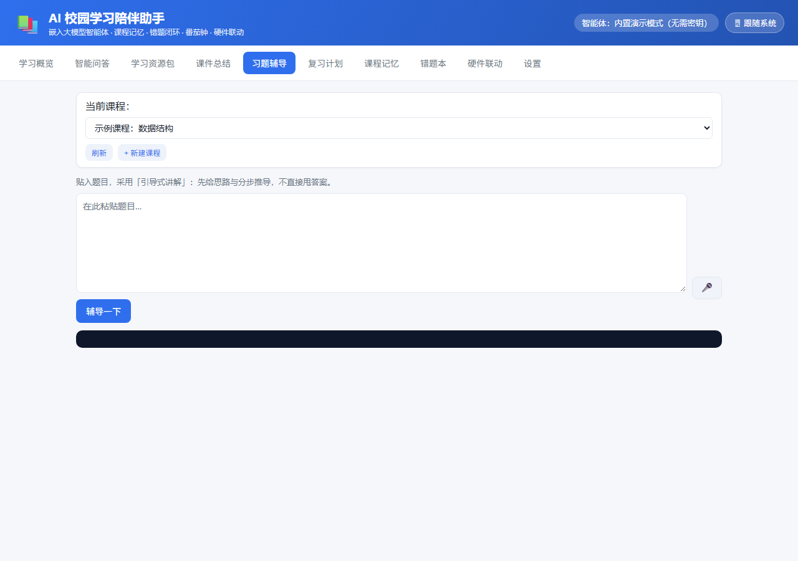

截图 4　习题辅导：大文本框 + 语音输入、「辅导一下」按钮与结果区；返回分步思路，不直接给出答案。

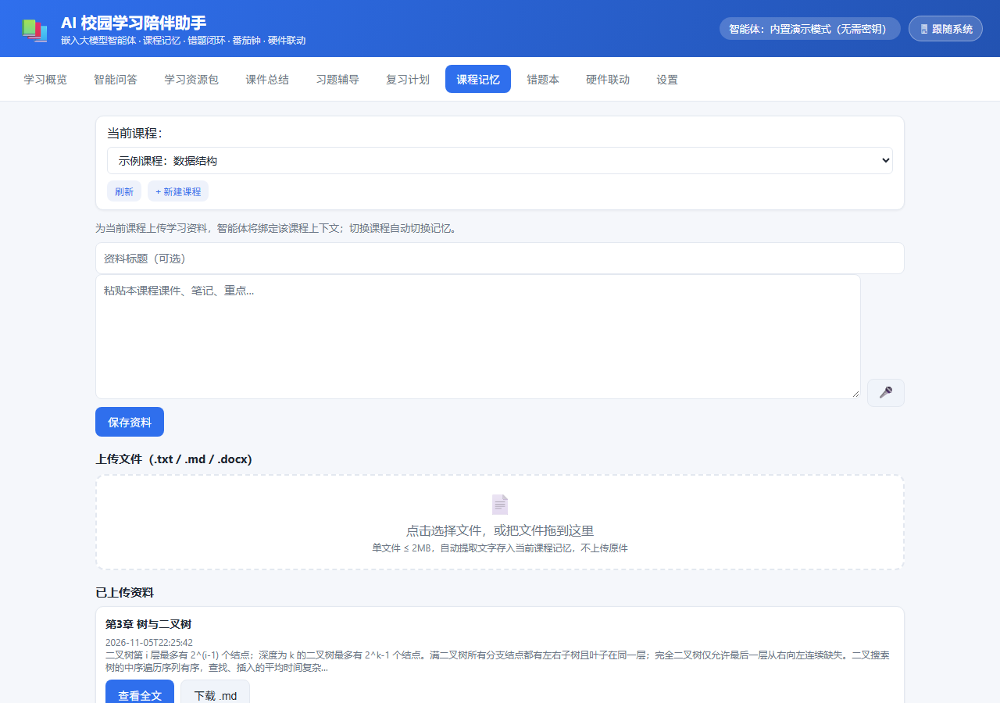

截图 5　课程记忆：资料标题 / 正文、上传区与资料列表；可见「第 3 章 树与二叉树」及「查看全文 / 下载 .md」。


截图 6　硬件联动：任务创建、测试提醒、专注灯、6 点清单表与状态看板。图中只表达接口与状态，ESP32 未实机联调。

#### 1.2.2 墨刀原型：页面、流程、状态与组件

原型按 V1.5.0 建立，共 16 页。后台 5 页只重组真实存在的管理操作，不虚构登录、权限或多租户。作业要求「前台应用与后台管理原型」，两部分同处一套原型、共用预览链接。


原型图 1　P00 信息架构：前台 / 后台页面层级、六步核心场景、跳转关系汇总与 F / A 编号索引。

| 页号 | 分组 | 页面名（标识） | 功能编号 | 验收编号 | 关键交互状态 |
|---|---|---|---|---|---|
| P00 | 信息架构 | 原型总览与需求索引 | F01 – F37 / A01 – A39 | — | 页面层级 / 六步场景 / 跳转汇总，非功能页 |
| P01 | 前台 | 学习概览 `dashboard` | F12 · F26 · F29 | A15 · A29 · A32 | 默认 / 空 / 键盘焦点 / 异常降级 |
| P02 | 前台 | 智能问答 `chat` | F01 · F06 · F25 · F27 · F28 · F33 · F34 | A05 · A06 · A28 · A30 · A31 · A36 · A37 | 默认 / 忙碌 / 回退 / 切课程 |
| P03 | 前台 | 学习资源包 `study` | F13 – F19 · F27 · F35 | A16 – A22 · A30 · A38 | 默认 / 忙碌 / 部分失败 / 直达 |
| P04 | 前台 | 课件总结 `summarize` | F02 · F25 · F27 · F30 | A07 · A28 · A30 · A33 | 默认 / 忙碌 / 空值拦截 / 异常降级 |
| P05 | 前台 | 习题辅导 `tutor` | F03 · F25 · F27 · F30 | A08 · A28 · A30 · A33 | 默认 / 忙碌 / 结果 / 异常降级 |
| P06 | 前台 | 复习计划 `plan` | F04 · F12 · F27 | A09 · A15 · A30 | 默认 / 忙碌 / 结果 / 异常降级 |
| P07 | 前台 | 课程记忆 `memory` | F05 · F07 · F08 · F25 · F32 · F33 | A10 · A11 · A12 · A28 · A35 · A36 | 默认 / 空 / 上传中 / 展开 / 校验失败 |
| P08 | 前台 | 错题本 `wrong` | F09 – F11 · F25 · F31 · F36 | A13 · A14 · A28 · A34 · A39 | 默认 / 空 / 忙碌 / 校验失败 |
| P09 | 前台 | 硬件联动 `hardware` | F37（可选，不列入验收） | 不列入验收 | 默认 / 未配置 / 边界声明 |
| P10 | 前台 | 设置 `settings` | F20 – F24 · F30 · F31 | A23 – A27 · A33 · A34 | 默认 / 配置生效 / 自检 / 回退 / 掩码 |
| M01 | 后台管理 | 课程与资料管理 `m01` | F05 · F07 · F08 · F32 · F33 | A04 · A10 · A11 · A12 · A35 · A36 | 默认 / 空 / 校验失败 / 上传中 |
| M02 | 后台管理 | 智能体运行配置 `m02` | F20 – F24 · F30 · F31 | A23 – A27 · A33 · A34 | 默认 / 配置生效 / 自检 / 回退 / 掩码 |
| M03 | 后台管理 | 运行状态与硬件看板 `m03` | F26 · F29 · F37（可选） | A01 · A29 · A32 | 默认 / 未配置 / 边界声明 |
| M04 | 后台管理 | 复习任务与专注管理 `m04` | F04 · F12 · F26 · F29 | A09 · A15 · A29 · A32 | 默认 / 空 / 忙碌 / 异常降级 |
| M05 | 后台管理 | 错题与归档管理 `m05` | F09 – F11 · F25 · F31 · F36 | A13 · A14 · A28 · A34 · A39 | 默认 / 空 / 忙碌 / 校验失败 |

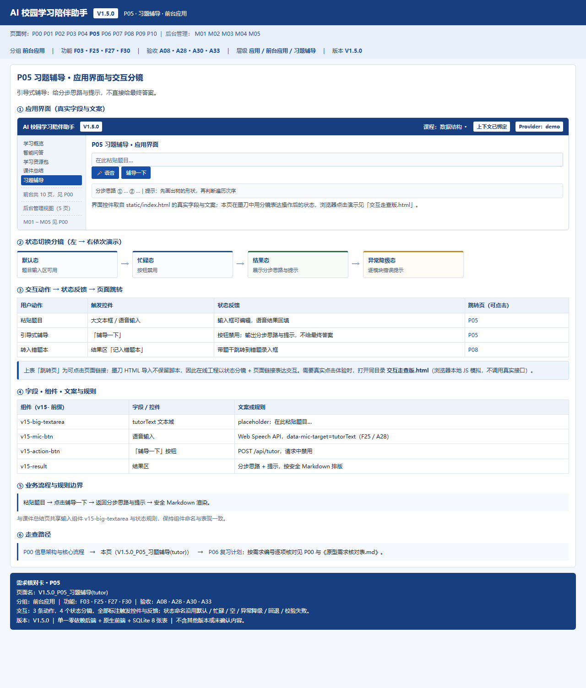

原型图 2　P05 习题辅导：界面、字段与组件、交互状态、流程及需求核对卡（F03 · F25 · F27 · F30）。

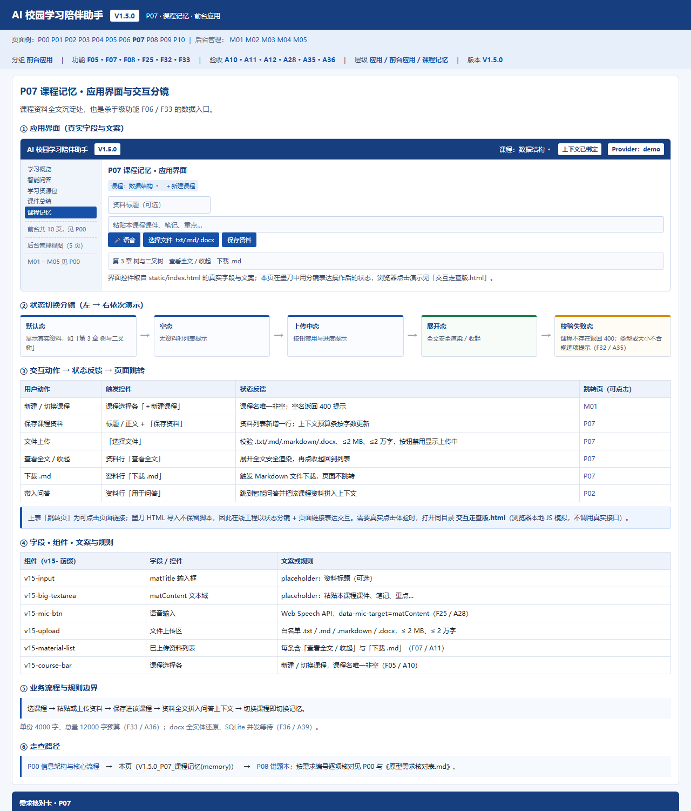

原型图 3　P07 课程记忆：资料字段、上传白名单、全文查看 / 下载与上下文预算（F05 · F07 · F08 · F32 · F33）。

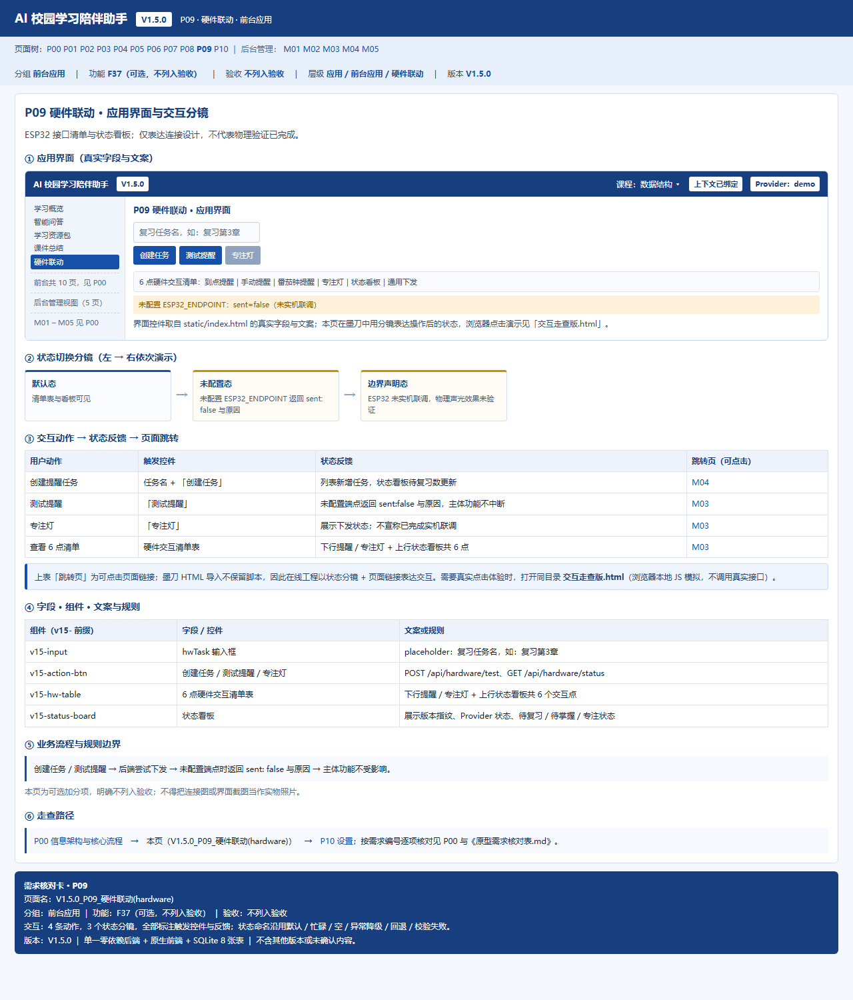

原型图 4　P09 硬件联动：接口清单、未配置态与「不代表物理联调」的边界声明（F37）。

**核心使用场景**：进入应用（P01）→ 在课程记忆保存「数据结构」资料（P07）→ 切到「高等数学」确认资料不跟随（P07 / P02）→ 回到「数据结构」提问，资料全文拼入上下文（P02）→ 观察忙碌态、回答卡与无密钥回退（P02 / P10）→ 错题分析、标记掌握并加入复习任务（P08 / P06）。

**业务流程**

1. 课程记忆：`选课程 → 粘贴 / 上传资料 → 保存到该课程 → build_course_context(course_id) 拼入问答上下文 → 切课即切记忆`。单份 4000 字、总量 12000 字，超出按序保留并提示；为全文拼接，不是检索增强。
2. 智能生成：`选参数 → 单动作或一键五件套 → 五区渲染 → 可回写课程记忆 → 导出 Markdown`。`/?autopack=1#study` 为直达态。
3. 复习闭环：`录入错题 → 错因与变式题 → 标记掌握 → 按状态筛选 → 导出`；复习计划与提醒由后台线程每 30 秒扫描。
4. 运行配置：`选 Provider → 填密钥 / 模型 / 地址 → 保存或自检 → 运行时写入 SQLite → 异常自动回退 demo`。
5. 后台管理：`M01 课程与资料 → M02 运行配置 → M03 状态看板 → M04 任务与专注 → M05 错题归档`，对应真实 REST 路由。

**交互状态字典**

| 状态 | 界面表现 | 触发与恢复 | 需求 |
|---|---|---|---|
| 默认态 | 数据区有值、控件可用 | 页面加载完成 | — |
| 忙碌态 | 按钮禁用 + 状态文案，`finally` 恢复 | 请求期间；5 个资源包按钮统一控制 | F28 / A31 |
| 空态 | 「暂无」提示，不显示 `0.0%` | 无资料、无误题、筛选无结果 | F26 / A29 |
| 结果态 | 结果区安全 Markdown 渲染 | 生成 / 辅导 / 计划成功 | F27 / A30 |
| 异常降级态 | 逐模块错误提示，页面仍可切换 | 单个接口失败 | F30 / A33 |
| 回退态 | 演示模式提示条 + `fallback` 标记 | 无密钥或厂商异常 | F23 / A26 |
| 校验失败态 | 逐项错误文案，课程不存在返回 400 | 类型 / 大小 / 必填项不合规 | F32 / A35 |
| 未配置态 | `sent: false` 与原因 | 未设置 `ESP32_ENDPOINT` | F37 |
| 掩码态 | 只回密钥掩码 | 读取 Provider 配置 | F31 / A34 |
| 键盘焦点态 | `:focus-visible` 焦点框 | Tab / Enter / Space | F29 / A32 |

**关键文案与字段**（取自 `static/index.html`）

| 位置 | 字段 | 文案 |
|---|---|---|
| P02 | `chatInput` | `输入课程问题，或点右侧 🎤 语音输入（Chrome / Edge）…` |
| P03 | `studySubject` | 默认 `高等数学上册`；placeholder `如：数学 / 高等数学上册` |
| P04 | `sumText` | `在此粘贴课件或笔记文字…` |
| P05 | `tutorText` | `在此粘贴题目…`；按钮 `辅导一下` |
| P06 | `planSubject` | `考试科目，如：数据结构` |
| P07 | `matTitle` / `matContent` | `资料标题（可选）` / `粘贴本课程课件、笔记、重点…` |
| P08 | `wqQuestion` / `wqUser` / `wqCorrect` | `错题题目` / `我的答案（可选）` / `正确答案（可选）` |
| P09 | `hwTask` | `复习任务名，如：复习第3章` |
| P10 | `agentKey` / `agentSecret` / `agentModel` / `agentBaseUrl` / `agentTokenUrl` | `必填，如 sk-… / 千帆 API Key`；`仅文心旧版 WenxinWorkshop 需要`；`留空用默认：ernie-3.5-8k / moonshot-v1-8k`；`可选；千帆 v2 或自定义端点必填`；`仅文心旧版需要，可留空` |
| 全局 | 校验与限制 | `课程不存在，请先选择或新建课程`；资料白名单 `.txt/.md/.markdown/.docx`、≤ 2 MB、≤ 2 万字 |

**组件命名**：统一 `v15-` 前缀，包括 `v15-input`、`v15-big-textarea`、`v15-mic-btn`（覆盖 5 处输入）、`v15-action-btn`、`v15-result`、`v15-course-bar`、`v15-material-list`、`v15-stat-card × 6`、`v15-pomodoro`、`v15-provider-card × 6`、`v15-status-board`。

### 1.3 后台管理原型

原型含 M01 – M05 共 5 个后台管理页，与前台同处一套原型、共用预览链接。V1.5.0 为单机单用户课程作业，暂无登录与权限体系；管理页只重组真实存在的操作，所有对象与路由可在 `static/index.html` 与 `server.py` 中核对。

| 页号 | 管理页 | 真实承载位置 | 可管理对象 | 关键规则 |
|---|---|---|---|---|
| M01 | 课程与资料管理 | 顶栏课程条、`#memory` | 课程新建 / 切换、资料粘贴 / 上传 / 查看 / 下载 | `/api/courses`、`/api/courses/{id}/materials`、`.../upload`；课程名唯一非空；资料白名单与大小限制；课程不存在返回 400 |
| M02 | 智能体运行配置 | `#settings` | 6 个 Provider 的密钥 / 模型 / 地址、激活项、自检 | `/api/agent/providers`、`/credentials`、`/test`；优先级 运行时 SQLite ＞ `.env` ＞ `demo`；只回掩码 |
| M03 | 运行状态与硬件看板 | `#hardware`、`#dashboard` | 版本指纹、Provider 状态、复习 / 专注状态、手动提醒 | `/api/status`、`/api/providers`、`/api/hardware/*`、`/api/focus/state`；未配置返回 `sent: false` |
| M04 | 复习任务与专注管理 | 学习概览待复习区、`#plan` | 任务增删与完成、逐日计划、专注记录 | `/api/review-tasks`、`/api/focus/sessions`、`/api/focus/state`；每 30 秒扫描 |
| M05 | 错题与归档管理 | `#wrong` | 错题录入、错因与变式题、掌握状态、筛选、导出 | `/api/wrong-questions`、`/analyze`、`/master`、`/export`；写入前校验课程存在；无 DELETE 路由 |

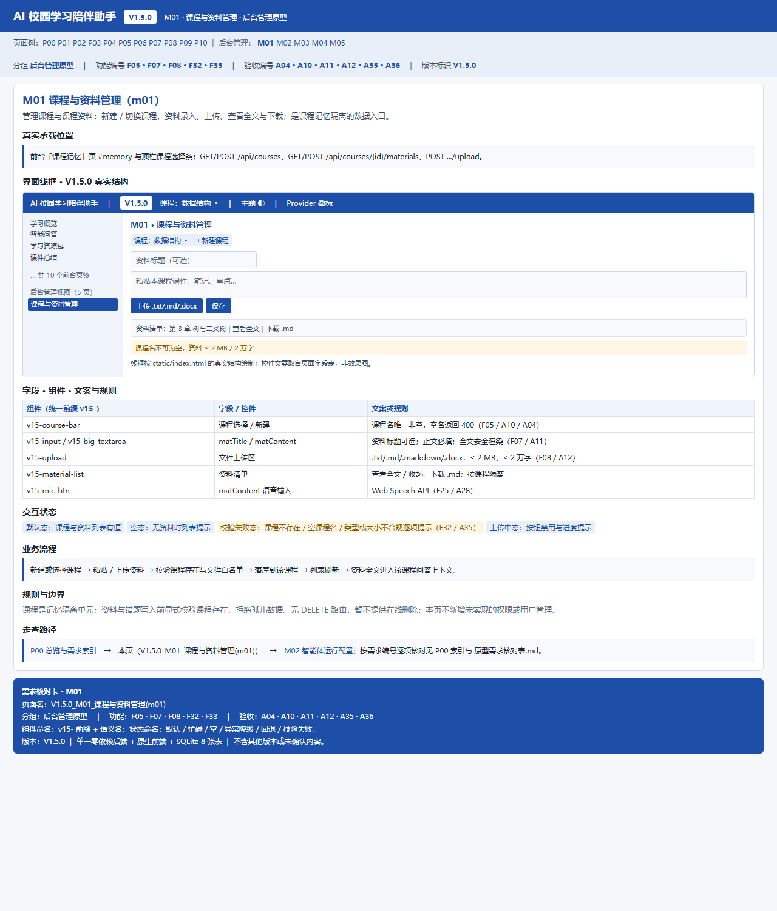

原型图 5　M01 课程与资料管理：界面、真实承载位置、字段 / 组件、状态、流程与需求核对卡。

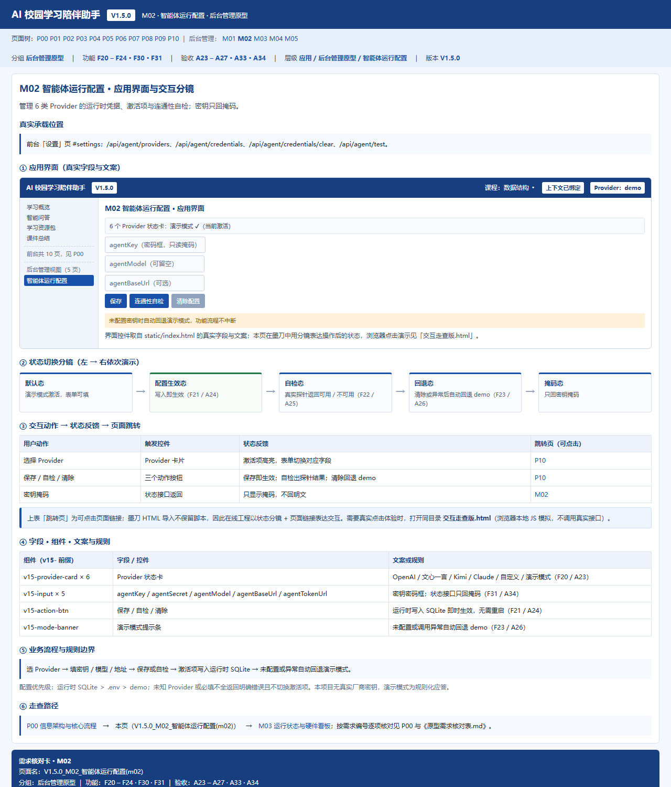

原型图 6　M02 智能体运行配置：6 个 Provider 状态卡、密钥掩码与自动回退演示模式。

### 1.4 关键交互与规则

| 机制 | 原型可见表现 | 规则 |
|---|---|---|
| 课程记忆绑定 | 顶栏课程选择条；问答页提示条 | 提问时把该课程资料拼入 system prompt；切课即切上下文，两门课互不串上下文（A05、A06） |
| 上下文预算 | 资料较多时回答仍可用 | 单份截取前 4000 字，总预算 12000 字；超预算提示已展示份数（A36） |
| 安全 Markdown | 问答 / 总结 / 计划 / 资源包富文本 | escape-first：先转义再替换标记；注入串输出为文本（A30、A34） |
| 忙碌态 | 请求期间按钮置灰并显示状态文案 | 5 个资源包按钮统一禁用 / `finally` 恢复（A31） |
| 接口异常降级 | 故障后端下页面仍可切换标签 | 事件绑定先于请求，逐模块 `safe()` 降级（A33） |
| 资料校验 | 非法类型 / 超限给出明确文案 | `.txt/.md/.markdown/.docx`、2 MB、2 万字；课程不存在返回 400 |
| 导出健壮性 | 下载失败只提示 | `fetch` + blob + `URL.createObjectURL`，失败不替换当前页面（A39） |
| 键盘可达 | 卡片与上传区有焦点框 | `tabindex`、`role`、`aria-label`、Enter / Space 与 `:focus-visible`（A32） |

错误码：200 成功；400 参数校验失败；404 未知路径；厂商异常转降级文案，不抛 5xx。请求 / 响应为 JSON，上传为 `multipart/form-data`，下载带 `Content-Disposition`。

### 1.5 UI 美观与一致性

主色 `#2F6FED`（CSS 变量 `--primary`），与项目标志及图表配色一致。主题含跟随系统 / 浅色 / 深色三档与 6 套预设色，写入 `localStorage`，首屏内联脚本在样式加载前确定主题。卡片统一圆角、留白与 1 px 边框；表格、代码块、引用、列表有独立 `.md` 排版样式；SVG 思维导图跟随主题变量。

### 1.6 硬件原型连接图


图 7　硬件连接图：前端「硬件联动」页 ↔ `server.py` 的 `/api/hardware/*` ↔ Wi-Fi / HTTP Webhook ↔ ESP32 固件 ↔ LED / 蜂鸣器；6 个交互点为到点提醒、测试提醒、番茄钟提醒、专注状态灯、学习状态看板和通用消息预留。

作业原文为「硬件原型照片**或连接图**」，图 7 已满足该项。图中接口与固件齐备，但 ESP32 未实机联调，物理声光效果未验证；连接图不冒充实物照片。

### 1.7 重要特点

1. **课程记忆绑定与隔离（F06 / F33）**：课程为一等对象，资料全文由 `build_course_context(course_id)` 拼入 system prompt 后交给 `AgentProvider`；切课即切记忆。这是智能体嵌入自研系统的代码证据，演示模式即可复现。
2. **无密钥自动回退（F23 / C05）**：Provider 未配置或异常时回退 `DemoProvider`，响应带 `fallback` 标记，流程不中断。
3. **单一零依赖后端（C01 / C02）**：只有 `server.py` 一个 HTTP 入口，仅用 Python 标准库，`python server.py` 启动，无需安装依赖。
4. **escape-first 安全 Markdown（F27 / F31 / C07）**：进入 `innerHTML` 的内容先转义，SQL 全部参数化；故障注入与无头浏览器对照确认载荷不再执行。

---

## 二、概要设计（权重 40%）

> 完整分层设计与模块说明见《无言以对_系统设计说明书.pdf》，数据模型与库表映射见《无言以对_数据库设计说明书.pdf》，三处使用同一套模块名、F / A 编号与表名。

### 2.1 功能模块与系统结构


图 9　V1.5.0 功能思维导图：中心为 AI 校园学习陪伴助手，六个分支为核心学习功能（F01 – F04）、杀手级功能（F05 – F11）、学习资源包（F13 – F19）、可插拔智能体（F20 – F23）、体验与健壮性（F24 – F36）、硬件联动（F37，未实机）。

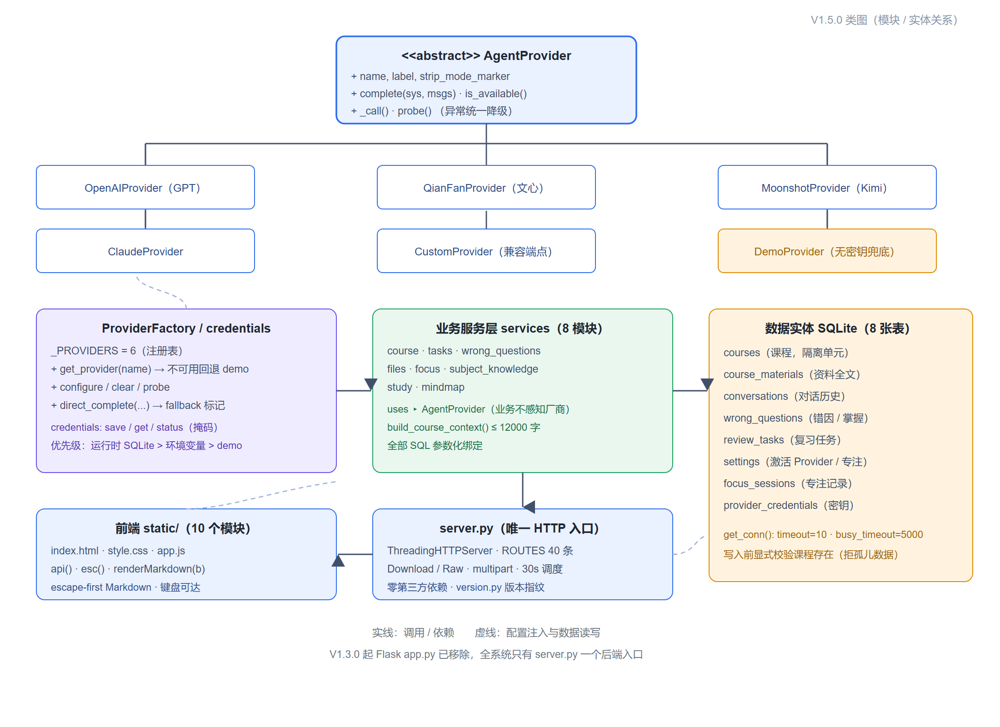

图 10　类图：`AgentProvider` 抽象与 6 个实现、`ProviderFactory` 与配置中心、8 个业务服务模块、单一 HTTP 入口、8 张数据实体及前端 10 个模块的关系。

### 2.2 UML 图

| 图 | 视角 | 回答的问题 |
|---|---|---|
| 图 1 用例图 | 需求分析 | 谁用系统、各自能做什么 |
| 图 2 活动图 | 业务流程 | 课程复习从资料到归档如何流转、失败如何回退 |
| 图 3 时序图 | 重要算法模块 | 课程记忆问答对象间消息的时间顺序 |
| 图 4 协作图 | 对象协作 | 一键生成资源包时对象间链接与消息传递 |

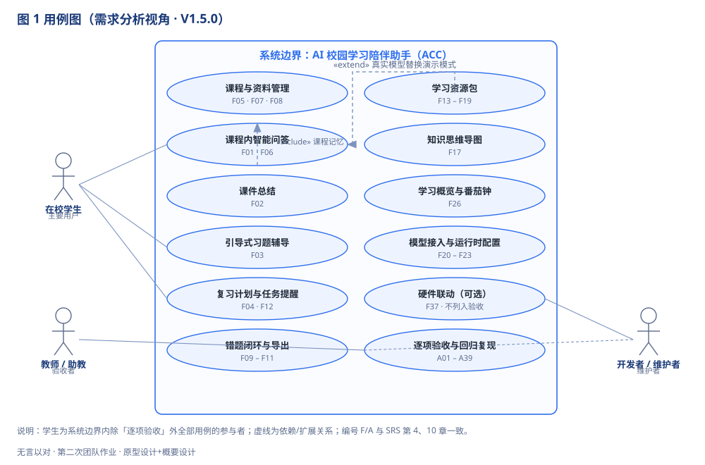

图 1　用例图：在校学生、教师 / 助教、开发者 / 维护者三类参与者与系统边界内的用例；「课程内智能问答」包含「课程与资料管理」，「模型接入与运行时配置」扩展「课程内智能问答」。


图 2　活动图：选择课程 → 上传或粘贴资料 → 校验判定（不通过则提示并重新上传）→ 生成课程记忆上下文 → 智能问答 / 总结与资源包 / 错题分析并行 → 生成复习计划 → 30 秒扫描提醒 → 标记掌握与导出。

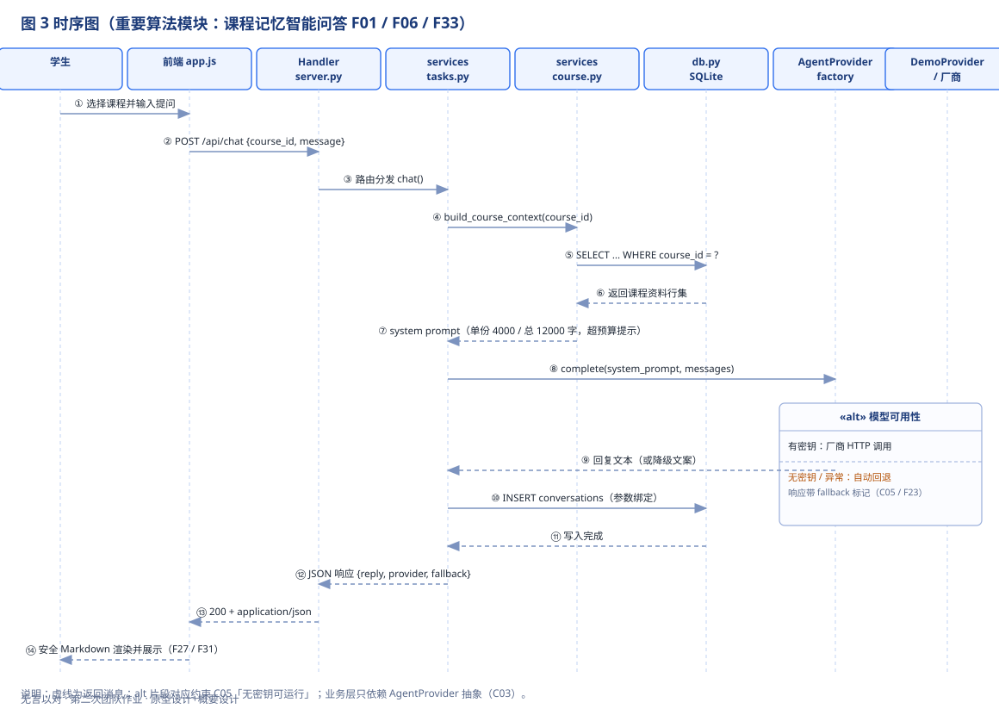

图 3　时序图：学生 → 前端 → `Handler` → `services/tasks.py` → `services/course.py` → `db.py` → `AgentProvider` → 厂商 / `DemoProvider`，共 14 条消息；`«alt»` 区分有密钥与无密钥 / 异常回退。


图 4　协作图：以「一键生成学习资源包」为例，8 个对象间的链接与 8 条编号消息；模型不可用或超时时回退内置结构化知识库。

### 2.3 数据库概要

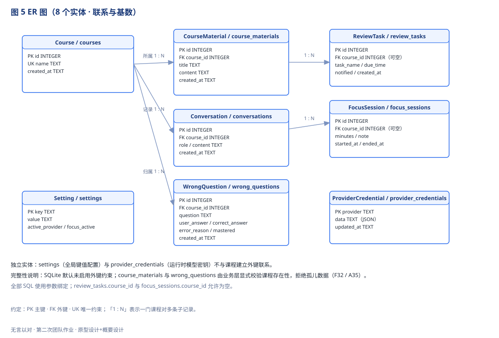

图 5　ER 图：`Course` 与 `CourseMaterial`、`Conversation`、`WrongQuestion`、`ReviewTask`、`FocusSession` 为 1 : N；`Setting` 与 `ProviderCredential` 为独立全局实体。SQLite 默认未启用外键，资料与错题由业务层校验课程存在性，拒绝孤儿数据（F32 / A35）。

关系数据模型（主键、外键与可空性以 DDL 为准）：

```
courses(id PK, name UK NOT NULL, created_at NOT NULL)
course_materials(id PK, course_id FK NOT NULL, title, content NOT NULL, created_at NOT NULL)
conversations(id PK, course_id FK NOT NULL, role NOT NULL, content NOT NULL, created_at NOT NULL)
wrong_questions(id PK, course_id FK NOT NULL, question NOT NULL, user_answer, correct_answer,
                error_reason, mastered NOT NULL DEFAULT 0, created_at NOT NULL)
review_tasks(id PK, course_id FK NULL, task_name NOT NULL, due_time NOT NULL,
             notified NOT NULL DEFAULT 0, created_at NOT NULL)
settings(key PK, value)
focus_sessions(id PK, course_id FK NULL, minutes NOT NULL, note, started_at, ended_at, created_at NOT NULL)
provider_credentials(provider PK, data NOT NULL, updated_at NOT NULL)
```

| 实体类 | 库表 | 主要服务模块 | 说明 |
|---|---|---|---|
| `Course` | `courses` | `services/course.py` | 课程记忆的隔离单元，课程名唯一且非空 |
| `CourseMaterial` | `course_materials` | `course.py`、`files.py` | 资料全文，上传后进入该课程上下文 |
| `Conversation` | `conversations` | `tasks.py` | 课程内对话历史 |
| `WrongQuestion` | `wrong_questions` | `wrong_questions.py` | 错题、错因、变式题与掌握状态 |
| `ReviewTask` | `review_tasks` | `focus.py`、`hardware/esp32.py` | 复习任务与提醒状态，`course_id` 可空 |
| `Setting` | `settings` | `config.py`、`agents/credentials.py` | 全局键值，含激活 Provider 与专注状态 |
| `FocusSession` | `focus_sessions` | `focus.py` | 一次专注记录 |
| `ProviderCredential` | `provider_credentials` | `agents/credentials.py` | 运行时密钥与地址，只回掩码 |

数据规模定位为单机单库原型，不承诺多用户、分库分表或海量数据性能。

### 2.4 后端设计


图 6　后端分层与请求分发（L1 层次视图）：客户端经 `server.py` 的 `Handler` 按 `ROUTES` 分发到 8 个业务服务模块，按需调用智能体层，业务数据落到 SQLite 8 张表；后台线程每 30 秒扫描到期任务。


图 8　系统架构（L0 整体视图）：浏览器经 REST 访问单一入口，服务层、智能体层、数据层与可选硬件层在同一进程内协同。

- **接入层**：`ThreadingHTTPServer` + `Handler`；`ROUTES` 为「方法 / 正则路径 / 处理函数」三元组；返回普通 dict（JSON）、`Download` 或 `Raw`。
- **业务服务层（8 模块）**：`course`、`tasks`、`wrong_questions`、`files`、`focus`、`subject_knowledge`、`study`、`mindmap`。
- **智能体层**：`AgentProvider` 定义 `is_available()`、`complete()`、`_call()`、`probe()`；`factory._PROVIDERS` 注册 6 项；厂商 HTTP 走标准库 `urllib`。
- **数据层与调度**：`db.py` 的 `SCHEMA` 定义 8 张表，`get_conn()` 设超时与 `busy_timeout`；后台线程每 30 秒调用 `check_due_tasks()`。

---

## 三、团队协作记录（权重 20%）

### 3.1 按周计划表

W1 – W4 为阶段编号，不是教学周次。已完成日期取自 `git log`，课程校历未提供，不推测教学周次。

| 阶段 | 真实日期 | 里程碑 | 主要产出 | 状态 |
|---|---|---|---|---|
| W1 | 2026-11-05 | 选题与需求落地；原型与核心流程尽早打通；V1.0 上线 | 选题报告、SRS 初版、可运行系统、`demo_check.py`、答辩 PPT | 已完成 |
| W1 | 2026-11-06 | 架构收敛为单一零依赖后端；V1.5.0 验收基线 | 移除 Flask `app.py`、四套回归、SRS 按国标重写、技术复盘长文 | 已完成 |
| W2 | 2026-11-08 | 答辩材料与文档口径统一 | 28 页答辩 PPT，README / 自检报告 / SRS 同步 | 已完成 |
| W4 | 2026-11-14 ～ 2026-11-21【重点 · R07】 | 第二次团队作业：原型设计与概要设计定稿 | 本文、两份说明书 PDF、原型预览、提交清单、合规检查表、界面与原型图 | 已定稿 |
| W3 | 2026-11-09 ～ 2026-11-13【重点 · R07】 | 杀手级功能深化：长文档记忆与多用户方向（计划，非 V1.5.0 已实现能力） | 计划产出：上下文预算方案与压力用例、多用户数据模型草案、对应回归脚本（均为计划） | 计划 |

【重点 · R07】需补：课程校历或周次对照表与可判定验收指标；日期已明确：W3（杀手级功能深化）11-09～11-13、W4（第二次团队作业）11-14～11-21。

### 3.2 团队分工书面说明

分工延续第一次团队作业的队内角色约定，按「后端与质量保障 / 前端与交互体验」两条线推进，以 SRS 第 6 章的 40 条 REST 接口全表为共同契约。

**陈明凯（3124004503）负责后端与质量保障。** 承担 `server.py` 的 40 条路由、multipart 上传、Download / Raw 响应与到期任务扫描；`db.py` 的 8 张表；`config.py`、`version.py`、`launch.py`；`agents/` 的 6 类 Provider 抽象与工厂；`services/` 的 8 个服务模块；`hardware/` 的 ESP32 接口与固件。交付包括 REST 接口全表、上下文预算（单份 4000 字、总量 12000 字）、可插拔智能体与自动回退、参数化 SQL 与孤儿数据拦截、四套回归脚本及 JSON 结果，并撰写 SRS 第 5、6、9、10 章。证据为 `docs/*_results.json` 及 `_线上` 副本、SRS 10.5 实测表。

**邓文炜（3124004505）负责前端与交互体验。** 承担 `static/index.html` 的 10 个页面、`static/css/style.css` 的主题与 Markdown 排版，以及 `static/js/app.js` 的 API 封装、渲染器、上传下载、主题、语音、番茄钟、思维导图与导出。交付包括 10 个可操作页面、深浅色与 6 套主题色、escape-first 安全 Markdown、忙碌态与异常降级、键盘可达性、界面截图与 28 页答辩 PPT。证据为 `docs/ui/*.png`、`docs/pptx/team_v15/`、`node --check` 结果及 SRS 第 8 章。

**共同职责。** 两人共同承担需求讨论、回归复验与文档一致性核对：需求变更只修改 SRS 单一源再重生成 `.docx`；每次版本升级后分别复跑四套回归并交叉核对界面、接口与说明书。本次原型同样由后端线核对路由、字段与边界，前端线核对控件、状态与交互动作。GitHub 账号见 3.4。

### 3.3 协作过程记录

- 按双线并行推进，接口以 SRS 第 6 章 40 条 REST 全表为契约；需求变更只改 SRS 单一源后重生成 `.docx`。
- 过程留痕：Git 提交历史、SRS 0.2 迭代记录表、四套回归结果 JSON 与 `_线上` 副本、`docs/自我检查报告.md` 第十 / 十一节。计数随提交递增，以提交前实测为准。
- 分工记录：见 3.2 书面分工说明与上述过程留痕，内容可核验，无缺口。

### 3.4 每人 GitHub 贡献记录

| GitHub 账号 |
|---|
| `KECIT33` |

---

## 四、交付地址与下载 / 预览链接

| 项 | 地址 |
|---|---|
| GitHub 团队仓库 | `https://github.com/kecit33/ai-agent-study` |
| 原型在线预览 / 分享链接 | `https://modao.cc/proto/zhsPz0tourxb68EcNCVE/sharing?view_mode=read_only&screen=llmVbc4XXaOMwo2Ij`（备注：「校园AI陪伴助手-分享」；只读分享，无需分享密码；16 页：P00 信息架构 + P01 – P10 前台 + M01 – M05 后台管理） |
| 本地可交互走查版 | `modao_v150/交互走查版.html`（浏览器直接打开，不依赖网络与后端） |
| 可运行系统在线试用 | `https://ai-campus-companion.app.workbuddy.host/?sharecode=CEUN7FBTFJ`（可运行系统入口，非在线原型预览） |
| 交付合规检查表 | `交付合规检查表与缺口清单.md` |
| 原型源文件与核对表 | `gen_modao_v150.py`、`gen_modao_interactive.py`、`gen_modao_ops.py`、`gen_modao_navfix.py`、`gen_modao_hotzones.py`、`modao_v150/*.html`、`原型需求核对表.md` |
| 链接汇总 | `原型在线预览与下载地址.md` |
| 硬件原型照片或连接图 | 图 7 `assets/硬件连接图.svg` 已满足原文「照片或连接图」 |
| 本文发布链接 | 【重点 · R12】【待填写：队长博客发布后的随笔链接】 |

---

## 五、交付合规核验状态速览

| 编号 | 要求来源 | 判定 | 仍需团队补齐 |
|---|---|---|---|
| R01 | 原型源文件 | ✅ 16 页在线工程 + HTML 单一源 + 导入载荷 + 本地走查版，均已复核 | 无 |
| R02 | 在线预览地址与分享密码 | ✅ 只读分享链接已填入，备注「校园AI陪伴助手-分享」，无需分享密码 | 无 |
| R03 | 两份 PDF 云盘链接与提取码 | ✅ 两份说明书后续随作业附上，本次不列云盘链接 | 无（PDF 由团队另行附上） |
| R04 | 硬件原型照片或连接图 | ✅ 图 7 连接图已满足 | 实物照片为可选增强 |
| R05 | 习题辅导 / 课程记忆 / 硬件联动 3 张原型截图 | ✅ 3 张界面截图 + 3 张同名原型页图，另含 P00 与 2 张后台管理图 | 无 |
| R06 | 前台应用与后台管理原型 | ✅ 5 页后台管理原型与前台同处一套原型 | 无 |
| R07 | 按周计划表与周次日期 | ⚠️ 里程碑、产出与 W3 计划齐全；日期已明确（W3 11-09～11-13、W4 11-14～11-21），校历未提供 | 校历与验收指标 |
| R08 | 分工记录 | ✅ 3.2 / 3.3 已提供书面说明与过程留痕 | 无 |
| R10 | 每人 GitHub 贡献记录 | ✅ 已填账号 `KECIT33` | 无 |
| R11 | 课程 / 班级链接与作业要求链接 | 【重点】 | 三项外链 |
| R12 | 队长发布的团队博客与发布链接 | 【重点】 | 发布账号与发布后链接（队长：邓文炜） |

R09 已删除，编号保留空位；其余各项按作业明写条目核对，未提供的外部凭证保留占位，不代填。

---

## 六、未完成事项醒目清单（提交前必读）

下列项目前未完成，须由对应责任人补齐后按本文标注位置回填，并同步《交付合规检查表与缺口清单》与《原型在线预览与下载地址》。

| 编号 | 未完成事项 | 本文位置 | 必须由谁完成 |
|---|---|---|---|
| R11 | 课程名称、班级主页 / 班级博客链接、作业要求链接 | 0、5 | 队长 |
| R12 | 发布账号与本文发布后的随笔链接 | 0、4、5、文末 | 队长 |
| R07 | 课程校历与可判定验收指标（日期已明确：W3 11-09～11-13、W4 11-14～11-21） | 3.1、5 | 队长 |

原型、走查版、说明书与核对表均已完成并复核；以上均为需本人操作或课程方信息才能补齐的外部材料。

---

发布人（队长）：邓文炜　【重点 · R12】【待填写：发布账号与本文发布链接】　　团队：无言以对　　日期：2026-11-09
