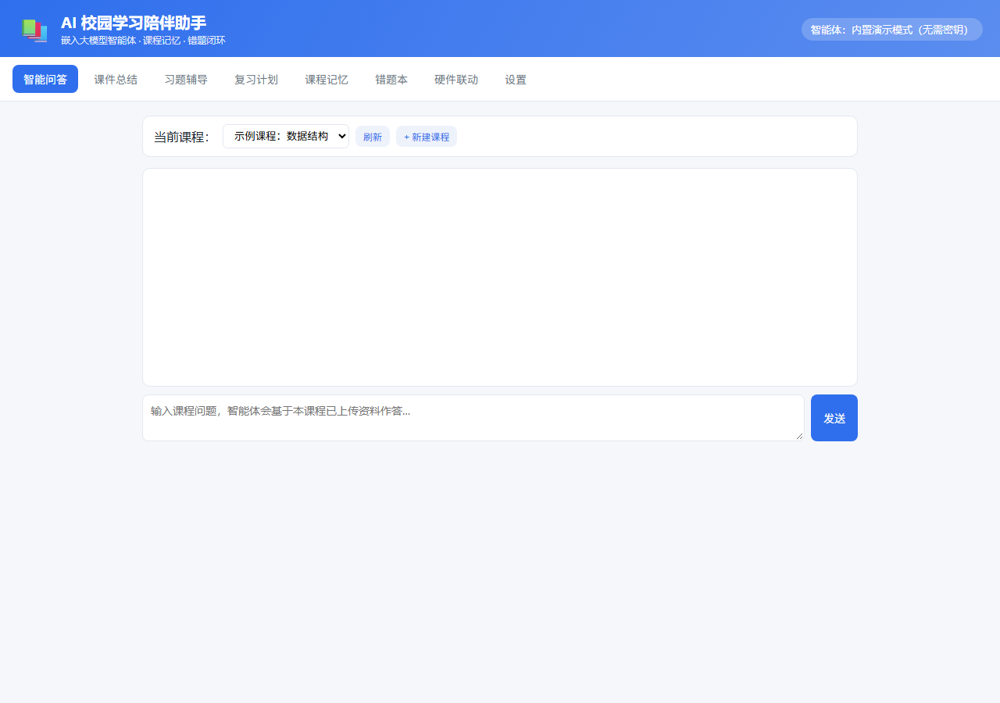
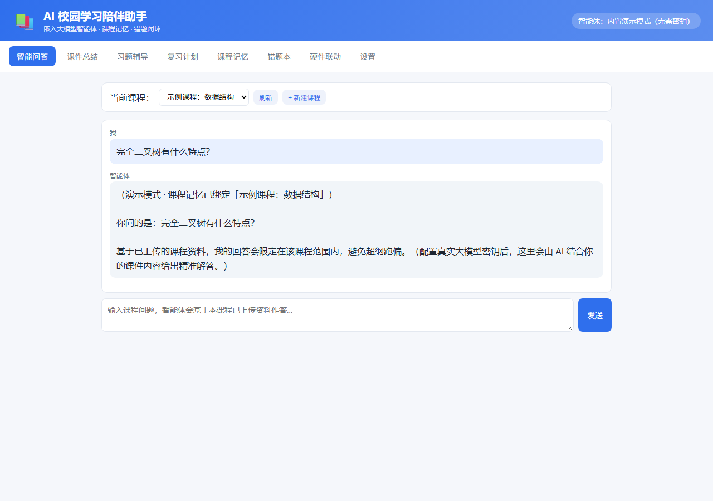
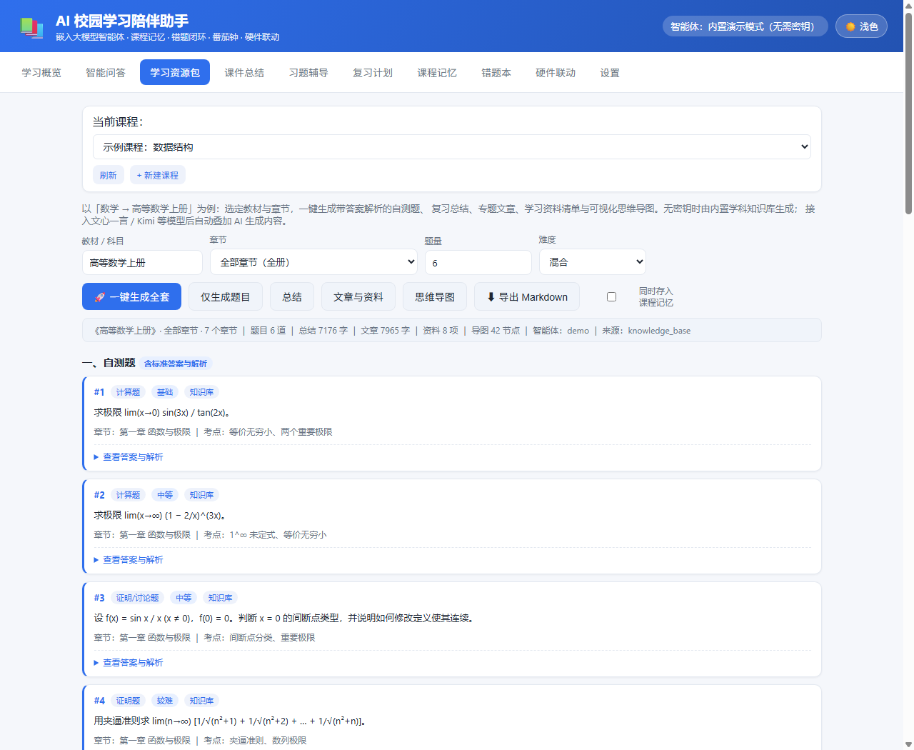
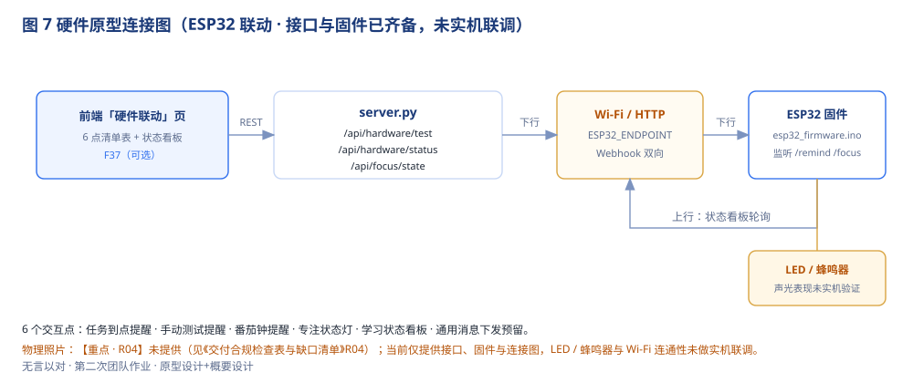
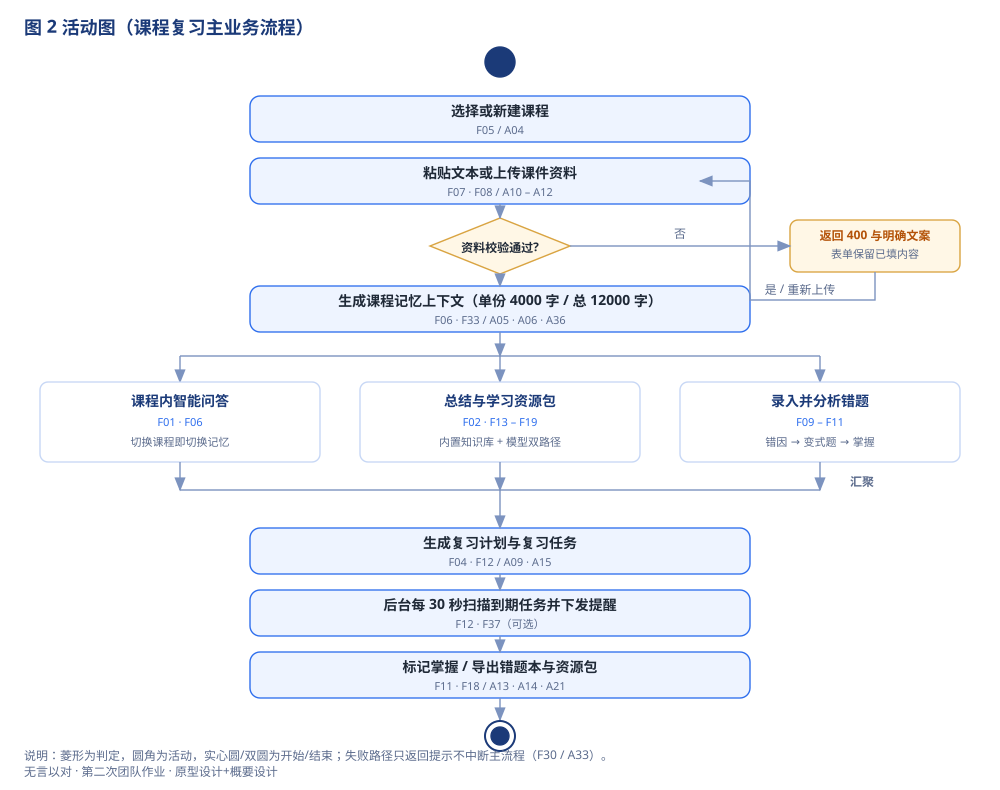
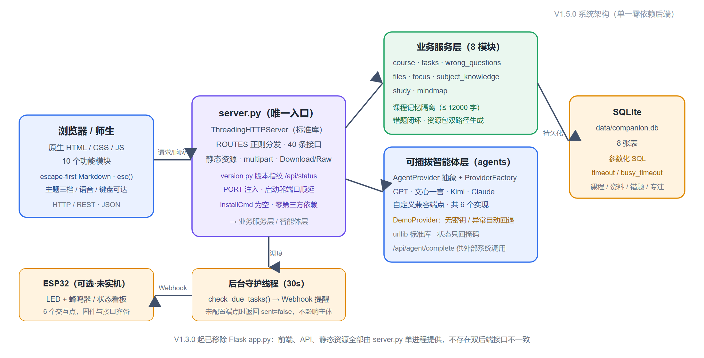

# 无言以对第二次团队作业——原型设计+概要设计

> 队名：无言以对　｜　项目：AI 校园学习陪伴助手（ACC）　｜　版本基线：V1.5.0　｜　编制日期：2026-11-09
> 本次作业不安排现场答辩，交付重心为设计文档与可核验的原型、概要设计成果。

## 0 作业信息表

| 项 | 内容 |
|---|---|
| 作业所属课程及班级链接 | 【待填写：课程名称、班级、班级博客或课程主页链接】 |
| 作业要求链接 | 【待填写：第二次团队作业要求博文链接】 |
| 你理解的作业目标具体内容 | 在第一次团队作业已确定的选题、需求分析与系统规划基础上，把「已经跑起来的系统」反向沉淀为规范的设计产物：① 用原型把前台应用与后台管理的界面、交互、文本与业务规则固定下来，形成可在线预览、可对照走查的界面基线；② 用概要设计自顶向下说明功能模块划分与运行逻辑，用用例图、活动图、类图、时序图、协作图、ER 图与后端设计图把「需求 → 结构 → 数据 → 运行」串成一条可追溯的链；③ 用按周计划表、逐人分工表与协作记录说明团队如何分工与推进。本次不追求新增功能，而追求设计表达与已实现系统逐字一致、图文编号一致、缩减语与符号事先定义、无推测性承诺。 |
| 团队名称 | 无言以对 |
| 团队成员学号-名字 | 3124004503-陈明凯；3124004505-邓文炜 |
| 队长及发布账号 | 【待填写：队长姓名、博客园 / 语雀等发布账号与本文发布链接】 |
| 本次交付形态 | 团队博客随笔 1 篇 + 《无言以对_系统设计说明书.pdf》 + 《无言以对_数据库设计说明书.pdf》 + 原型在线预览 + 仓库提交清单 |

### 0.1 本次作业的推进策略：原型与核心流程尽早完成，把时间留给杀手级功能

第一次团队作业期间，我们没有把时间花在纸面推演上，而是在 2026-11-05 当天就完成了「选题 → 需求与架构 → 核心流程 → 可运行系统上线」的闭环：V0.5 确定功能分解与 SQLite 数据模型，V0.8 打通课程记忆问答、课件总结、习题辅导、复习计划、错题闭环的端到端流程，V1.0 发布公网可访问地址。此后 11-06 收敛为单一零依赖后端并完成三轮自查与 V1.5.0 验收基线，11-08 统一答辩材料与文档口径。

这条时间线带来的直接结果是：第二次作业开始时，前台 10 个模块、40 条接口、8 张表、四套回归脚本都已经是可点、可测、可截图的既成事实，本次只需把它们规范化为原型说明与概要设计文档，不需要重新设计，也不存在「文档写了但系统没有」的风险。省下来的时间被投到杀手级功能上——课程记忆绑定与隔离（F06 / F33）：V1.4.1 补齐资料全文查看与下载、修复列表注入，V1.5.0 加入单份 4000 字、总量 12000 字的上下文预算与超预算提示，并把 20 份 × 1 万字压力场景从 80351 字收敛到 12160 字。杀手级功能不是本次新画的一张饼，而是原型跑通之后持续投入的既有能力。

---

## 一、原型设计（权重 40%）

### 1.1 原型工具、形态与在线预览

| 项 | 内容 |
|---|---|
| 原型工具 | 【待填写：Axure / 墨刀 项目名称、版本号与源文件（.rp / .mdf）】 |
| 原型在线预览链接 | 【待填写：Axure Cloud / 墨刀 在线预览地址与访问密码】 |
| 已可访问的等价高保真原型 | 已上线的可运行系统：`https://ai-campus-companion.app.workbuddy.host/?sharecode=CEUN7FBTFJ`（`sharecode` 为访问凭证，需原样保留）；浏览器直接打开，无需安装、无需 API Key |
| 原型截图来源 | `assets/界面_*.png`，共 7 张，全部取自 V1.5.0 真实运行界面，非示意图、非 AI 生成图 |
| 原型说明 | 由于第一次作业已交付可运行系统，本次以「真实系统 + 真实界面截图 + 逐页交互规则表」作为高保真原型基线；Axure / 墨刀 源文件与在线预览为需补交的规范化载体，页面清单、交互与规则以本随笔及两份说明书为准，两者内容一致 |

### 1.2 前台应用原型：10 个页面模块

单页应用（`static/index.html`），顶栏含品牌、当前智能体徽标与主题切换；左侧 10 个导航按钮，右侧 10 个 `section.panel`；课程选择条全局生效；支持 URL hash 直达（如 `/#study`），`/?autopack=1#study` 打开即自动生成全套资源，用于走查与演示。

| # | 页面 / `data-tab` | 原型关键元素 | 主要交互 | 对应需求 | 截图 |
|---|---|---|---|---|---|
| 1 | 学习概览 `dashboard` | 6 项统计卡片、待复习任务快捷增删、番茄钟、最近专注记录 | 卡片可 Tab / Enter / Space 激活；无误题显示「暂无」而非 `0.0%` | F12、F26、F29 | `assets/界面_学习概览.png` |
| 2 | 智能问答 `chat` | 演示模式提示条、对话区、输入框与语音按钮 | 选择课程即切换上下文；发送期间按钮禁用；切课程清空对话 | F01、F06、F28、F34 | `assets/界面_智能问答.png` |
| 3 | 学习资源包 `study` | 教材 / 章节 / 题量 / 难度、7 个动作按钮、题目、总结、文章、资料、思维导图 | 5 个生成按钮统一忙碌态；双请求独立判错；一键五件套与导出 | F13 – F19、F35 | `assets/界面_学习资源包.png` |
| 4 | 课件总结 `summarize` | 大文本框 + 语音、生成按钮、富文本结果区 | 输出「关键知识点 / 复习考点提纲」并按安全 Markdown 排版 | F02、F27 | `assets/界面_课件总结.png` |
| 5 | 习题辅导 `tutor` | 大文本框 + 语音、辅导按钮、结果区 | 返回分步思路与提示，不直接给最终答案 | F03、F27 | 【待填写：习题辅导页原型截图】 |
| 6 | 复习计划 `plan` | 科目、天数、生成按钮、结果区 | 生成「第 1 天」至「第 N 天」逐日安排 | F04、F27 | `assets/界面_复习计划.png` |
| 7 | 课程记忆 `memory` | 资料标题 / 正文、文件上传区、资料列表 | 每条资料「查看全文 / 收起」「下载 .md」；上传类型与大小白名单 | F05、F07、F08 | 【待填写：课程记忆页原型截图】 |
| 8 | 错题本 `wrong` | 录入表单、筛选下拉、导出按钮、错题列表 | 录入 → 错因分析 + 变式题 → 标记掌握 → 按状态筛选 → 导出 | F09 – F11、F36 | `assets/界面_错题本.png` |
| 9 | 硬件联动 `hardware` | 任务创建、测试提醒、专注灯、6 点清单表、状态看板 | 未配置 `ESP32_ENDPOINT` 时返回 `sent: false` 与原因，不影响主体 | F37（可选） | 【待填写：硬件联动页原型截图】 |
| 10 | 设置 `settings` | 主题三档与色板、模型接入表单、Provider 状态卡片、参数速查 | 运行时写入密钥即时生效、只回掩码；清除后自动回退 `demo` | F20 – F24 | `assets/界面_模型接入设置.png` |

#### 1.2.1 典型页面原型截图（V1.5.0 真实运行界面）



截图 1　学习概览页：6 项统计卡片、待复习任务快捷区与番茄钟；统计卡片支持 Tab / Enter / Space 激活，无误题时显示「暂无」。



截图 2　课程内智能问答页：顶部课程选择条切换即切换课程记忆，回答按安全 Markdown 排版；请求期间按钮禁用并显示状态。



截图 3　学习资源包页：教材 / 章节 / 题量 / 难度参数区与 7 个生成动作，结果分题目、总结、专题文章、资料清单、思维导图五区展示，支持一键生成与导出。

其余 4 张（课件总结、复习计划、错题本、模型接入设置）见 1.2 表格「截图」列与 `assets/界面_*.png`。7 张截图全部取自 V1.5.0 真实运行界面，非示意图、非 AI 生成图。

### 1.3 后台管理原型

本系统定位为单机单用户课程作业原型，**不设独立后台管理站点**；管理类操作由以下三处承载，界面与规则与前台同源：

| 管理面 | 承载位置 | 可管理对象 | 交互与规则 |
|---|---|---|---|
| 运行配置管理 | 前台「设置」模块 + `/api/agent/*` 共 5 条接口 | 6 个 Provider 的 `api_key` / `secret_key` / `model` / `base_url` / `token_url`、当前激活 Provider | 配置优先级：运行时 SQLite `provider_credentials` > `.env` 环境变量 > 内置演示模式；状态接口只返回掩码；未知 Provider 或必填项不全返回明确错误且不切换激活项 |
| 运行状态管理 | `GET /api/status`、`GET /api/providers`、`GET /api/hardware/status` | 版本指纹、Provider 可用性与配置状态、学习状态看板 | 版本由 `version.py` 统一提供，`launch.py` 启动前探测，避免「页面新、接口旧」；动态接口 `Cache-Control: no-store` |
| 业务数据管理 | `GET/POST /api/courses*` 等 40 条 REST 接口 | 课程、资料、对话、错题、复习任务、专注记录、键值设置 | 全部 SQL 参数绑定；写入资料 / 错题前显式校验课程存在；无 DELETE 路由，资料暂不提供在线删除 |

【待填写：若课程要求独立的 Axure / 墨刀 后台管理页面，请补充后台管理原型的页面清单与在线预览地址】

### 1.4 关键交互、文本与规则描述

| 机制 | 原型可见表现 | 规则（可判定） |
|---|---|---|
| 课程记忆绑定 | 顶栏课程选择条；问答页演示模式提示条 | 提问时把该课程资料拼入 system prompt；切换课程即切换上下文；A / B 两门课分别提问，绑定的课程名不同且不串上下文（A05、A06） |
| 上下文预算 | 资料较多时回答仍可用 | 单份截取前 4000 字，总预算 12000 字；超预算追加「共 N 份，已展示前 M 份」提示（A36） |
| 安全 Markdown | 问答 / 总结 / 计划 / 资源包富文本排版 | escape-first：先转义 `& < > " '`，再做标记替换；注入串输出为转义文本而非活动标签（A30、A34） |
| 忙碌态 | 请求期间按钮置灰并显示状态文案 | 5 个资源包按钮由 `studyBusy(on, msg)` 统一禁用 / `finally` 恢复，防重复提交（A31） |
| 接口异常降级 | 故障后端下页面仍可切换标签 | 事件绑定先于所有请求；逐模块 `safe()` 降级并保留已填内容，不整页变砖（A33） |
| 资料校验 | 非法类型 / 超限时给出明确文案 | `.txt/.md/.markdown/.docx` 白名单、2 MB、2 万字；课程不存在返回 400「课程不存在，请先选择或新建课程」 |
| 导出健壮性 | 下载失败只提示 | `fetch` + blob + `URL.createObjectURL`，失败不替换当前页面（A39） |
| 键盘可达 | 统计卡片与上传区有焦点框 | `tabindex="0"`、`role="button"`、`aria-label`、Enter / Space 激活与 `:focus-visible` 样式（A32） |

错误码统一：200 成功；400 参数校验失败；404 未知路径；厂商异常由 `complete()` 捕获并转降级文案，不向上抛 5xx。请求 / 响应为 JSON（`charset=utf-8`），上传为 `multipart/form-data`，下载带 `Content-Disposition: attachment`。

### 1.5 UI 美观与一致性

主色 `#2F6FED`（CSS 变量 `--primary`），与项目标志、全部图表的蓝色系一致；深浅色跟随系统 + 浅色 / 深色 / 跟随系统三档，提供 6 套预设主题色与自定义主色并写入 `localStorage`，首屏内联脚本在样式加载前确定主题避免闪白；卡片统一圆角、留白与 1 px 边框；表格、代码块、引用、列表有独立 `.md` 排版样式；SVG 思维导图跟随主题变量。所有界面截图取自同一主题下的真实运行页面，保证原型内部风格统一。

### 1.6 硬件原型照片或连接图



图 7　硬件原型连接图：前端「硬件联动」页 ↔ `server.py` 的 `/api/hardware/*` 与 `/api/focus/state` ↔ Wi-Fi / HTTP Webhook ↔ ESP32 固件 ↔ LED / 蜂鸣器。6 个交互点为：复习任务到点提醒、手动测试提醒、番茄钟到点提醒、专注状态灯、学习状态看板、通用消息下发预留。服务端 `hardware/esp32.py` 与 `esp32_firmware.ino` 齐备，前端内置同一张清单表与实时看板。

**硬件原型照片：【待填写：ESP32 开发板、LED 与蜂鸣器的实物照片或接线照片】**。当前本机无开发板，物理声光表现与 Wi-Fi 连通性未做实机联调，故 F37 为「可选（未实机）」，不列入验收；本图仅表达接口与连接设计，不宣称已完成物理验证。

### 1.7 重要特点单独说明

**特点一：课程记忆绑定与隔离（杀手级功能，F06 / F33）。** 通用聊天工具不区分课程，每次提问都要重新交代教材与进度；本原型把「课程」做成一等对象，上传的课件全文由业务层 `build_course_context(course_id)` 拼入 system prompt，再交给 `AgentProvider`，切换课程即切换记忆。这是智能体嵌入自研系统（约束 C03）而非外挂聊天页的代码证据，也是本项目与直接打开一个大模型窗口的根本差别。走查方式：在高等数学下提问 → 切到另一门课问同一句 → 回答依据立刻不同；无需密钥，演示模式即可复现。

**特点二：无密钥自动回退的演示模式（F23 / C05）。** 6 个 Provider 任一未配置或调用异常时自动回退 `DemoProvider`，响应带 `fallback` 标记，功能流程不中断。它保证任何机房、任何网络条件下原型都能完整走查，是特点一能被当场验证的前提。

**特点三：单一零依赖后端（C01 / C02）。** V1.3.0 起移除 Flask `app.py`，全项目只有 `server.py` 一个 HTTP 入口，仅用 Python 标准库，`python server.py` 即可启动，无 `pip install`。管理面、业务面、静态资源在同一个进程内，原型与实现不会漂移。

**特点四：escape-first 安全 Markdown（F27 / F31 / C07）。** 所有进入 `innerHTML` 的动态内容先转义，SQL 全部参数化；V1.5.0 第三轮自查用故障注入与无头浏览器 A/B 对照确认注入载荷不再执行。原型展示的长文本区域因此既能富文本排版，又不会成为注入入口。

---

## 二、概要设计（权重 40%）

> 本节为概要级说明，完整分层细化、符号约定与逐模块设计见《无言以对_系统设计说明书.pdf》，数据模型、关系模式与库表映射见《无言以对_数据库设计说明书.pdf》。三处使用同一套模块名、F / A 编号与表名。

### 2.1 自顶向下的功能模块与运行逻辑


图 9　功能思维导图（V1.5.0）：顶层为「课程复习闭环」，下分课程与资料、理解与练习、计划与执行、复盘与产出四条主线，共 37 项功能需求（F01 – F37）。


图 6　后端分层与请求分发设计图（运行逻辑）：浏览器发起 REST 请求 → `server.py` 的 `Handler` 按 `ROUTES` 正则表（40 条接口）分发 → 8 个业务服务模块处理 → 需要生成能力时调用智能体层 `AgentProvider` → 业务数据落到 SQLite 的 8 张表 → 后台守护线程每 30 秒扫描到期复习任务并可向 ESP32 下发 Webhook。静态资源与首页由 `Handler` 单独分支返回。约束 C01 – C07（单一后端、零第三方依赖、智能体嵌入自研系统、密钥不硬编码、无密钥可运行、前后端版本一致、用户输入必须转义）贯穿全部层次。

### 2.2 UML：需求分析 → 业务流程 → 系统结构 → 算法与对象协作

| 图 | 视角 | 回答的问题 | 文件 |
|---|---|---|---|
| 用例图 | 需求分析 | 谁用系统、各自能做什么 | `assets/用例图.svg` |
| 活动图 | 业务流程 | 一次课程复习从资料到归档如何流转、失败如何回退 | `assets/活动图.svg` |
| 类图 | 系统结构 | 有哪些类 / 模块、依赖与继承关系如何 | `assets/类图.png` |
| 时序图 | 重要算法模块 | 课程记忆问答（F01 / F06 / F33）对象间消息的时间顺序 | `assets/时序图.svg` |
| 协作图 | 对象协作 | 一键生成资源包（F18）时对象间链接、消息传递与交互 | `assets/协作图.svg` |


图 1　用例图：三类参与者为在校学生（主要用户）、教师 / 助教（验收者）、开发者 / 维护者（维护者）。系统边界内 12 个用例与 F / A 编号一一对应；「课程内智能问答」`«include»`「课程与资料管理」（依赖课程记忆上下文），「模型接入与运行时配置」`«extend»`「课程内智能问答」（有密钥时以真实模型替换演示模式）。



图 2　活动图：选择 / 新建课程 → 上传或粘贴课件资料 → 资料校验判定（不通过则提示并重新上传，不中断主流程）→ 生成课程记忆上下文 → 三条并行活动（智能问答 / 总结与资源包 / 错题录入分析）→ 汇聚后生成复习计划与任务 → 30 秒定时扫描提醒 → 标记掌握与导出 → 结束。


图 10　类图（V1.5.0）：展示 `AgentProvider` 抽象与 6 个实现、`ProviderFactory` 与运行时配置中心、8 个业务服务模块、单一 HTTP 入口 `server.py`、8 张 SQLite 数据实体，以及前端 10 个模块之间的依赖与调用关系。


图 3　时序图（杀手级功能所在的关键算法模块）：学生 → 前端 → `Handler` → `services/tasks.py` → `services/course.py` → `db.py` → `AgentProvider` → 厂商 / `DemoProvider`，共 14 条消息。`«alt»` 片段区分「有密钥：厂商 HTTP 调用」与「无密钥 / 异常：自动回退」，对应 C05 与 F23；虚线为返回消息。


图 4　协作图（通信图）：以「一键生成学习资源包」为例，8 个对象之间的链接与 8 条编号消息。第 4 步在模型不可用、超时或返回非预期 JSON 时静默回退内置结构化知识库，接口不返回空结果（F18 / A21）。

### 2.3 数据库概要：ER 图、关系数据模型、实体类与库表映射


图 5　ER 图：`Course` 与 `CourseMaterial`、`Conversation`、`WrongQuestion`、`ReviewTask`、`FocusSession` 均为 1 : N 联系；`Setting` 与 `ProviderCredential` 为独立全局实体。SQLite 默认未启用外键约束，资料与错题由业务层显式校验课程存在性，拒绝孤儿数据（F32 / A35）。

关系数据模型（主键、外键与可空性以 DDL 为准）：

```
courses(id PK, name UK NOT NULL, created_at NOT NULL)
course_materials(id PK, course_id FK NOT NULL, title, content NOT NULL, created_at NOT NULL)
conversations(id PK, course_id FK NOT NULL, role NOT NULL, content NOT NULL, created_at NOT NULL)
wrong_questions(id PK, course_id FK NOT NULL, question NOT NULL, user_answer, correct_answer,
                error_reason, mastered NOT NULL DEFAULT 0, created_at NOT NULL)
review_tasks(id PK, course_id FK NULL, task_name NOT NULL, due_time NOT NULL,
             notified NOT NULL DEFAULT 0, created_at NOT NULL)
settings(key PK, value)
focus_sessions(id PK, course_id FK NULL, minutes NOT NULL, note, started_at, ended_at, created_at NOT NULL)
provider_credentials(provider PK, data NOT NULL, updated_at NOT NULL)
```

| 实体类 | 库表 | 主要服务模块 | 说明 |
|---|---|---|---|
| `Course` | `courses` | `services/course.py` | 课程记忆的隔离单元，课程名唯一且非空 |
| `CourseMaterial` | `course_materials` | `course.py`、`files.py` | 资料全文，上传后立即进入该课程上下文 |
| `Conversation` | `conversations` | `tasks.py` | 课程内对话历史 |
| `WrongQuestion` | `wrong_questions` | `wrong_questions.py` | 错题、错因、变式题与掌握状态 |
| `ReviewTask` | `review_tasks` | `focus.py`、`hardware/esp32.py` | 复习任务与提醒状态，`course_id` 可空 |
| `Setting` | `settings` | `config.py`、`agents/credentials.py` | 全局键值，含 `active_provider` 与专注状态 |
| `FocusSession` | `focus_sessions` | `focus.py` | 一次专注记录，概览「今日专注 / 最近记录」来源 |
| `ProviderCredential` | `provider_credentials` | `agents/credentials.py` | 运行时模型密钥与地址，列表只回掩码 |

数据规模定位为单机单库原型；不承诺多用户、分库分表或海量数据性能。完整的字段类型、约束、范式说明、索引与完整性设计见《无言以对_数据库设计说明书.pdf》。

### 2.4 后端设计图与文字说明



图 8　系统架构图（V1.5.0）：浏览器经 REST 访问单一入口 `server.py`；`Handler` 按 `ROUTES` 正则表分发到业务服务层；服务层按需调用可插拔智能体层；所有业务数据落到 SQLite（8 张表）；后台守护线程每 30 秒扫描到期复习任务并可向 ESP32 下发 Webhook。

- **接入层**：`ThreadingHTTPServer` + `Handler`，`ROUTES` 为「HTTP 方法 / 正则路径 / 处理函数」三元组；返回值支持普通 dict（JSON）、`Download`（附件）、`Raw`（SVG 等原样输出）三种。
- **业务服务层（8 模块）**：`course`（课程与上下文预算）、`tasks`（问答 / 总结 / 辅导 / 计划 / 错因）、`wrong_questions`（错题闭环）、`files`（上传解析）、`focus`（专注与概览）、`subject_knowledge`（7 章结构化知识库）、`study`（资源包双路径）、`mindmap`（树 / SVG / 大纲 / Mermaid）。
- **智能体层**：`AgentProvider` 定义 `is_available()`、`complete()`、`_call()`、`probe()`；`factory._PROVIDERS` 注册 `openai` / `moonshot` / `claude` / `qianfan` / `custom` / `demo` 六项；业务层只依赖抽象，厂商 HTTP 走标准库 `urllib`。
- **数据层与调度**：`db.py` 的 `SCHEMA` 定义 8 张表，`get_conn()` 设 `timeout=10` 与 `PRAGMA busy_timeout=5000`；后台线程 `daemon=True`，每 30 秒 `check_due_tasks()`。

---

## 三、团队协作记录（权重 20%）

### 3.1 按周计划表（里程碑与产出）

> 已完成行的日期、里程碑与产出取自仓库迭代记录表与 Git 提交历史；周次编号与课程日历对齐关系为【待填写：课程周次日历】。计划行的具体起止日期与目标为【待填写：周次起止日期与迭代目标】。

| 周次 | 日期区间 | 里程碑 | 主要产出 | 状态 |
|---|---|---|---|---|
| W1 | 2026-11-05 | 选题与需求落地；**原型与核心功能流程尽早打通**；V1.0 上线 | 选题报告、SRS 初版、可运行系统（课程记忆 / 总结 / 辅导 / 计划 / 错题闭环）、端到端 `demo_check.py`、8 页答辩 PPT | 已完成 |
| W1 | 2026-11-06 | 架构收敛为单一零依赖后端；三轮自查；V1.5.0 验收基线 | 移除 Flask `app.py`、四套回归本地与线上全绿、SRS 按国标整体重写、博客园技术复盘长文 | 已完成 |
| W2 | 2026-11-08 | 答辩材料与文档口径统一 | 28 页四部分答辩 PPT（含 7 个单图页）、README / 自检报告 / SRS 同步、10 次文档与材料提交 | 已完成 |
| W3 | 2026-11-09 ～【待填写：结束日期】 | **第二次团队作业：原型设计与概要设计定稿** | 本文、`无言以对_系统设计说明书.pdf`、`无言以对_数据库设计说明书.pdf`、仓库提交清单与命名规范、原型在线预览 | 进行中 |
| W4 | 【待填写：起止日期】 | 杀手级功能深化：长文档记忆与多用户方向 | 【待填写：迭代目标、拆解任务与验收项】 | 计划 |

说明：W1 起即交付可运行原型与核心流程，是 W3 能够只做设计沉淀、W4 能够专注杀手级功能的前提；本次作业未新增功能，未改变第一次作业已确定的选题、需求与系统规划。

### 3.2 逐人角色与详细开发分工表

| 学号-名字 | 角色 | 负责范围（模块 / 文件） | 具体产出 | 可核验证据 |
|---|---|---|---|---|
| 3124004503-陈明凯 | 后端开发 · 测试工程师 | `server.py`（ROUTES 40 条、multipart、Download / Raw、30 秒调度）、`db.py`（8 张表）、`config.py` / `version.py` / `launch.py`、`agents/`（11 个 .py，6 Provider 抽象与工厂）、`services/`（8 个服务模块）、`hardware/`（esp32.py 与固件） | REST 接口全表、课程记忆上下文预算、可插拔智能体与自动回退、参数化 SQL 与孤儿数据拦截、四套回归脚本与 JSON 结果、SRS 第 5 / 6 / 9 / 10 章 | `docs/startup_results.json`、`demo_results.json`、`feature_results.json`、`study_results.json` 及 `_线上` 副本；SRS 10.5 实测表 |
| 3124004505-邓文炜 | 前端开发 | `static/index.html`（10 模块）、`static/css/style.css`（主题与 `.md` 排版）、`static/js/app.js`（API 封装、渲染器、上传下载、主题、语音、番茄钟、思维导图、导出） | 10 个页面模块、深浅色与 6 套主题色、escape-first 安全 Markdown、忙碌态与异常降级、键盘可达、7 张真实界面截图、28 页答辩 PPT | `docs/ui/*.png`、`docs/pptx/team_v15/`、`node --check static/js/app.js`、SRS 第 8 章 |

分工口径依据第一次团队作业已确定的队内角色约定；两位成员共同承担需求讨论、回归复验与文档一致性核对。逐人提交级别的量化记录见 3.5。

### 3.3 协作过程记录

- **分工与评审**：按「后端与质量保障 / 前端与交互体验」双线并行，接口以 SRS 第 6 章 40 条 REST 全表为契约，前后端各自对照同一张表实现与验收；需求变更只改 `docs/软件需求规格说明书.md` 单一源，再运行 `python docs/build_docx.py` 重生成 `.docx`，避免两份内容漂移。
- **过程留痕**：仓库 Git 提交历史可核验（`git log`；截至 2026-11-09 本地 78 次提交，日期集中于 11-05 / 11-06 / 11-08）；SRS 0.2 迭代记录表 12 行；四套回归结果 JSON 与 `_线上` 副本；`docs/自我检查报告.md` 第十、十一节记录三轮自查的 11 项修复、5 类误报剔除与 A-B 对照。
- **讨论照片 / 视频**：【待填写：线下或线上讨论照片、屏幕录制视频链接与拍摄日期】。

### 3.4 专业项目管理平台使用说明

【待填写：项目管理平台名称（如 GitHub Projects / Teambition / 禅道 /TAPD）、项目地址、看板或燃尽图截图、任务卡与里程碑编号】

当前阶段的实际过程留痕方式为：Git 提交历史 + SRS 迭代记录表 + 四套回归 JSON + 文档单一源。上述平台化的任务卡、看板与燃尽图尚未建立，本项不作为已完成的协作证据。

### 3.5 每人 GitHub 贡献记录

【待填写：各成员 GitHub 账号、逐人 commit 数 / PR / Issue / Code Review 统计与贡献图截图】

**当前仓库的真实情况（如实说明）**：`git shortlog -sne --all` 仅有一条作者记录 `kecit33 <kecit33@users.noreply.github.com>`，共 78 次提交，即所有提交均由同一账号产生，**无法据此拆出逐人贡献数据**。因此本表不填写任何推测的 commit 数或占比。团队后续将以各自账号提交并按任务卡关联 PR，使贡献可逐人核验；仓库远端同步状态见下方备注。

---

## 四、交付地址与下载 / 预览链接

| 项 | 地址 |
|---|---|
| GitHub 团队仓库 | `https://github.com/kecit33/ai-agent-study` （`git remote -v` 的 `origin`；**备注**：SRS 11.1 记录 V1.5.0 发布时未执行远端同步，远端 `main` 可能落后于本地，提交前请以 GitHub 页面实际内容为准） |
| 《无言以对_系统设计说明书.pdf》 | 【待填写：蓝奏云 / 百度网盘 / 微云 下载链接与提取码】 |
| 《无言以对_数据库设计说明书.pdf》 | 【待填写：蓝奏云 / 百度网盘 / 微云 下载链接与提取码】 |
| 原型在线预览链接 | 【待填写：Axure Cloud / 墨刀 在线预览地址与访问密码】 |
| 可运行系统在线试用 | `https://ai-campus-companion.app.workbuddy.host/?sharecode=CEUN7FBTFJ` |
| 硬件原型照片 | 【待填写：照片所在云盘链接或图床地址】 |
| 本文发布链接 | 【待填写：队长博客发布后的随笔链接】 |

发布人（队长）：【待填写：队长姓名】　　团队：无言以对　　日期：2026-11-09
