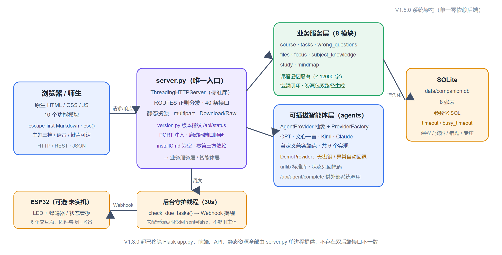
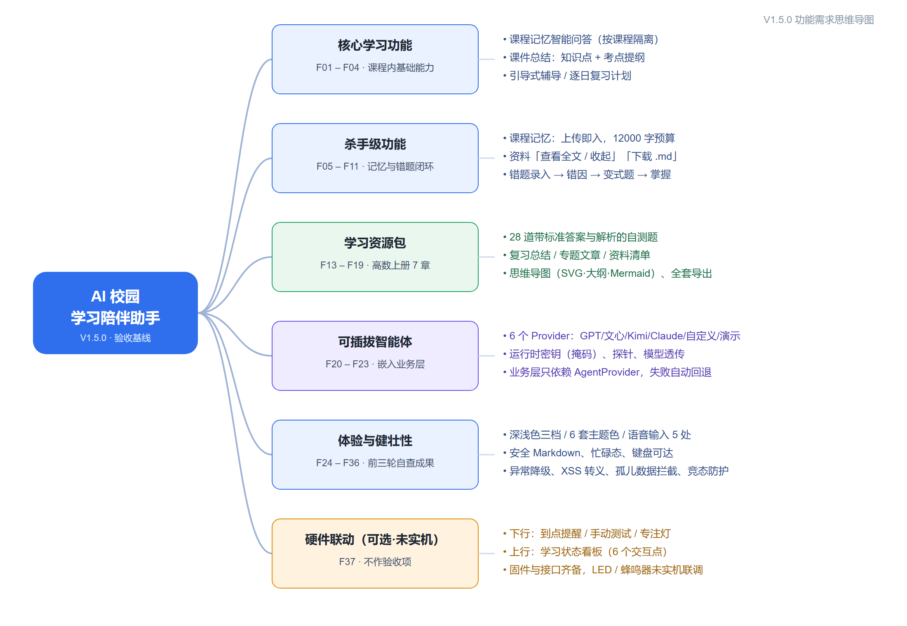
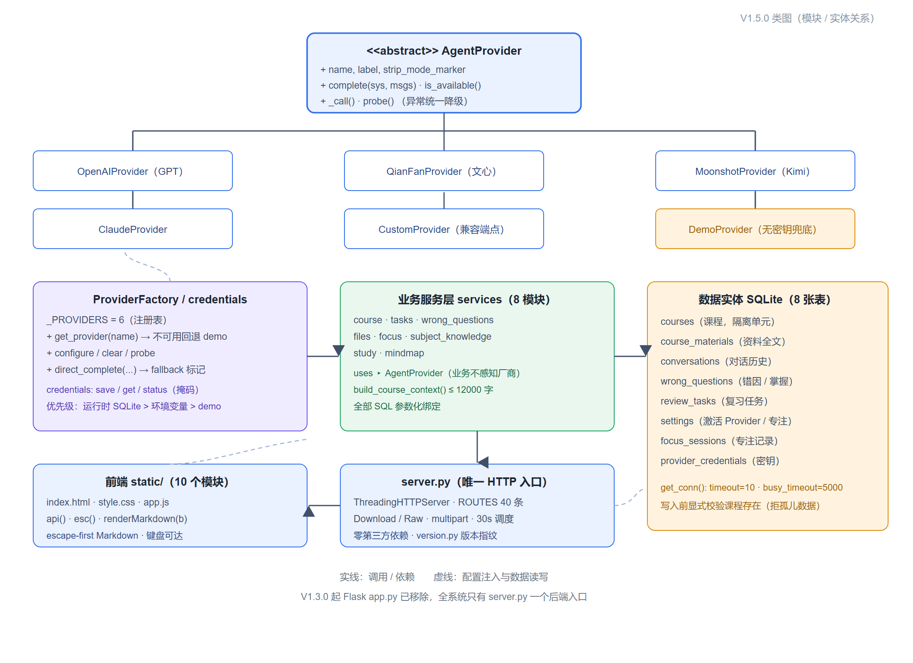

# 软件需求规格说明书

AI 校园学习陪伴助手（AI Campus Learning Companion）

文档版本：V1.5.0（验收基线）　　编制日期：2026-11-06　　适用产品版本：1.5.0

编写依据：GB/T 9385-2008《计算机软件需求说明编制指南》、GB/T 8567-2006《计算机软件文档编制规范》

> **本文档性质与撰写口径**：本文档是**面向最终验收的基线文档**，仅描述 V1.5.0 中已经实现、且能在代码或测试报告中找到证据的能力。凡未实现、未实测或依赖外部条件的能力，一律写入第 11 章「范围边界与不予承诺」，**不作为验收项**。文中所有版本号、接口数、表数、断言数均取自仓库代码与 `docs/*_results.json`，未作推测性承诺。

## 0 文档信息与迭代记录

### 0.1 文档控制信息

| 项目 | 内容 |
|---|---|
| 文档名称 | 软件需求规格说明书（SRS） |
| 产品标识 | AI 校园学习陪伴助手 / AI Campus Learning Companion / 缩写 ACC |
| 当前文档版本 | V1.5.0 |
| 对应产品版本 | `version.py` 中 `APP_VERSION = "1.5.0"` |
| 文档状态 | 验收基线（已发布、已完成本地与线上双环境复验） |
| 编制 / 审核 | 无言以对队：陈明凯（3124004503，后端 / 测试）、邓文炜（3124004505，前端） |
| 维护方式 | 本 Markdown 为单一内容源，`docs/build_docx.py` 由它生成同名 .docx；图资产位于 `docs/*.svg` |
| 在线协作 | 本 .md 可直接导入语雀、腾讯文档等平台（图片引用 `svg_fallback/*.png`，各平台通用）；.docx 为离线归档与答辩用，自动使用 SVG 矢量图并以 PNG 兜底 |
| 线上验收地址 | `https://ai-campus-companion.app.workbuddy.host/?sharecode=CEUN7FBTFJ` |

### 0.2 迭代记录表

| 版本 | 日期 | 阶段 / 迭代内容 | 对应产物与验证状态 | 负责人 |
|---|---|---|---|---|
| V0.1 | 2026-11-05 | 选题调研：基于选题报告中的校内调研痛点确定选题与价值边界 | 选题报告，需求来源见 2.3 | 无言以对队 |
| V0.5 | 2026-11-05 | 需求与架构：功能分解、可插拔智能体抽象、SQLite 数据模型 | 架构与数据模型设计 | 无言以对队 |
| V0.8 | 2026-11-05 | 核心实现：后端 REST、原生前端、课程记忆与错题闭环 | 端到端回归脚本 `demo_check.py` | 无言以对队 |
| V0.9 | 2026-11-05 | 硬件接口：ESP32 Webhook 联动接口与固件（可选加分项） | `hardware/esp32.py`、`esp32_firmware.ino` | 无言以对队 |
| V1.0 | 2026-11-05 | 上线与交付：部署指南、需求文档、答辩材料 | 公网可访问链接 | 无言以对队 |
| V1.1 | 2026-11-05 | 体验增强：深浅色主题与主题色、语音输入、文件上传与错题导出、学习概览、番茄钟、硬件双向联动 | 新增 12 项接口；`feature_check.py` 19/19 | 无言以对队 |
| V1.2 | 2026-11-05 | 学科资源与模型接入：高等数学上册学习资源包、文心一言 / Kimi 运行时接入、通用模型透传 | 新增 14 项接口；`study_check.py` 本地 36/36 | 无言以对队 |
| V1.2.1 | 2026-11-06 | 启动修复：版本指纹、端口占用探测与自动顺延，根治「新页面 + 旧接口」 | `launch.py`、`startup_check.py` 26/26 | 无言以对队 |
| V1.3.0 | 2026-11-06 | 架构收敛：**移除 Flask `app.py`**，全项目仅保留单一零依赖后端 `server.py` | 部署入口统一为 `python server.py` | 无言以对队 |
| V1.4.0 | 2026-11-06 | 体验优化：安全 Markdown 富文本渲染、按钮忙碌态、概览空态、未内置学科提示、修复 `app.js` 空字节损坏 | 四套回归本地全绿并发布线上 | 无言以对队 |
| V1.4.1 | 2026-11-06 | 课程资料「上传后打不开」修复：新增「查看全文 / 收起」与「下载 .md」，修掉列表 XSS | 线上 17 条资料全文可取回、17 组按钮真实渲染 | 无言以对队 |
| V1.5.0 | 2026-11-06 | **当前验收基线**：第三轮自查，修复异常路径、边界输入、数据一致性与交互细节共 11 项，剔除 5 类误报；同步博客园文章与文档 | 本地四套回归 26/26、26/26·30/30、19/19、36/36；线上 26/26、26/26·30/30、19/19、25/25 | 无言以对队 |

> 说明：V0.x～V1.0 为阶段归并记录，精确时间以仓库 Git 提交历史为准；V1.2.1 之后的迭代均集中在本工程 2026-11-06 的自我检查与发布闭环中。**验收只以 V1.5.0 一行为准**，历史行仅用于说明演进。

## 1 项目标志


图 1 项目标志：以展开的书页与「AI」字样组合，体现「学习陪伴 + 智能体」的产品定位；配色为产品主色 `#2F6FED`，与前端 CSS 变量 `--primary` 及文档图表保持一致。

| 标识项 | 取值 |
|---|---|
| 中文全称 | AI 校园学习陪伴助手 |
| 英文名称 | AI Campus Learning Companion |
| 项目缩写 | ACC |
| 产品形态 | Web 应用（B/S 架构，浏览器访问，无客户端安装） |
| 当前版本 | 1.5.0（`GET /api/status` 返回 `version`） |
| 版本指纹文件 | `version.py`，后端 `/api/status` 与启动器 `launch.py` 共用 |
| 线上入口 | `https://ai-campus-companion.app.workbuddy.host/?sharecode=CEUN7FBTFJ`（`sharecode` 为访问凭证，需原样保留） |
| 代码仓库 | `kecit33/ai-agent-study`（本地 `main` 分支；远端是否同步见 11.1） |

## 2 引言

### 2.1 编写目的与读者

本文档明确 ACC  V1.5.0 的功能需求、数据需求、接口需求、非功能需求、前端与后端设计以及验收标准，作为**开发依据、测试依据与最终验收依据**。预期读者为：课程验收教师 / 助教、开发组成员、参与答辩评审的人员。读者可依据第 10 章逐条复现验收，依据第 12 章追溯每一项结论的代码与数据出处。

### 2.2 产品范围

**范围内**：一个单机部署、零第三方依赖、可无密钥运行的课程学习 Web 应用，包含课程记忆智能体问答、课件总结、引导式习题辅导、复习计划、AI 错题闭环、学科学习资源包、可插拔大模型接入、学习概览与番茄钟、深浅色主题与语音输入、文件上传与导出、可选 ESP32 联动接口。

**范围外**（详见第 11 章）：用户注册登录与多租户、向量检索 / RAG、真实厂商计费调用、ESP32 实机联调、资料删除、公网配置接口鉴权、生产级高可用与性能 SLA。

### 2.3 需求来源

需求源于课程作业提供的《AI 校园学习陪伴助手》选题报告中记录的校内调研痛点，逐条映射如下。调研由选题报告提供，本工程未另行发放问卷，因此**不编造样本量、比例与统计口径**。

| 调研痛点 | 对应功能 | 需求编号 |
|---|---|---|
| 课堂笔记与课件零散，按课程找不到 | 按课程隔离的资料管理与全文查看 | F05、F07、F08 |
| 通用大模型不了解本校课程重点，回答容易跑偏 | 课程记忆上下文绑定与隔离 | F06、F33 |
| 作业与习题缺乏引导式讲解，直接给答案无助于理解 | 引导式习题辅导 | F03 |
| 考前不知如何规划复习，缺少可自测的题目与资料 | 复习计划与学科学习资源包 | F04、F13～F18 |
| 错题靠手抄整理，缺少错因归纳与同类题巩固 | AI 错题本闭环 | F09～F11 |

### 2.4 术语与缩略语

| 术语 | 定义 |
|---|---|
| 智能体 / Provider | 通过 HTTP 接口接入的大模型能力；本系统统一抽象为 `AgentProvider`，包含 6 个实现 |
| 课程记忆 | 按 `course_id` 隔离、由该课程已上传资料拼接而成的智能体系统提示上下文，非向量检索 |
| 演示模式 | `DemoProvider`，无密钥时的规则化应答与内置知识库作答，保证功能流程可走通；**不是真实大模型推理** |
| 错题闭环 | 录入错题 → 错因分析 → 定向变式题 → 标记掌握 → 导出 |
| 学习资源包 | 针对某一教材 / 章节生成的题目、总结、专题文章、资料清单与思维导图五件套 |
| 安全 Markdown | escape-first 渲染策略：先转义 HTML 元字符，再做 Markdown 标记替换，杜绝 XSS |
| 孤儿数据 | 外键未启用时写入的、指向不存在课程 ID 的资料或错题 |
| SRS | 软件需求规格说明书 |
| F / NFR / A | 功能需求 / 非功能需求 / 验收标准编号 |

### 2.5 参考资料

- GB/T 9385-2008《计算机软件需求说明编制指南》
- GB/T 8567-2006《计算机软件文档编制规范》
- 项目源码：`server.py`、`db.py`、`config.py`、`version.py`、`launch.py`、`agents/`、`services/`、`hardware/`、`static/`
- 验证脚本：`docs/startup_check.py`、`demo_check.py`、`feature_check.py`、`study_check.py`
- 结构化结果：`docs/startup_results.json`、`demo_results.json`、`feature_results.json`、`study_results.json` 及各自 `_线上.json` 副本
- 过程报告：`docs/自我检查报告.md`、`docs/演示验收报告.md`、`docs/自测报告_高等数学与模型接入.md`、`docs/模型接入接口说明.md`、`docs/硬件交互说明.md`
- `README.md`（运行、部署、接口速览）

### 2.6 文档约定

- 需求编号 `Fxx` 为功能需求、`NFR-xx` 为非功能需求、`Axx` 为验收标准；三者通过第 4 章功能总表与附录 A 建立追溯。
- 「已实现」「已实测」指有对应代码与测试结果；「可选」「未实机」指接口与代码齐备但受外部条件限制未做物理验证；「不予承诺」指明确排除在验收之外。
- 接口路径中的 `{id}` 表示课程 / 错题 / 任务的整数主键，实际路由为正则 `\d+` 匹配。

## 3 总体描述

### 3.1 产品前景与定位

ACC 是面向大学生课程学习场景的轻量级 Web 学习助手，核心价值不在于「再做一个聊天页」，而在于把大模型能力**嵌入自研业务流程**：按课程隔离的记忆上下文、围绕错题的闭环、按教材章节组织的学习资源包。系统采用单用户课程作业原型定位，**不宣称支持多账号或生产级服务**。

### 3.2 用户特征与角色

| 角色 | 典型操作 | 前置技能 |
|---|---|---|
| 在校学生（主要用户） | 选课程、提问、上传资料、生成总结 / 题目 / 计划、录入与复习错题、使用番茄钟 | 会用浏览器；不需要命令行与 API Key |
| 教师 / 助教（验收者） | 打开线上链接逐项走查、运行四套回归脚本、核对课程记忆隔离与导出结果 | 能按第 10 章命令执行脚本 |
| 开发者 / 维护者 | 填运行时密钥、切换 Provider、本地启动与排障、重生成文档 | 了解 Python 与 REST 基础 |

系统无登录与权限体系，所有访问者共享同一份 SQLite 数据，验收时按「单用户原型」说明。

### 3.3 运行环境

| 层次 | 环境要求 | 事实依据 |
|---|---|---|
| 客户端 | 现代浏览器（Chrome / Edge 最佳）；语音输入依赖 Web Speech API | `static/index.html`、`static/js/app.js` |
| 后端 | Python 3.8+；**仅标准库**，无 `pip install` 步骤 | `server.py` 使用 `http.server.ThreadingHTTPServer` |
| 数据存储 | SQLite，文件 `data/companion.db`，首次启动自动建表 | `db.py` 的 `init_db()` |
| 本地启动 | 双击 `start.bat` → `launch.py` → `server.py`；默认端口 5000，占用时自动顺延；支持 `PORT` 环境变量 | `launch.py`、`start.bat` |
| 云端部署 | 平台注入 `PORT`；启动命令 `python server.py`，安装命令为空；健康检查 `/api/status` | `Procfile`、`render.yaml`、发布记录 |
| 可选硬件 | ESP32 开发板 + LED + 蜂鸣器，通过 `ESP32_ENDPOINT` 配置 | `hardware/esp32.py`、`esp32_firmware.ino` |

> 零依赖是可验收事实：`requirements.txt` 仅含说明性注释，无 pip 安装项；云端 `installCmd` 为空字符串。

### 3.4 设计与实现约束

- **C01 单一后端**：V1.3.0 起已移除 Flask `app.py`，全项目只有 `server.py` 一个 HTTP 入口，禁止再出现「双后端接口不一致」。
- **C02 零第三方依赖**：厂商 HTTP 调用使用标准库 `urllib`（`agents/http_client.py`），multipart 解析手写，docx 解析用 `zipfile` + XML。
- **C03 智能体必须嵌入自研系统**：业务层 `services/tasks.py` 只依赖 `AgentProvider` 抽象，不感知厂商；课程记忆上下文由服务层拼入 system prompt；同时提供 `/api/agent/complete` 供外部系统调用。
- **C04 密钥不硬编码**：环境变量或运行时 SQLite 配置；状态接口只返回掩码；密钥不写日志、不落前端持久化。
- **C05 无密钥可运行**：任一 Provider 未配置或调用失败，自动回退 `DemoProvider`，功能流程不中断。
- **C06 前后端版本一致**：`version.py` 版本指纹由 `/api/status` 暴露，`launch.py` 启动前探测，避免静态页新、接口旧。
- **C07 用户输入必须转义**：所有进入 `innerHTML` 的动态内容先转义；SQL 全部参数化。

### 3.5 假设与依赖

- 依赖厂商开放接口可达；不可达时按 C05 回退，系统不因此不可用。
- 部署平台提供 Python 运行环境与公网 HTTP 访问；本地验收需能访问 `127.0.0.1`（注意代理设置，见 10.1）。
- 语音输入、深色模式跟随系统、本地主题持久化依赖浏览器能力；能力缺失时给出降级提示而非报错。
- ESP32 相关功能依赖开发板与网络连通，未配置 `ESP32_ENDPOINT` 不影响主体功能。

### 3.6 系统架构图



图 2 系统架构（V1.5.0）：浏览器经 REST 访问单一入口 `server.py`；`Handler` 按 `ROUTES` 正则表分发到业务服务层；服务层按需调用可插拔智能体层；所有业务数据落到 SQLite（8 张表）；后台守护线程每 30 秒扫描到期复习任务并可向 ESP32 下发 Webhook。

### 3.7 主要数据流

- 问答流：选择课程 → `build_course_context(course_id)` 拼出带预算的课程记忆 → 作为 system prompt 交给 `get_provider(...).complete(...)` → 回复经安全 Markdown 渲染 → 对话写入 `conversations`。
- 资料流：粘贴或上传 → 后端校验课程存在、类型白名单、2 MB 与 2 万字限制 → 解析文本写入 `course_materials` → 后续问答自动引用；前端可展开全文或下载 `.md`。
- 错题流：录入 → `analyze` 生成错因与变式题 → 标记 `mastered` → 概览掌握率聚合 → 导出 Markdown。
- 资源包流：教材 / 章节 / 题量 → 内置结构化知识库（或叠加模型原创内容）→ 题目、总结、文章、资料、思维导图五件套 → 前端渲染 / 导出 / 可选回写课程记忆。

## 4 功能描述（具体需求 · 功能需求）

### 4.1 功能思维导图



图 3 功能思维导图（V1.5.0）：以「核心学习功能 / 杀手级功能 / 学习资源包 / 可插拔智能体 / 体验与健壮性 / 硬件联动」六大分支组织，覆盖第 4 章全部功能需求。

### 4.2 功能需求总表

状态列中「已实现」= 有代码与自动化验证；「可选（未实机）」= 接口与固件齐备但未做物理联调，不作为验收项。

| 编号 | 功能名称 | 简述 | 主要接口 | 优先级 | 状态 | 验收项 |
|---|---|---|---|---|---|---|
| F01 | 智能问答 | 按课程隔离上下文的课程内问答 | `POST /api/chat` | 高 | 已实现 | A05、A06 |
| F02 | 课件总结 | 粘贴课件文本，输出知识点与考点提纲 | `POST /api/summarize` | 高 | 已实现 | A07 |
| F03 | 引导式习题辅导 | 给分步思路与提示，不直接给最终答案 | `POST /api/tutor` | 高 | 已实现 | A08 |
| F04 | 复习计划 | 按科目与天数生成逐日安排 | `POST /api/review-plan` | 中 | 已实现 | A09 |
| F05 | 课程与资料管理 | 新建课程、保存资料、按课程列出资料 | `GET/POST /api/courses`、`GET/POST /api/courses/{id}/materials` | 高 | 已实现 | A04、A10 |
| F06 | 课程记忆绑定与隔离 | 把该课程资料拼入 system prompt，切换课程即切换上下文 | `POST /api/chat`、`services/course.py` | 高 | 已实现 | A05、A06 |
| F07 | 资料全文查看与下载 | 每条资料「查看全文 / 收起」与「下载 .md」 | 前端 `loadMaterials` | 高 | 已实现（V1.4.1） | A11 |
| F08 | 课件文件上传解析 | txt / md / markdown / docx 上传即入课程记忆 | `POST /api/courses/{id}/materials/upload` | 中 | 已实现 | A12 |
| F09 | 错题录入与筛选 | 录入题干 / 我的答案 / 正确答案，按掌握状态筛选 | `GET/POST /api/wrong-questions` | 高 | 已实现 | A13 |
| F10 | 错因分析与变式题 | 分析错因并生成同类变式题 | `POST /api/wrong-questions/{id}/analyze` | 高 | 已实现 | A13 |
| F11 | 掌握标记与导出 | 标记掌握，导出错题本 Markdown | `POST /api/wrong-questions/{id}/master`、`GET /api/wrong-questions/export` | 中 | 已实现 | A13、A14 |
| F12 | 复习任务与到点提醒 | 创建 / 完成 / 列出复习任务，后台 30 秒扫描下发 | `POST/GET /api/review-tasks`、`POST /api/review-tasks/{id}/done` | 中 | 已实现 | A15 |
| F13 | 学科目录与别名解析 | 数学 → 高等数学上册 → 7 章；「高数」等别名可解析 | `GET /api/study/catalog` | 中 | 已实现 | A16 |
| F14 | 定向自测题生成 | 按章节 / 难度 / 题量输出题目、标准答案、分步解析、考点 | `POST /api/study/quiz` | 高 | 已实现 | A17 |
| F15 | 复习总结生成 | 章节或全册的知识点、公式速查、易错点 | `POST /api/study/summary` | 中 | 已实现 | A18 |
| F16 | 专题文章与资料清单 | 专题文章与带链接的学习资料 | `POST /api/study/article`、`POST /api/study/resources` | 中 | 已实现 | A19 |
| F17 | 知识思维导图 | 树 JSON + SVG + Markdown 大纲 + Mermaid | `POST /api/study/mindmap`、`GET /api/study/mindmap.svg` | 中 | 已实现 | A20 |
| F18 | 一键全套与导出 | 五件套一次生成、可回写课程记忆、导出 Markdown | `POST /api/study/pack`、`GET /api/study/pack/export` | 中 | 已实现 | A21 |
| F19 | 学科来源提示 | 未内置学科返回 `discipline=自定义科目` 并给出提示 | `services/study.py` | 低 | 已实现（V1.4.0） | A22 |
| F20 | 六类可插拔智能体 | OpenAI / 文心一言 / Kimi / Claude / 自定义 / 演示模式 | `agents/factory.py` | 高 | 已实现 | A23 |
| F21 | 运行时密钥配置 | Web 或 REST 写入密钥与模型地址，即时生效无需重启 | `POST /api/agent/credentials`、`POST /api/agent/credentials/clear` | 高 | 已实现 | A24 |
| F22 | 连通性自检与模型透传 | 配置校验 / 真实探针；自建系统直接调用当前模型 | `POST /api/agent/test`、`POST /api/agent/complete` | 高 | 已实现 | A25 |
| F23 | 自动回退演示模式 | 未配置或调用异常时回退，响应带 `fallback` 标记 | `agents/base.py`、`agents/factory.py` | 高 | 已实现 | A26 |
| F24 | 深浅色主题与主题色 | 跟随系统 / 手动三档、6 套预设与自定义主色、本地持久化 | 前端 `initTheme`、CSS 变量 | 中 | 已实现 | A27 |
| F25 | 语音输入 | Web Speech API，覆盖问答 / 总结 / 辅导 / 资料 / 错题 5 处 | 前端 `.mic-btn` | 中 | 已实现 | A28 |
| F26 | 学习概览与番茄钟 | 六项统计聚合；专注计时、记录与状态同步 | `GET /api/overview`、`GET/POST /api/focus/sessions` | 中 | 已实现 | A29 |
| F27 | 安全 Markdown 富文本 | 问答 / 总结 / 辅导 / 计划 / 资源包按安全 Markdown 排版 | 前端 `renderMarkdown` / `setMarkdown` | 中 | 已实现（V1.4.0） | A30 |
| F28 | 忙碌态与防重复提交 | 请求中禁用按钮并提示，结束恢复 | 前端 `studyBusy` 与各按钮 `disabled` | 低 | 已实现（V1.4.0） | A31 |
| F29 | 键盘可达 | 统计卡片与上传区支持 Tab / Enter / Space 与焦点样式 | 前端 `tabindex` / `role` / `focus-visible` | 低 | 已实现（V1.5.0） | A32 |
| F30 | 接口异常降级 | 任一 API 失败页面仍可操作，逐模块提示而非整页变砖 | 前端 `api()` / `init()` / `showApiError()` | 高 | 已实现（V1.5.0） | A33 |
| F31 | 全链路 XSS 防护 | 错题、专注记录、上传提示、资料列表、Provider 列表统一转义 | 前端 `esc()` / `mdEscape()` | 高 | 已实现（V1.5.0） | A34 |
| F32 | 孤儿数据与空值拦截 | 不存在的课程拒绝写资料 / 错题；空任务名回落默认名 | `services/course.py`、`wrong_questions.py`、`server.py` | 高 | 已实现（V1.5.0） | A35 |
| F33 | 课程记忆上下文预算 | 单份 4000 字、总量 12000 字，超出按序保留并提示 | `services/course.py` `MAX_CONTEXT_CHARS` | 高 | 已实现（V1.5.0） | A36 |
| F34 | 切课程状态与竞态防护 | 切换时清空对话；过期异步响应丢弃 | 前端 `courseLoadSeq` | 中 | 已实现（V1.5.0） | A37 |
| F35 | 资源包异常路径兜底 | 双请求独立判错；资料链接协议白名单；失败后按钮恢复 | 前端 `renderPack` / `renderResources` | 中 | 已实现（V1.5.0） | A38 |
| F36 | 导出与解析健壮性 | blob 下载失败不替换页面；docx 全实体还原；SQLite 并发等待 | 前端 `downloadFromUrl()`、`services/files.py`、`db.py` | 中 | 已实现（V1.5.0） | A39 |
| F37 | ESP32 双向联动 | 下行提醒 / 专注灯 + 上行状态看板共 6 个交互点 | `POST /api/hardware/test`、`GET /api/hardware/status` 等 | 低（加分） | 可选（未实机） | 不列入验收 |

### 4.3 核心功能详细描述

#### 4.3.1 课程记忆智能体（F05～F08、F33）

- **输入**：课程 ID；资料标题与正文，或 `.txt/.md/.markdown/.docx` 文件；用户提问文本。
- **处理**：`add_material` 先校验课程存在再入库；`build_course_context(course_id)` 按上传顺序拼接资料，单份截取前 4000 字，整体受 `MAX_CONTEXT_CHARS = 12000` 约束；无资料时写入「暂无资料」引导语；超预算时追加「共 N 份，已展示前 M 份」提示。`services/tasks.py` 把该上下文作为 system prompt 传给 `get_provider(...).complete(...)`。
- **输出**：限定在当前课程范围内的回复；资料列表；可展开的资料全文与 `.md` 下载文件。
- **异常与边界**：课程不存在返回 400「课程不存在，请先选择或新建课程」；空资料内容返回 400；上传类型不在白名单、超过 2 MB、正文超过 20000 字分别被拒绝或截断；编码按 utf-8 / utf-8-sig / gb18030 依次尝试；docx 用 `zipfile` 读取 `document.xml` 并经 `html.unescape` 还原全部实体。
- **实测**：20 份 × 1 万字压力场景下，上下文由 80351 字收敛到 **12160 字**并带预算提示；线上 17 条用户资料全文可取回。

#### 4.3.2 AI 错题闭环（F09～F11）

- **输入**：题干、我的答案（可选）、正确答案（可选）、课程 ID、筛选条件。
- **处理**：录入校验课程存在；`analyze` 调用当前 Provider 生成错因诊断与同类变式题；`master` 更新 `mastered` 状态；概览按状态聚合掌握率；导出生成 Markdown 附件。
- **输出**：错题列表、错因与变式题文本、掌握状态、导出文件。
- **异常与边界**：无错题时概览显示「暂无」而非 `0.0%`；导出失败只提示、不替换当前页面（blob 下载）；列表渲染对题干、时间、编号全部转义。
- **实测**：`demo_check.py` 覆盖录入 → 分析 → 掌握全链路；XSS 载荷在真实浏览器中不再执行（见 A34）。

#### 4.3.3 学科学习资源包（F13～F19）

- **输入**：教材 / 科目（如「数学」「高等数学上册」「高数」）、章节、题量、难度、`save_to_course` 开关。
- **处理**：双路径设计。内置结构化知识库（高等数学上册 7 章 × 4 题 = 28 道带标准答案与解析的题目）始终可用；配置真实模型后以知识库作为接地上下文追加原创内容并标记 `origin=llm` / `source=hybrid`。模型未配置、超时、鉴权失败或返回非预期 JSON 时静默回退知识库，**接口不返回空结果**。`quiz` 的 `count` 后端有钳制（实测 `count=5000` 仅生成 28 题）。
- **输出**：题目集合、章节 / 全册总结、专题文章与资料清单、思维导图（树 JSON / SVG / 大纲 / Mermaid）、一键五件套、Markdown 导出文件。
- **异常与边界**：未内置学科返回 `discipline=自定义科目` 并给出来源提示；`Promise.all` 的两个请求独立判错，任一失败给出明确文案且按钮恢复；资料链接做协议白名单，拒绝 `javascript:` 等非白名单链接。
- **实测**：`study_check.py` 本地 36/36、线上 25/25；全册总结约 7.2 千字、专题文章约 8 千字、思维导图 42 节点。

#### 4.3.4 可插拔智能体接入（F20～F23）

- **输入**：提供商标识、`system_prompt` / `message` 或 `messages`、运行时配置（api_key、secret_key、model、base_url、token_url）、`activate` 开关。
- **处理**：`AgentProvider` 定义 `is_available()`、`complete(system_prompt, messages)`、`_call()`、`probe()`；`factory._PROVIDERS` 注册 6 个实现，按 `get_active_provider_name()` 装配；`complete()` 捕获所有异常并返回降级文案；`direct_complete()` 返回 `provider`、`requested_provider`、`model`、`fallback`、`latency_ms`。文心一言支持千帆 v2（Bearer）与旧版 WenxinWorkshop（OAuth 换 token）双模式；所有 HTTP 走标准库 `urllib`。
- **输出**：模型回复或降级提示；Provider 状态列表（含 `available`、`configured`、`masked`、`source`、`required`）；探针结果（含 `ok`、`latency_ms`、`error`）。
- **配置优先级**：运行时 SQLite `provider_credentials` > `.env` 环境变量 > 内置演示模式。清除配置后若当前激活的是该 Provider，自动切回 `demo`。
- **异常与边界**：未知提供商、必填项不全返回明确错误且不切换激活项；密钥不回传前端明文，状态接口只给掩码；`/api/agent/*` 公网未加鉴权（见 11.1）。

#### 4.3.5 体验与前端交互（F24～F29）

- 主题：`prefers-color-scheme` 跟随 + 浅色 / 深色 / 跟随系统三档 + 6 套预设主题色与自定义主色，写入 `localStorage`；首屏内联脚本在样式加载前确定主题，避免闪白。
- 语音：`webkitSpeechRecognition`，`zh-CN`，覆盖 5 处输入框；不支持时给降级提示，切换标签时停止识别释放麦克风。
- 概览与番茄钟：课程数、资料数、错题掌握率、今日专注分钟、待复习任务数、最近专注记录；专注开始 / 暂停 / 重置、到点写入 `focus_sessions` 并同步 `settings` 中的专注状态。
- 富文本：escape-first 安全 Markdown，先 `mdEscape` 转义 `& < > " '`，再做行内与块级解析，支持标题、列表、表格、代码块、引用、粗斜体与行内代码。
- 忙碌态：资源包 5 个按钮统一 `studyBusy(on, msg)`，问答 / 总结 / 辅导 / 计划各自在请求期间禁用并在 `finally` 恢复。
- 无障碍：统计卡片与上传区为 `div` 元素补 `tabindex="0"`、`role="button"`、`aria-label`、Enter / Space 激活与 `:focus-visible` 样式。

#### 4.3.6 健壮性与数据一致性（F30～F36）

V1.5.0 第三轮自查通过「静态走查 → HTTP 边界复现 → 故障注入后端 + 无头浏览器 A/B 对照 → 临时 SQLite 压力测试」确认并修复 11 项，其中可验收要点如下：

| 项 | 修复前可复现现象 | 修复后判定 |
|---|---|---|
| 接口异常降级 | `init()` 串行 `await` 且 `bindEvents()` 在最后，任一 API 失败导致整页无法交互 | 事件绑定提前到所有请求之前，逐模块 `safe()` 降级；故障后端下仍可切换标签 |
| XSS | 错题列表、最近专注记录、上传提示的注入载荷在真实浏览器执行（`data-xss3=FIRED`） | 全部字段 `esc()`；同一批已落库恶意数据复测不再出现该 DOM 标记 |
| 孤儿数据 / 空值 | 向 `course_id=999999` 写资料返回 200；空任务名静默入库 | 返回 400；空任务名回落「复习任务」并回传 |
| 上下文预算 | 20 份资料拼出 80351 字 system prompt | 收敛到 12160 字并带提示 |
| 竞态 | 切课程后旧对话残留；慢响应覆盖新课程列表 | 切换清空 `chatBox`；`courseLoadSeq` 丢弃过期响应 |
| 导出 / 解析 | `location.href` 导出失败会替换整页；docx 只还原 3 种实体；SQLite 并发无等待 | blob 下载；`html.unescape` 全覆盖；`timeout=10` + `busy_timeout=5000` |

同一轮**剔除 5 类误报**（思维导图 SVG 已被后端转义、题量后端已钳制、空值已有 400、`index.html` 无 `form` 元素、番茄钟无定时器泄漏），体现「无法复现即不修改」的原则，避免把不存在的问题写进需求。

#### 4.3.7 硬件联动（F37，可选加分，不列入验收）

系统实现 6 个交互点：复习任务到点提醒（后台 30 秒扫描 → `POST {ESP32}/remind`）、手动测试提醒、番茄钟到点提醒、专注状态灯（`POST /api/focus/state` → `/focus`）、学习状态看板（开发板定时 `GET /api/hardware/status`）、通用消息下发预留。`hardware/esp32.py` 与 `esp32_firmware.ino` 齐备，前端「硬件联动」页内置同一张清单表与实时看板。未配置 `ESP32_ENDPOINT` 时接口返回 `{sent: false, reason: ...}`，不影响主体功能。**本机无开发板，LED / 蜂鸣器物理表现与 WiFi 连通性未做实机联调**，因此本章为范围说明，不作为验收项。

## 5 数据需求

### 5.1 类图



图 4 类图（V1.5.0）：展示 `AgentProvider` 抽象与 6 个实现、`ProviderFactory` 与运行时配置中心、8 个业务服务模块、单一 HTTP 入口 `server.py`、8 张 SQLite 数据实体，以及前端 10 个模块之间的依赖与调用关系。

### 5.2 数据实体清单（8 张表）

| 实体 / 表名 | 主要字段 | 说明 | 关联 |
|---|---|---|---|
| Course / `courses` | `id`、`name`（UNIQUE）、`created_at` | 课程，课程记忆的隔离单元 | 被资料、对话、错题、任务、专注引用 |
| CourseMaterial / `course_materials` | `id`、`course_id`、`title`、`content`、`created_at` | 课程资料全文 | 所属课程；写入前显式校验课程存在 |
| Conversation / `conversations` | `id`、`course_id`、`role`、`content`、`created_at` | 课程内对话历史 | 所属课程 |
| WrongQuestion / `wrong_questions` | `id`、`course_id`、`question`、`user_answer`、`correct_answer`、`error_reason`、`mastered`、`created_at` | 错题、错因与掌握状态 | 所属课程；写入前显式校验课程存在 |
| ReviewTask / `review_tasks` | `id`、`course_id`、`task_name`、`due_time`、`notified`、`created_at` | 复习任务与提醒状态 | 课程可空；空任务名回落默认值 |
| Setting / `settings` | `key`、`value` | `active_provider`、`focus_active`、`focus_since` 等键值 | 全局配置 |
| FocusSession / `focus_sessions` | `id`、`course_id`、`minutes`、`note`、`started_at`、`ended_at`、`created_at` | 一次专注记录 | 概览「今日专注 / 最近记录」来源 |
| ProviderCredential / `provider_credentials` | `provider`（主键）、`data`（JSON）、`updated_at` | 运行时模型密钥与地址 | 覆盖环境变量；列表只回掩码 |

### 5.3 数据完整性与约束

- SQLite 默认未启用外键约束，因此 `course.add_material()` 与 `wrong_questions.add_wrong_question()` **显式查询课程存在性**，拒绝孤儿数据（V1.5.0）。
- 所有 SQL 使用参数绑定，无字符串拼接查询。
- 课程名唯一且非空；资料内容非空；复习任务名非空（回落「复习任务」）。
- 单份上传正文入库上限 `MAX_TEXT_CHARS = 20000`；单份进入上下文上限 4000 字；上下文总预算 12000 字。
- `get_conn()` 设置 `timeout=10` 与 `PRAGMA busy_timeout=5000`，应对 `ThreadingHTTPServer` 并发写。
- 初始数据：首次启动自动建表并预置 1 门示例课程「示例课程：数据结构」。验收数据由脚本动态创建课程，不依赖固定 ID。

### 5.4 数据规模

定位为单机单库课程原型；当前线上复验时的实况为 24 个课程、课程 1 有 17 条用户资料。课程级资料、对话、错题量在千级以内，SQLite 即可满足；**不承诺多用户、分库分表或海量数据性能**。

## 6 接口需求

### 6.1 REST 接口全表（40 条）

以下 40 条路由全部由 `server.py` 的 `ROUTES` 正则表定义并分发，是本系统唯一的对外 HTTP 接口集合（另有 `GET /` 与 `/static/*` 静态资源）。

| # | 方法 | 路径 | 说明 |
|---|---|---|---|
| 1 | GET | `/api/status` | 版本指纹、激活 Provider、Provider 列表 |
| 2 | GET | `/api/providers` | 厂商状态列表 |
| 3 | POST | `/api/settings/provider` | 切换当前 Provider |
| 4 | GET | `/api/courses` | 课程列表 |
| 5 | POST | `/api/courses` | 新建课程 |
| 6 | GET | `/api/courses/{id}/materials` | 课程资料列表（含全文） |
| 7 | POST | `/api/courses/{id}/materials` | 新增资料 |
| 8 | POST | `/api/chat` | 课程记忆问答 |
| 9 | POST | `/api/summarize` | 课件总结 |
| 10 | POST | `/api/tutor` | 引导式辅导 |
| 11 | POST | `/api/review-plan` | 复习计划 |
| 12 | GET | `/api/wrong-questions` | 错题列表（支持课程与掌握状态过滤） |
| 13 | POST | `/api/wrong-questions` | 新增错题 |
| 14 | POST | `/api/wrong-questions/{id}/analyze` | 错因分析 + 变式题 |
| 15 | POST | `/api/wrong-questions/{id}/master` | 标记掌握 |
| 16 | POST | `/api/review-tasks` | 创建复习任务 |
| 17 | GET | `/api/review-tasks` | 待复习任务列表（含课程名） |
| 18 | POST | `/api/review-tasks/{id}/done` | 标记任务完成 |
| 19 | POST | `/api/hardware/test` | 下发 ESP32 测试提醒 |
| 20 | POST | `/api/courses/{id}/materials/upload` | multipart 课件上传 |
| 21 | GET | `/api/wrong-questions/export` | 导出错题本 Markdown |
| 22 | GET | `/api/overview` | 学习概览统计 |
| 23 | GET | `/api/focus/sessions` | 专注记录列表 |
| 24 | POST | `/api/focus/sessions` | 新增专注记录 |
| 25 | POST | `/api/focus/state` | 设置专注状态并推送硬件 |
| 26 | GET | `/api/hardware/status` | 学习状态看板（供 ESP32 轮询） |
| 27 | GET | `/api/study/catalog` | 学科目录 |
| 28 | POST | `/api/study/quiz` | 生成自测题 |
| 29 | POST | `/api/study/summary` | 生成复习总结 |
| 30 | POST | `/api/study/article` | 生成专题文章 |
| 31 | POST | `/api/study/resources` | 生成资料清单 |
| 32 | POST | `/api/study/mindmap` | 生成思维导图（JSON / SVG / 大纲 / Mermaid） |
| 33 | POST | `/api/study/pack` | 一键生成全套，可回写课程记忆 |
| 34 | GET | `/api/study/mindmap.svg` | 直接返回 SVG 图片 |
| 35 | GET | `/api/study/pack/export` | 导出全套 Markdown |
| 36 | GET | `/api/agent/providers` | 模型列表、配置状态与掩码 |
| 37 | POST | `/api/agent/credentials` | 运行时写入密钥并可即时切换 |
| 38 | POST | `/api/agent/credentials/clear` | 清除配置并回退演示模式 |
| 39 | POST | `/api/agent/test` | `validate` 校验 / `probe` 真实探针 |
| 40 | POST | `/api/agent/complete` | 通用模型透传，供自建系统调用 |

### 6.2 通信约定与错误码

| 项 | 约定 |
|---|---|
| 请求 / 响应 | JSON，`Content-Type: application/json; charset=utf-8`；上传用 `multipart/form-data`；下载用 `Content-Disposition: attachment` |
| 缓存 | 动态接口 `Cache-Control: no-store` |
| 跨域 | `Access-Control-Allow-Origin: *`，允许 `GET, POST, OPTIONS`，允许头 `Content-Type` |
| 200 | 成功，返回业务对象 |
| 400 | 参数校验失败（空课程名、空资料、课程不存在、非法文件类型、超大小限制、未知 Provider 等） |
| 404 | 未知路径；访问 `/api/not-exist` 应返回 404 |
| 异常 | `complete()` 捕获厂商异常并返回降级文案，不向上抛 5xx；前端 `api()` 归一化 `res.ok`、`null` 与非 JSON 响应 |
| 文件下载 | 错题本、资源包、思维导图 SVG 走 `Download` / `Raw` 响应分支 |

### 6.3 内部接口

| 接口 | 契约 | 调用方 |
|---|---|---|
| `AgentProvider.complete(system_prompt, messages)` | 返回回复文本；异常自动降级 | `services/tasks.py`、`services/study.py`、`services/wrong_questions.py` |
| `AgentProvider.probe()` | 返回 `{ok, provider, label, reply/error, latency_ms}`，不抛异常、不回传密钥 | `factory.probe()`、`/api/agent/test` |
| `factory.get_provider(name)` | 返回可用实例，不可用回退 `DemoProvider` | 全部业务服务 |
| `factory.direct_complete(...)` | 返回 `reply / provider / requested_provider / model / fallback / latency_ms` | `/api/agent/complete` |
| `course.build_course_context(course_id)` | 返回带预算的课程记忆 system prompt | `/api/chat` |
| `credentials.save / get / status / validate / clear` | 运行时配置中心，状态只回掩码 | `factory.configure`、`/api/agent/*` |
| `db.get_conn()` | 返回带 `row_factory` 与并发等待的 SQLite 连接 | 全部数据访问 |

### 6.4 硬件接口（可选）

| # | 交互点 | 方向 / 接口 | 状态 |
|---|---|---|---|
| H1 | 复习任务到点提醒 | 服务端 30 秒扫描 → `POST {ESP32}/remind` | 接口已实现，未实机 |
| H2 | 手动测试提醒 | `POST /api/hardware/test` → `/remind` | 接口已实现，未实机 |
| H3 | 番茄钟到点提醒 | `POST /api/focus/sessions` → `/remind` | 接口已实现，未实机 |
| H4 | 专注状态灯 | `POST /api/focus/state` → `POST {ESP32}/focus` | 接口已实现，未实机 |
| H5 | 学习状态看板 | `GET /api/hardware/status` | 服务端可验收，开发板侧未实机 |
| H6 | 通用消息下发（预留） | `esp32.notify_esp32(task, message)` | 代码预留 |

## 7 非功能需求

| 编号 | 类别 | 需求 | 可判定方式 |
|---|---|---|---|
| NFR-01 | 性能 | 演示模式下本地接口应答迅速，四套回归脚本在其超时设置内全部通过 | 运行四套脚本，结果与 10.5 一致 |
| NFR-02 | 性能 | 真实厂商应答受网络影响，不设硬性毫秒 SLA；但请求期间必须有忙碌态且不阻塞其他模块 | 前端按钮禁用态与故障注入 A/B 对照 |
| NFR-03 | 并发 | `ThreadingHTTPServer` 多线程；SQLite 连接配置 `timeout=10` 与 `busy_timeout=5000`，并发写不直接返回 500 | 读 `db.py`；回归脚本并发请求无 5xx |
| NFR-04 | 安全 · XSS | 所有动态内容进入 `innerHTML` 前转义；Markdown 采用 escape-first | 浏览器注入载荷复测，`data-xss3` 不出现 |
| NFR-05 | 安全 · 注入 | 全部 SQL 参数化绑定 | 代码走查，无字符串拼接查询 |
| NFR-06 | 安全 · 密钥 | 不硬编码；状态接口只回掩码；不写日志、不落前端持久化 | 读 `agents/credentials.py` 与 `/api/agent/providers` 响应 |
| NFR-07 | 安全 · 上传 | 类型白名单 4 种、2 MB 上限、2 万字正文上限；资料链接协议白名单 | 非法类型 / 超限上传返回 400；`javascript:` 链接被拒 |
| NFR-08 | 可靠性 | 任一 API 失败页面仍可操作；厂商异常自动回退演示模式 | 故障注入后端 A/B 对照 |
| NFR-09 | 可靠性 | 导出失败不替换当前页面；切课程过期响应丢弃；资源包失败后按钮恢复 | 前端专项复测 |
| NFR-10 | 数据一致性 | 拒绝孤儿资料与孤儿错题；空任务名回落默认值；上下文总预算 12000 字 | HTTP 边界复测与临时 SQLite 压测 |
| NFR-11 | 易用性 | 深浅色三档、6 套主题色、语音输入、忙碌态、明确错误提示、无错题显示「暂无」 | 手工验收清单 A27～A31 |
| NFR-12 | 无障碍 | 统计卡片与上传区键盘可达并有可见焦点 | Tab / Enter / Space 实测与 DOM 检查 |
| NFR-13 | 可维护性 | 零第三方依赖、模块化目录、版本指纹、四套可重复回归脚本、文档单一源生成 | `requirements.txt`、`version.py`、`docs/*.py`、本 .md |
| NFR-14 | 可移植性 | 本地与云端同一入口；端口由 `PORT` 注入或自动顺延；部署无需安装依赖 | `python server.py` 与线上 `/api/status` 一致 |

## 8 前端详细描述

### 8.1 技术栈与文件

| 文件 | 职责 |
|---|---|
| `static/index.html` | 单页结构：顶栏（品牌、当前智能体徽标、主题切换）、10 个导航按钮、10 个 `section.panel`、课程选择条；首屏内联防闪烁主题脚本 |
| `static/css/style.css` | CSS 变量主题系统、深浅色令牌、6 套主题色、`.md` 富文本排版、资料展开区、硬件清单表、`:focus-visible` 焦点样式 |
| `static/js/app.js` | 全部交互逻辑：API 封装、状态加载、事件绑定、渲染器、上传下载、主题、语音、番茄钟、思维导图与导出 |

无构建步骤、无框架、无 CDN 依赖；页面由 `server.py` 直接提供静态文件。

### 8.2 页面结构（10 个模块）

| # | 标签 / `data-tab` | 主要元素 | 对应功能 |
|---|---|---|---|
| 1 | 学习概览 `dashboard` | 统计卡片、待复习任务快捷增删、番茄钟、最近专注记录 | F12、F26 |
| 2 | 智能问答 `chat` | 演示模式提示条、对话区、输入框与语音按钮 | F01、F06 |
| 3 | 学习资源包 `study` | 教材 / 章节 / 题量 / 难度、7 个动作按钮、题目列表、总结、文章、资料、思维导图 | F13～F19 |
| 4 | 课件总结 `summarize` | 大文本框 + 语音、生成按钮、富文本结果区 | F02、F27 |
| 5 | 习题辅导 `tutor` | 大文本框 + 语音、辅导按钮、富文本结果区 | F03、F27 |
| 6 | 复习计划 `plan` | 科目、天数、生成按钮、富文本结果区 | F04、F27 |
| 7 | 课程记忆 `memory` | 资料标题 / 正文、文件上传区、已上传资料列表（全文展开 + 下载） | F05、F07、F08 |
| 8 | 错题本 `wrong` | 录入表单、筛选下拉、导出按钮、错题列表（错因 / 变式 / 掌握） | F09～F11 |
| 9 | 硬件联动 `hardware` | 任务创建、测试提醒、专注灯、6 点清单表、状态看板 | F37（可选） |
| 10 | 设置 `settings` | 主题三档与色板、模型接入表单、Provider 状态卡片、参数速查 | F20～F24 |

URL hash 直达（如 `/#study`）；`/?autopack=1#study` 打开即自动生成全套资源，供答辩现场演示。

### 8.3 状态与关键交互逻辑

| 机制 | 实现 | 解决的问题 |
|---|---|---|
| `api()` | 统一检查 `res.ok`，把 JSON `null` / 非 JSON / 空响应归一化为 `{error}` | 消除响应形状不一致导致的异常 |
| `init()` | **先 `bindEvents()`，再逐模块 `safe()` 加载** | V1.5.0 根治「任一接口失败整页变砖」 |
| `showApiError()` | 统一失败提示，表单保留已填内容 | 避免「点了没反应」 |
| `studyBusy(on, msg)` | 资源包 5 个按钮统一禁用 / 恢复并显示状态 | 防重复提交 |
| `courseLoadSeq` | 切课程递增序号，过期异步响应直接丢弃 | 防竞态覆盖 |
| 切课程 | 清空 `chatBox`，重载资料与错题 | 防跨课程对话残留 |
| `downloadFromUrl()` | `fetch` + blob + `URL.createObjectURL` 下载 | 导出失败不替换整页 |
| `esc()` | HTML 元字符转义 | 错题 / 专注记录 / 上传提示 / Provider 列表 XSS |
| `mdEscape` → `mdInline` → `renderMarkdown` | escape-first 安全 Markdown | 富文本显示且不执行注入脚本 |
| `subjectHintText(r)` | 依据 `discipline` 追加来源提示 | 未内置学科不误导用户 |
| `loadOverview` | 无错题显示「暂无」；待复习卡片聚焦首页任务区 | 空态语义与跳转正确 |

### 8.4 前端验收要点

- 无头浏览器打开页面应有 10 个导航标签，切换标签后 DOM 中对应 `panel` 处于激活态。
- 故障注入后端（所有 `/api/*` 返回错误）下，页面仍可切换标签、按钮可点击、徽标降级为「智能体：状态不可用」。
- Markdown 渲染单测覆盖 `strong / em / code / h2 / ul / ol / table / blockquote / code-fence`，注入串输出为转义文本而非活动标签。
- 统计卡片与上传区存在 `tabindex="0"`、`role="button"`，Enter / Space 可激活。
- `node --check static/js/app.js` 通过，文件无空字节（历史上曾有 4 个 `0x00` 导致整页脚本失效，V1.4.0 已修复）。

## 9 后端详细描述

### 9.1 技术栈与目录

| 目录 / 文件 | 职责 |
|---|---|
| `server.py` | **唯一 HTTP 入口**：`ThreadingHTTPServer`、`Handler`、`ROUTES` 正则分发、静态资源、multipart 解析、`Download` / `Raw` 响应、30 秒后台调度 |
| `launch.py` / `start.bat` | 本地一键启动：版本指纹探测、端口占用与自动顺延、自动打开浏览器 |
| `version.py` / `config.py` | 版本指纹与配置中心（端口、DB 路径、`ESP32_ENDPOINT` 等） |
| `db.py` | SQLite 建表（8 张）与连接管理（并发等待） |
| `agents/`（11 个 .py） | `base` 抽象、`credentials` 运行时配置、`http_client` 标准库 HTTP、6 个 Provider、`demo_knowledge` 内置知识库、`factory` 工厂 |
| `services/`（8 个 .py） | `course`、`tasks`、`wrong_questions`、`files`、`focus`、`subject_knowledge`、`study`、`mindmap` |
| `hardware/` | `esp32.py`（下行 Webhook / 专注状态 / 状态看板）、`esp32_firmware.ino`（固件） |
| `static/` | 前端三件套 |
| `docs/*.py` | 四套回归脚本、界面截图脚本、文档与演示材料生成脚本 |

### 9.2 启动链路与部署

- 本地：`start.bat` → `launch.py`（读 `version.py` 版本，探测端口是否已有同版本服务；占用则顺延 5001、5002…）→ `python server.py` → 自动打开浏览器。
- 端口：默认 5000；显式设置 `PORT` 时严格绑定；云端由平台注入 `PORT` 并绑定 `0.0.0.0`。
- 版本一致性：`/api/status` 返回 `version`，启动器据此避免「页面新、接口旧」。
- 云端：`Procfile` 声明 `web: python server.py`；`render.yaml` 为 Blueprint；本环境实际部署参数为 `startCmd: "python server.py"`、`installCmd: ""`（入口不是 `main.py`，且零依赖无需安装）。
- 后台线程：`threading.Thread(target=_scheduler, daemon=True)`，每 30 秒执行 `check_due_tasks()`，`srv.daemon_threads = True`。

### 9.3 请求分发

`ROUTES` 为 `(HTTP 方法, 正则路径, 处理函数)` 三元组列表；`Handler` 依次匹配，命中后把解析后的 JSON body / query / 正则捕获组交给处理函数。返回值支持三种：普通 dict（序列化为 JSON）、`Download`（带附件的文件响应）、`Raw`（如 SVG 原样输出）。静态资源与首页由 `Handler` 单独分支处理。

### 9.4 智能体层

- `AgentProvider`（`agents/base.py`）定义 `name` / `label` / `strip_mode_marker` 与四个方法；`complete()` 内建 `try/except`，任何厂商异常转成「已回退演示模式」文案。
- `_PROVIDERS` 注册 6 项：`openai`、`moonshot`、`claude`、`qianfan`、`custom`、`demo`。
- `credentials` 统一配置来源，`status()` 输出掩码；`validate()` 检查必填项；`save()` 写 `provider_credentials`。
- `http_client` 使用标准库 `urllib`，无 `requests` 依赖。
- 业务层 `services/tasks.py` 只调用 `get_provider(...).complete(...)`，并把 `build_course_context(course_id)` 拼入 system prompt —— 这是「智能体嵌入系统而非外挂聊天页」的代码证据；`/api/agent/complete` 则允许外部系统复用同一个模型实例。

### 9.5 业务服务层（8 个模块）

| 模块 | 职责 | 关键约束 |
|---|---|---|
| `course.py` | 课程 CRUD、资料 CRUD、课程记忆上下文 | 显式校验课程存在；单份 4000 字；总预算 12000 字 |
| `tasks.py` | 问答 / 总结 / 辅导 / 计划 / 错因 / 变式题 | 只依赖 `AgentProvider` 抽象 |
| `wrong_questions.py` | 错题列表 / 新增 / 分析 / 掌握 / 导出 | 显式校验课程存在 |
| `files.py` | 上传解析与校验 | 白名单 4 类、2 MB、2 万字、三编码回退、`html.unescape` |
| `focus.py` | 专注记录与学习概览聚合 | 参数化 SQL；无错题返回「暂无」 |
| `subject_knowledge.py` | 高等数学上册 7 章结构化知识库 | 28 道带标准答案与解析的题目 |
| `study.py` | 资源包生成，知识库 + 模型双路径 | 失败静默回退；返回 `discipline` 来源标记 |
| `mindmap.py` | 思维导图树 / SVG / 大纲 / Mermaid | 科目名转义；SVG 跟随主题变量 |

### 9.6 数据层与硬件层

- 数据层：`db.py` `SCHEMA` 定义 8 张表；`get_conn()` 返回 `sqlite3.Row` 连接并设 `timeout=10`、`PRAGMA busy_timeout=5000`；数据库文件 `data/companion.db`。
- 硬件层：`esp32.py` 提供 `notify_esp32()`、`set_focus_state()`、`hardware_status()`、`check_due_tasks()`；未配置 `ESP32_ENDPOINT` 时返回 `sent: false` 与原因，不抛异常。固件监听 `/remind` 与 `/focus`。

### 9.7 后端验收要点

- 全量 `python -m py_compile` 通过；改动文件无空字节。
- `GET /api/status` 返回 `version: 1.5.0`、`active_provider: demo`、`providers` 长度 6。
- 40 条路由均可按 6.1 表访问；未知路径返回 404；必填缺失返回 400。
- 向不存在课程写资料 / 错题返回 400；空任务名回落「复习任务」；上下文压测收敛到约 1.2 万字。

## 10 验收标准

> 本章为**最终验收依据**。每条标准均给出可判定条件与复现方式；判定为「通过」需有脚本输出、HTTP 响应或浏览器 DOM 证据。第 11 章列出的边界项不属于本章范围。

### 10.1 验收环境与前置条件

| 项 | 本地 | 线上 |
|---|---|---|
| 启动 | `python server.py`（或双击 `start.bat`），默认 5000，冲突时自动顺延；本文档测试记录使用 5055 / 5056 | 无需启动，直接访问线上地址 |
| 地址 | `http://127.0.0.1:5055` 或实际顺延端口 | `https://ai-campus-companion.app.workbuddy.host/?sharecode=CEUN7FBTFJ` |
| 会话 | 无需 | 脚本必须先带 `SHARECODE` 建立访问会话 Cookie，否则 API 返回 403 |
| 代理 | 本地测试需 `unset HTTP_PROXY HTTPS_PROXY http_proxy https_proxy` 并 `export NO_PROXY="127.0.0.1,localhost"` | 线上 unset 代理 |
| 依赖 | 仅 Python 3.8+ 与标准库；无需密钥、无需 `pip install` | 同左；线上 `active_provider=demo` |
| 复现脚本 | `docs/startup_check.py`、`demo_check.py`、`feature_check.py`、`study_check.py` | 同左，配合 `BASE_URL` / `SHARECODE` 环境变量 |

### 10.2 自动化验收标准（A01～A39）

| 编号 | 验收项 | 可测标准（判定条件） | 复现方式 |
|---|---|---|---|
| A01 | 版本指纹 | `GET /api/status` 返回 `version = "1.5.0"` | `startup_check.py` / curl |
| A02 | 零依赖启动 | 不执行 `pip install`，`python server.py` 可启动并提供首页与 API | 本地启动 |
| A03 | 无密钥可运行 | `active_provider = demo` 时全部功能流程可走通，无 5xx | 四套回归 |
| A04 | 课程管理 | 新建课程返回 `id`；列表包含该课程；空课程名返回 400 | `demo_check.py` |
| A05 | 课程记忆绑定 | 为课程 A 上传资料后，`/api/chat` 回复含该课程标记并引用资料 | `demo_check.py` |
| A06 | 课程记忆隔离 | 课程 A / B 分别提问，绑定的课程名不同，上下文互不串 | `demo_check.py` |
| A07 | 课件总结 | 返回「关键知识点」与「复习考点提纲」两部分结构化内容，并按 Markdown 渲染 | `demo_check.py` + 页面 |
| A08 | 引导式辅导 | 返回分步思路与提示，不直接给最终答案 | `demo_check.py` |
| A09 | 复习计划 | 科目 + N 天生成「第 1 天」至「第 N 天」逐日安排 | `demo_check.py` |
| A10 | 资料保存 | 保存资料后 `GET /api/courses/{id}/materials` 可取回全文 | `feature_check.py` |
| A11 | 资料可打开 | 页面每条资料有「查看全文 / 收起」与「下载 .md」；展开区按 Markdown 排版 | 无头浏览器 `#memory` |
| A12 | 文件上传 | txt / md / docx 上传成功并入课程记忆；非法类型返回 400；超 2 MB 被拒 | `feature_check.py` |
| A13 | 错题闭环 | 录入 → 错因分析 + 变式题 → 标记掌握 → 按状态筛选，全链路可用 | `demo_check.py` |
| A14 | 错题导出 | `GET /api/wrong-questions/export` 返回带 attachment 响应头的 Markdown | `feature_check.py` |
| A15 | 复习任务 | 创建 / 列出 / 完成任务可用；空任务名回落「复习任务」 | `demo_check.py` + 边界复测 |
| A16 | 学科目录 | `/api/study/catalog` 返回「数学」「高等数学上册」与 7 个章节；别名可解析 | `study_check.py` |
| A17 | 题目生成 | 指定第一章生成 4 道题，每题含题干、标准答案、分步解析、考点；首题答案 `3/2` | `study_check.py` |
| A18 | 总结生成 | 单章含知识点 / 公式速查 / 易错点；全册覆盖 7 章标题 | `study_check.py` |
| A19 | 文章与资料 | 文章不少于 3000 字且含规定章节；资料不少于 5 项且均带 http 链接 | `study_check.py` |
| A20 | 思维导图 | 不少于 30 个节点；SVG 以 `<svg` 开头、含章节标题；另有大纲与 Mermaid；SVG 接口返回 `image/svg+xml` | `study_check.py` |
| A21 | 全套与导出 | 一键接口五件套齐全且可回写课程记忆；导出为带 attachment 的 Markdown | `study_check.py` |
| A22 | 学科来源提示 | 「数据结构」返回 `discipline=自定义科目` 并展示提示；「高等数学上册」返回学科名且无提示 | `study_check.py` / 页面 |
| A23 | 可插拔 Provider | `/api/agent/providers` 返回 6 个 Provider 及 `available` / `configured` / `masked` | `study_check.py` |
| A24 | 运行时配置 | 写入配置后状态变为已配置且只显示掩码；清除后自动回退 `demo`；无需重启 | `study_check.py`（本地模拟端点） |
| A25 | 探针与透传 | `validate` 校验配置；`probe` 返回结构化结果；`/api/agent/complete` 返回 `provider` 与 `fallback` | `study_check.py`（本地模拟端点） |
| A26 | 失败降级 | 未知提供商 / 空配置返回 400；厂商异常不抛 5xx 且回退演示模式 | `study_check.py` + 故障注入 |
| A27 | 主题系统 | 三档切换与 6 套主题色即时生效；刷新后保持；跟随系统时随系统主题变化 | `feature_check.py` + 手工 |
| A28 | 语音输入 | 支持浏览器中点击麦克风可将语音转为文字填入对应输入框；不支持时给降级提示 | 手工（Chrome / Edge） |
| A29 | 概览与番茄钟 | 统计数字与数据库一致；无错题显示「暂无」；专注记录写入并在看板反映 | `feature_check.py` |
| A30 | 富文本渲染 | 结果区不再显示原始 `**` / 表格管道符；渲染器 10 组单测正确 | Node 单测 + 页面 |
| A31 | 忙碌态 | 请求进行中按钮 `disabled` 且有状态提示，结束后恢复 | 页面 / 故障注入 |
| A32 | 键盘可达 | 统计卡片与上传区有 `tabindex=0`、`role=button`，Enter / Space 可激活 | DOM 检查 |
| A33 | 接口异常降级 | 全部 `/api/*` 返回错误时，页面仍可切换标签、按钮可点击、徽标降级显示 | 故障注入后端 A/B 对照 |
| A34 | XSS 防护 | 已落库的注入载荷在真实浏览器中不执行（`data-xss3` DOM 标记不出现） | 无头浏览器复测 |
| A35 | 孤儿数据与空值 | 向不存在课程写资料 / 错题返回 400；空任务名回落默认值 | HTTP 边界复测 |
| A36 | 上下文预算 | 20 份大资料压测，上下文由 8 万字级收敛到约 1.2 万字并带预算提示 | 临时 SQLite 压测 |
| A37 | 切课程竞态 | 切换后旧对话清空；慢响应不覆盖新课程数据 | 前端 A/B 对照 |
| A38 | 资源包异常路径 | 双请求之一失败时给出明确失败文案、按钮恢复、页面不被导航替换 | 故障注入探针 |
| A39 | 导出与解析 | 导出失败只提示不换页；docx 全实体还原；并发写不出现 `database is locked` | 专项复测 |

> A24、A25 的「真实调用模型」部分需要本机临时模拟的 OpenAI 兼容端点与文心 OAuth 端点，线上环境自动跳过这 11 项；已在本地 36/36 中完整验证，**不代表已对厂商官方接口做过真实计费调用**。

### 10.3 手工验收清单（浏览器逐项走查）

| # | 操作 | 预期结果 | 对应标准 |
|---|---|---|---|
| 1 | 打开首页 | 10 个导航标签、当前智能体徽标、6 项统计卡片 | A01、A29 |
| 2 | 智能问答选课程并提问 | 回复绑定课程并引用该课程资料 | A05、A06 |
| 3 | 新建课程 B 并保存资料，A / B 分别提问 | 上下文互不串 | A06 |
| 4 | 粘贴课件文字生成总结 | 结构化两段内容，富文本排版 | A07、A30 |
| 5 | 粘贴题目点「辅导一下」 | 分步思路与提示，不直接给答案 | A08 |
| 6 | 科目 + 天数生成复习计划 | 逐日安排完整 | A09 |
| 7 | 录入错题 → 分析 → 变式 → 标记掌握 | 闭环可用，概览掌握率更新 | A13、A29 |
| 8 | 设置页查看 6 个 Provider 卡片、切换主题与主题色 | 状态正确、即时生效、刷新保留 | A23、A27 |
| 9 | 课程记忆上传资料后点「查看全文 / 下载 .md」 | 全文正确排版、下载文件可打开 | A11、A12 |
| 10 | 学习资源包填「高等数学上册」并一键生成全套 | 题目 / 总结 / 文章 / 资料 / SVG 导图齐全，可导出 | A16～A21 |
| 11 | 硬件联动页创建任务、点测试提醒与专注灯、刷新状态 | 返回明确的未配置原因，看板显示统计 | F37（范围说明） |
| 12 | 任一输入框点语音按钮；番茄钟开始并结束 | 语音转文字填入；专注记录产生 | A28、A29 |
| 13 | 键盘 Tab 遍历统计卡片与上传区并回车 | 焦点可见且可激活 | A32 |

### 10.4 验收通过判据

同时满足以下四条方可判定 V1.5.0 验收通过：

1. `GET /api/status` 返回 `version = 1.5.0`，且线上静态 `app.js` 与本地字节级一致（V1.5.0 实测 47665 字节）。
2. 四套回归脚本全绿：本地 `26/26`、`26/26 请求 + 30/30 断言`、`19/19`、`36/36`；线上 `26/26`、`26/26 请求 + 30/30 断言`、`19/19`、`25/25`。
3. 10.3 手工清单 13 项逐项符合预期；A33、A34 的浏览器 A/B 对照结论成立。
4. 第 11 章边界项已如实说明，且**未被当作验收项或宣称已实现**。

### 10.5 V1.5.0 实测结果（本地 / 线上对照）

| 测试集 | 本地（5056） | 线上 | 说明 |
|---|---|---|---|
| `startup_check.py` | 26/26 | 26/26 | 版本指纹与 26 项接口检查 |
| `demo_check.py` | 26/26 请求 + 30/30 断言 | 26/26 请求 + 30/30 断言 | 原有端到端回归 |
| `feature_check.py` | 19/19 | 19/19 | V1.1 新增功能 |
| `study_check.py` | 36/36 | 25/25 | 线上跳过 11 项需本机模拟厂商端点的探针 |
| `node --check static/js/app.js` | 通过 | 静态文件字节级一致 | 47665 字节 |
| 全量 `py_compile` | 通过 | — | 改动文件 0 空字节 |
| 浏览器 A/B 对照 | 故障后端下页面仍可操作 | 10 个导航、19 组资料按钮、无 `data-xss3` 残留 | 无头 Chrome DOM 证据 |

线上实况：`version = 1.5.0`、`active_provider = demo`、`providers = 6`；24 个课程，课程 1 有 17 条用户资料全文可取回，无自测残留 `_mat_test` 记录。证据文件：`docs/startup_results.json`、`docs/demo_results.json`、`docs/feature_results.json`、`docs/study_results.json` 及对应 `_线上.json`，报告见 `docs/演示验收报告*.md`、`docs/自测报告_高等数学与模型接入*.md`、`docs/自我检查报告.md` 第十、十一节。

### 10.6 验收复现命令

```bash
cd ai-campus-companion
python server.py

# 本地（注意关闭代理干扰）
unset HTTP_PROXY HTTPS_PROXY http_proxy https_proxy
export NO_PROXY="127.0.0.1,localhost"
python docs/startup_check.py
python docs/demo_check.py
python docs/feature_check.py
python docs/study_check.py

# 线上（sharecode 用于建立访问会话）
BASE_URL=https://ai-campus-companion.app.workbuddy.host SHARECODE=CEUN7FBTFJ python docs/startup_check.py
BASE_URL=https://ai-campus-companion.app.workbuddy.host SHARECODE=CEUN7FBTFJ python docs/demo_check.py
BASE_URL=https://ai-campus-companion.app.workbuddy.host SHARECODE=CEUN7FBTFJ python docs/feature_check.py
BASE_URL=https://ai-campus-companion.app.workbuddy.host SHARECODE=CEUN7FBTFJ python docs/study_check.py
```

## 11 范围边界与不予承诺

> 本章是「不画大饼」的核心声明。以下各项**不在验收范围内**，答辩与文档中均不得宣称已完成。

### 11.1 已实现但存在限制的能力

| 项 | 现状 | 影响 |
|---|---|---|
| 真实厂商模型调用 | 6 个 Provider 的鉴权、请求体、响应解析、失败降级链路均以**本机临时模拟端点**验证；本机与线上均无真实 API Key，未对官方接口做真实计费调用 | 答辩不得声称「已实测文心 / Kimi 官方接口」；填入真实密钥与官方地址即可切换 |
| 演示模式 | `DemoProvider` 是规则化应答 + 内置知识库，不是大模型推理 | 问答深度有限，但流程完整可验收 |
| 课程记忆 | 全文拼接，非 RAG / 向量检索 | 长课件受 12000 字总预算约束，超出部分需打开全文查看 |
| 学科知识库 | 仅「高等数学上册」为完整 7 章结构化数据；其他科目走通用模板 + 课程记忆 | 不承诺全学科覆盖 |
| ESP32 联动 | 6 个交互点、固件与服务端接口齐备，未实机联调 | 只能演示接口与状态看板，不承诺物理声光效果 |
| 课程资料删除 | 只有「查看全文 / 下载」，后端无 DELETE 路由 | 无法在线上直接删除资料，属后续优化项 |
| 公网配置接口 | `/api/agent/*` 未加鉴权，面向校内演示 | 生产化前需加登录 / Token |
| 多用户 | 无登录、无权限、单机单库 | 多人共用会共享数据，按单用户原型说明 |
| 部署数据覆盖 | 部署工具整目录上传，`data/companion.db` 会覆盖线上数据 | 发布前需同步线上数据，或把数据目录纳入部署排除 |
| GitHub 远端 | 本地 66 个提交；远端同步未随 V1.5.0 发布执行 | 远端 `main` 可能落后于本地与线上，仓库内容以 GitHub 页面为准 |
| 语音输入 | 依赖浏览器 Web Speech API | Firefox 等不支持时给降级提示，其余功能不受影响 |

### 11.2 待补的非功能性事项

- 团队展示信息已补齐：队名「无言以对」，成员陈明凯（3124004503）与邓文炜（3124004505）的学号、性格、擅长技术、兴趣爱好、期望角色与主要负责已写入答辩演示文稿；本文 0.1 与迭代表「负责人」列已同步。**团队首次线下合照仍待补**，演示文稿第 7 页已留相框占位。
- 本 .md 使用相对路径引用 `svg_fallback/*.png`。导入语雀 / 腾讯文档等在线平台时，需**连同该目录的 4 张 PNG 一起上传**（或使用平台自带的「Markdown + 图片」导入功能）；仅粘贴 Markdown 文本不会自动携带本地图片。当前会话的腾讯文档连接器未授权，故未自动创建在线副本，在线协作需由团队成员在平台侧完成一次导入。
- 博客园文章配图使用 GitHub raw 外链，实测部分连接不稳定；正式发布前建议上传博客园图床替换前缀。
- 答辩口述稿尚未按 4 分钟陈述口径压缩。

### 11.3 明确不予承诺

不承诺生产级高可用、性能 SLA、多租户隔离、数据备份与恢复策略、移动原生客户端、第三方平台账号代操作、模型输出内容的绝对正确性（模型原创内容已用 `origin=llm` 标注来源，内置知识库题目答案经人工校验）。

## 12 附录 A：需求—实现—验收追溯矩阵（节选）

| 需求 | 主要实现文件 | 接口 | 验收 | 证据文件 |
|---|---|---|---|---|
| F01、F06 课程记忆问答 | `services/tasks.py`、`services/course.py` | `POST /api/chat` | A05、A06、A36 | `demo_results.json`、`study_results.json` |
| F05、F07、F08 资料管理 | `services/course.py`、`services/files.py`、`static/js/app.js` | `/api/courses/*/materials*` | A10～A12 | `feature_results.json`、线上 DOM 复验 |
| F09～F11 错题闭环 | `services/wrong_questions.py` | `/api/wrong-questions*` | A13、A14、A34 | `demo_results.json`、自我检查报告第十节 |
| F13～F19 学习资源包 | `services/study.py`、`subject_knowledge.py`、`mindmap.py` | `/api/study/*` | A16～A22 | `study_results.json`、自测报告 |
| F20～F23 智能体接入 | `agents/*`、`services/tasks.py` | `/api/agent/*`、`/api/providers` | A23～A26 | `study_results.json`、模型接入接口说明 |
| F24～F29 体验与无障碍 | `static/index.html`、`style.css`、`app.js` | 前端 | A27～A32 | `feature_results.json`、`docs/ui/*.png` |
| F30～F36 健壮性 | `app.js`、`services/course.py`、`files.py`、`db.py` | 全接口 | A33～A39 | 自我检查报告第十节 |
| F37 硬件联动 | `hardware/*` | `/api/hardware/*`、`/api/focus/*` | 不列入验收 | `docs/硬件交互说明.md` |

## 13 附录 B：文档与代码同源说明

| 产物 | 生成 / 维护方式 |
|---|---|
| `docs/软件需求规格说明书.md` | **本文件，单一内容源**，可直接导入语雀 / 腾讯文档协作 |
| `docs/软件需求规格说明书.docx` | 由 `python docs/build_docx.py` 读取本 .md 生成，内嵌 SVG 矢量图 |
| `docs/*.svg` | 4 张矢量图源，与本文图 1～4 一一对应；生成 docx 时作为主图 |
| `docs/svg_fallback/*.png` | 由无头浏览器渲染的 2 倍高清 PNG，供在线平台导入与旧版 Word 兜底 |
| `docs/AI校园学习陪伴助手_答辩.pptx` | 旧版 V1.1 口径材料，由 `docs/build_pptx.py` 生成，保留作历史存档 |
| `docs/AI校园学习陪伴助手_团队展示与需求分析.pptx` | **V1.5.0 验收用 22 页答辩演示**（团队展示 / 选题报告 / 成果展示 / 需求分析）；由 `docs/pptx/team_v15/gen_slides.py` 单一源生成 |
| `docs/blog/AI校园学习陪伴助手_博客园文章.md` | 技术复盘长文，已同步 V1.5.0 口径 |
| `README.md` | 运行、部署、接口与验收速览 |

修改需求内容时请**只改本 .md**，再运行 `python docs/build_docx.py` 重生成 .docx，避免两份内容漂移。若同时改动了 SVG 图源，需重新渲染 PNG：用无头浏览器按各 SVG 的 `width`/`height` 截图到 `svg_fallback/<同名>.png`（`--force-device-scale-factor=2` 可得高清位图）。

---

本文档结束。所有 V1.5.0 未实现或受限的能力均已列入第 11 章，不作为验收项。
